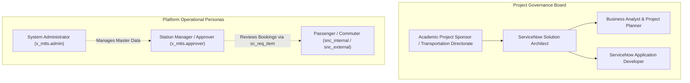
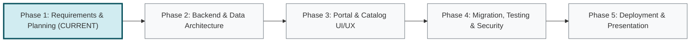

# Metro Ticket Generating System in ServiceNow
## Phase 1 Deliverable: Project Charter & Governance Plan

| Document Metadata | Value |
| :--- | :--- |
| **Document ID** | MTTS-DOC-01 |
| **Project Name** | Metro Ticket Generating System in ServiceNow |
| **Application Identifier** | `x_mtts` (Proposed Scoped Application Namespace) |
| **Current Phase** | Phase 1: Requirement Analysis & Project Planning |
| **Author / Role** | ServiceNow Solution Architect & Technical Project Planner |
| **Status** | Phase 1 Blueprint Complete (Pending Stakeholder Sign-Off) |
| **Target Platform Release** | ServiceNow Washington DC / Xanadu |

---

### 1. Executive Summary & Problem Statement

#### 1.1 Executive Summary
The **Metro Ticket Generating System in ServiceNow** is an enterprise-grade transit self-service solution designed to digitize, streamline, and govern urban commuter ticketing on the ServiceNow platform. By leveraging core ServiceNow platform architecture—including Scoped Applications, the Service Catalog, Service Portal, Workflow/Flow Designer, Role-Based Access Controls (RBAC), and automated notification engines—the system provides a centralized digital channel for commuters (passengers) to book metro journeys, calculate precise dynamic fares, obtain cryptographically verifiable digital QR-code tickets, track historical journeys, and manage cancellations.

#### 1.2 Problem Statement
Urban metro transportation networks face significant operational bottlenecks and customer experience deficits due to outdated ticketing infrastructure:
1. **Physical Queuing & Congestion:** Commuters face long waiting times at manual ticketing counters and token vending machines (TVMs), especially during peak transit hours.
2. **High Infrastructure & Maintenance Costs:** Operating physical token dispensers, ticket paper printers, and cash-handling booths incurs high capital and maintenance expenditures.
3. **Lack of Centralized Auditability & Reconciliation:** Disparate ticketing devices and offline records create audit challenges, manual fare calculation errors, and revenue leakage risks.
4. **Absence of Commuter Self-Service:** Passengers lack an integrated self-service interface to view route distances, calculate transparent fares in advance, store digital passes, or initiate trackable cancellations.
5. **Operational Rigidity:** Adjusting fare rules (e.g., promotional discounts, distance-rate adjustments, or return-journey multipliers) across physical stations requires manual configuration across distributed terminals rather than centralized, rule-based policy execution.

---

### 2. Business Objectives & Success Criteria

#### 2.1 Project Objectives
- **Digital Self-Service Transformation:** Deliver a modern, responsive ServiceNow Service Portal interface where passengers can complete end-to-end ticket reservations from any desktop or mobile browser.
- **Dynamic & Authoritative Fare Derivation:** Eliminate manual fare calculations by implementing an automated, server-side pricing engine driven by administrator-managed station distances and fare rule configurations.
- **Workflow-Driven Fulfillment & Approval Architecture:** Automate the transition from booking submission to station approval. A Service Catalog trigger is associated only with the Metro Ticket Booking catalog item; it creates one linked booking record before creating an approval anchored to `sc_req_item`.
- **End-to-End Commuter Visibility:** Provide passengers with real-time tracking of booking statuses across baseline states (`Pending`, `Approved`, `Generated`, `Cancelled`, with a 5th status `Rejected` proposed pending formal stakeholder confirmation) and seamless access to issued QR tickets in a dedicated "My Bookings" portal module.
- **Automated Governance & Audit Trail:** Ensure all master data (stations, routes, fares) and transactional data (bookings, approvals, cancellations) are securely audited, immutable after issuance, and protected by strict ServiceNow Access Control Lists (ACLs).

#### 2.2 Measurable Success Criteria & KPIs

| KPI ID | Metric | Baseline (Manual/Legacy) | Target (ServiceNow Solution) | Measurement Method |
| :--- | :--- | :--- | :--- | :--- |
| **KPI-01** | Ticket Fulfillment Turnaround | 5–15 minutes (queuing + issuing) | < 30 seconds (automated fulfillment post-approval) | ServiceNow transactional timestamps |
| **KPI-02** | Fare Calculation Accuracy | Periodic manual cashier discrepancies | 100% deterministic (server-side derivation) | Zero fare mismatch audits |
| **KPI-03** | Digital QR Adoption Rate | 0% (physical paper/tokens) | 100% digital self-service for catalog users | System generation audit logs |
| **KPI-04** | Client-Side Tamper Prevention | Vulnerable to browser inspection tampering | 100% rejection of unauthorized client fares | Script Include server-side validation logs |
| **KPI-05** | Commuter Self-Service Tracking | Requires phone calls/booth visits | Instant real-time portal visibility | "My Bookings" page views & portal telemetry |
| **KPI-06** | System Availability & ACL Security | N/A (fragmented) | Zero unauthorized cross-user record reads | Automated Test Framework (ATF) security suites |

---

### 3. Stakeholders & Governance Model

#### 3.1 Role Descriptions
- **Project Sponsor / Evaluation Board:** Evaluates academic and technical compliance against transportation management standards and ServiceNow best practices.
- **ServiceNow Solution Architect (Lead Author):** Oversees overall application architecture, data schema, security architecture, integration points, and ServiceNow platform alignment.
- **Business Analyst & Application Designer:** Defines functional/non-functional requirements, catalog specifications, user journeys, exception handlers, and backlog definitions.
- **ServiceNow Application Developer:** Translates Phase 1 specifications into Phase 2–5 configurations (Tables, Flow Designer, Service Portal widgets, Client Scripts, Script Includes).
- **System Administrator (`x_mtts.admin`):** Maintains station records, route matrix distances, ticket types, and fare rule parameters.
- **Station Approver (`x_mtts.approver`):** Reviews, validates, and approves or rejects booking requests assigned via native platform approvals (`sysapproval_approver`).
- **Passenger / Commuter:** Authenticated end-user submitting booking requests, viewing fares, tracking status, downloading digital tickets, and requesting cancellations.

---

### 4. Project Baseline Reconciliation

The project parameters define an established project baseline:
- **5 Implementation Phases**
- **6 Core Epics**
- **26 User Stories / Tasks**
- **12 Subtasks**
- **Reported Baseline Progress:** 33% conceptual progress.

#### 4.1 Workspace Inspection & Baseline Reconciliation Audit
An inspection of the workspace (`c:\Users\unkno\Downloads\a b c\Safe image\service now metro ticket generation`) confirmed that the local directory is initialized as a fresh, clean workspace with no pre-existing legacy code, conflicting files, or partial configuration exports. 

> [!NOTE]
> The **33% overall progress figure** represents supplied project baseline context reflecting initial problem formulation and conceptual scoping. Measured technical implementation progress is currently **0%**, as all application tables, scripts, portal widgets, and workflows are scheduled for Phases 2–5.

Phase 1 establishes a detailed **blueprint prepared for stakeholder review** structuring the 6 epics, 26 stories/tasks, and 12 subtasks. Technical mechanisms requiring instance validation remain explicitly gated and are not represented as tested or deployed.

---

### 5. Multi-Phase Implementation Roadmap

The five-phase implementation boundary is strictly governed as follows:

1. **Phase 1 — Requirement Analysis and Planning (Current Scope):**
   Delivery of blueprints, requirements specifications (FR/NFR), scoped data models, fare calculation algorithms, lifecycle state machine, portal/catalog designs, security matrices, risk registers, test strategies, and complete backlog.
2. **Phase 2 — Backend Development and Configuration (Future Phase):**
   Implementation of scoped tables (`x_mtts_station`, `x_mtts_route`, `x_mtts_fare_rule`, `x_mtts_ticket_type`, `x_mtts_booking_ticket`), business rules, Script Includes, technical feasibility spikes (QR & Number formatting), reference qualifiers, and platform dictionary controls.
3. **Phase 3 — UI/UX Development and Customization (Future Phase):**
   Implementation of Service Portal pages, Service Catalog item (`Metro Ticket Booking`), dynamic client-side pricing calculators (GlideAjax), summary widgets, and "My Bookings" views.
4. **Phase 4 — Data Migration, Testing, and Security (Future Phase):**
   Importing sample stations/routes, executing Automated Test Framework (ATF) test suites, configuring table/field ACLs, validating Flow Designer approval lifecycles, and verifying notifications.
5. **Phase 5 — Deployment, Documentation, and Final Presentation (Future Phase):**
   Packaging into ServiceNow Update Sets or scoped Git repository, compiling end-user operating manuals, verifying end-to-end demonstration, and delivering the project evaluation defense.

---

### 6. Phase 1 Boundary & Governance Commitment
- **No Premature Implementation:** No live JavaScript, workflow scripts, or schema configurations have been deployed to an instance in Phase 1.
- **Documentation Integrity:** All planning documents are cross-referenced, mathematically verified, and formatted for direct handoff to ServiceNow developers in Phase 2.
- **Instance Truthfulness:** This blueprint represents a complete engineering plan ready for stakeholder review and subsequent instance configuration.
