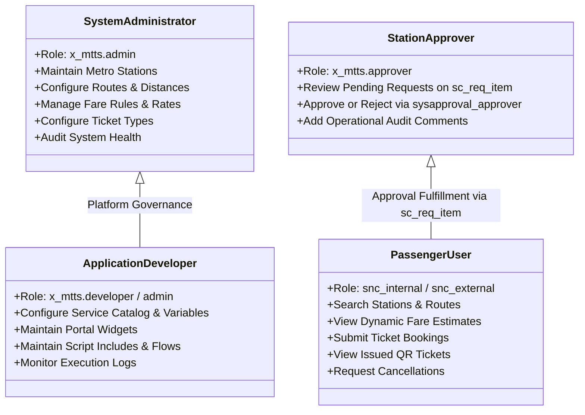
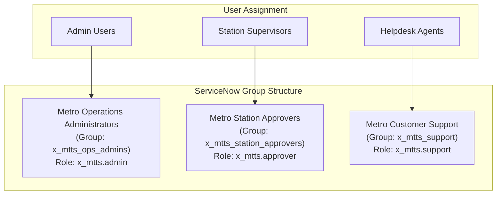

# Metro Ticket Generating System in ServiceNow
## Phase 1 Deliverable: Personas, Roles & Access Governance

| Document Metadata | Value |
| :--- | :--- |
| **Document ID** | MTTS-DOC-03 |
| **Project Name** | Metro Ticket Generating System in ServiceNow |
| **Current Phase** | Phase 1: Requirement Analysis & Project Planning |
| **Author / Role** | ServiceNow Security Architect & Application Designer |
| **Status** | Phase 1 Blueprint Complete (Pending Stakeholder Sign-Off) |

---

### 1. Persona Profiles & Operational Responsibilities

The Metro Ticket Generating System enforces strict segregation of duties across four primary persona profiles.



#### 1.1 Persona A: System Administrator (`x_mtts.admin`)
- **Profile:** Transit Operations Director, Transportation Master Data Manager.
- **Responsibilities:**
  - Create and update Metro Station master records (`x_mtts_station`).
  - Define and maintain route distance pairs in the route matrix (`x_mtts_route`).
  - Establish dynamic fare formulas, rate per km, minimum thresholds, and pass pricing (`x_mtts_fare_rule`).
  - Maintain active ticket categories (`x_mtts_ticket_type`).
  - Assign personnel to Station Approval Groups (`sys_user_group`).
  - Investigate transactional exceptions, pricing calculation errors, or delivery failures.
- **Access Level:** Unrestricted administrative read/write/delete access to application master data and read/write access to transactional booking records.

#### 1.2 Persona B: Station Approver / Station Manager (`x_mtts.approver`)
- **Profile:** Metro Station Duty Officer, Booking Fulfillment Supervisor.
- **Responsibilities:**
  - Access assigned queue of `Pending` requests via standard platform approvals (`sysapproval_approver`) generated against the parent `sc_req_item`.
  - Validate passenger volume, operational route viability, and travel schedule.
  - Approve or reject booking requests with mandatory audit justifications.
  - View booking history to support passenger inquiries at station counters.
- **Access Level:** Read-only access to master data (Stations, Routes, Fare Rules); Read and Approval Update access to assigned approvals on `sc_req_item`. **Explicitly prohibited** from altering fare rules, route distances, or application security settings.

#### 1.3 Persona C: Passenger / Commuter (`snc_internal` / `snc_external`)
- **Profile:** Transit Commuter, Enterprise Employee, or Registered Public Traveler.
- **Responsibilities:**
  - Authenticate to the ServiceNow Metro Service Portal.
  - Select journey parameters (stations, date, ticket type, passenger count).
  - Review real-time fare estimates.
  - Submit booking requests into the automated fulfillment lifecycle via Service Catalog.
  - Access personal digital tickets and display scannable QR tokens on mobile devices.
  - Initiate self-service cancellations within the allowable policy window.
- **Access Level:** Read access to active stations and ticket types via catalog reference queries; Create access for booking requests via Service Catalog; Read and permitted cancellation access are restricted to the booking owner (`passenger == current user`). If requester and passenger ever differ in a future scope, that ownership rule must be explicitly redesigned rather than referencing a nonexistent `opened_by` field on the custom booking table. Prohibited from viewing other commuters' bookings.

#### 1.4 Persona D: Application Developer & Support Engineer (`x_mtts.developer`)
- **Profile:** ServiceNow Platform Developer, Technical Administrator.
- **Responsibilities:**
  - Configure catalog variables, client scripts, UI policies, and Flow Designer actions.
  - Debug server-side Script Includes (`MetroFareCalculator`, `MetroTicketGenerator`).
  - Maintain Service Portal widgets and CSS theme assets.
  - Maintain Automated Test Framework (ATF) test suites.

---

### 2. ServiceNow Group Hierarchy & User Assignment Model

To avoid hardcoding individual user records into workflow activities, the system relies exclusively on platform User Groups (`sys_user_group`).



| Group Name | Group Identifier (`name`) | Assigned Role | Primary Function |
| :--- | :--- | :--- | :--- |
| **Metro Operations Administrators** | `x_mtts_ops_admins` | `x_mtts.admin` | Master data administration, fare pricing policy updates, emergency overrides. |
| **Metro Station Approvers** | `x_mtts_station_approvers` | `x_mtts.approver` | Fulfillment queue processing, journey approval/rejection on `sc_req_item`. |
| **Metro Customer Support** | `x_mtts_support` | `x_mtts.support` | Read-only investigation of passenger booking inquiries and cancellation disputes. |

---

### 3. Granular Table-Level & Record-Level CRUD Matrix

The table below defines the authoritative permissions across all application tables:

| Table Name | Technical Scope Identifier | Action | `x_mtts.admin` | `x_mtts.approver` | Passenger (`snc_internal`) | Unauthenticated Guest |
| :--- | :--- | :--- | :---: | :---: | :---: | :---: |
| **Metro Station** | `x_mtts_station` | Create | Allow | Deny | Deny | Deny |
| | | Read | Allow | Allow | Allow (Active only) | Deny |
| | | Update | Allow | Deny | Deny | Deny |
| | | Delete | Allow | Deny | Deny | Deny |
| **Metro Route** | `x_mtts_route` | Create | Allow | Deny | Deny | Deny |
| | | Read | Allow | Allow | Allow (Active only) | Deny |
| | | Update | Allow | Deny | Deny | Deny |
| | | Delete | Allow | Deny | Deny | Deny |
| **Metro Fare Rule** | `x_mtts_fare_rule` | Create | Allow | Deny | Deny | Deny |
| | | Read | Allow | Allow | Allow (System via script) | Deny |
| | | Update | Allow | Deny | Deny | Deny |
| | | Delete | Allow | Deny | Deny | Deny |
| **Metro Ticket Type** | `x_mtts_ticket_type` | Create | Allow | Deny | Deny | Deny |
| | | Read | Allow | Allow | Allow (Active only) | Deny |
| | | Update | Allow | Deny | Deny | Deny |
| | | Delete | Allow | Deny | Deny | Deny |
| **Metro Booking / Ticket** | `x_mtts_booking_ticket` | Create | Allow | Deny | Allow (via Service Catalog) | Deny |
| | | Read | Allow | Allow (All) | Allow (Own records only) | Deny |
| | | Update | Allow | Deny (Updates via Flow) | Allow (Cancellation action only) | Deny |
| | | Delete | Allow | Deny | Deny | Deny |

---

### 4. Record-Level Security & Field-Level Access Control (ACL) Architecture

#### 4.1 Passenger Record Ownership Validation (Row-Level Security)
To enforce strict data privacy and prevent Insecure Direct Object Reference (IDOR) attacks:
- **Read ACL on `x_mtts_booking_ticket`:**
  - Script condition:
    ```javascript
    answer = (gs.hasRole('x_mtts.admin') ||
              gs.hasRole('x_mtts.approver') ||
              current.passenger.toString() == gs.getUserID());
    ```
- **Result:** A commuter cannot access another passenger's booking details by altering the `sys_id` query parameter in the portal URL (`/metro?id=ticket_detail&sys_id=...`). Any unauthorized query returns an HTTP 403 Forbidden platform response.

#### 4.2 Financial & Status Field Immutability (Column-Level Security)
Financial fields (`unit_fare`, `total_fare`, `calculated_distance`) and fulfillment tokens (`ticket_number`, `qr_payload`, `qr_token_hash`) must remain strictly protected from direct browser or REST client manipulation:
- **Field Write ACL on `x_mtts_booking_ticket.total_fare`:** Role required: `admin` (System execution only). End-users and Approvers have Read-Only access.
- **Field Write ACL on `x_mtts_booking_ticket.status`:** Role required: `admin` / Flow Designer. End-users can trigger state changes only via audited portal actions (`Request Cancellation`).
- **Field Write ACL on `x_mtts_booking_ticket.ticket_number`:** Role required: `admin` / Automation. Field is permanently locked upon generation.

#### 4.3 Reference Field Qualifiers (Lookup Security)
To prevent passengers from booking journeys between decommissioned or inactive stations:
- **Catalog Variable `source_station`:** `javascript:'active=true'`
- **Catalog Variable `destination_station`:** `javascript:'active=true^sys_id!=' + current.variables.source_station` (enforced via dynamic filter and client script).
