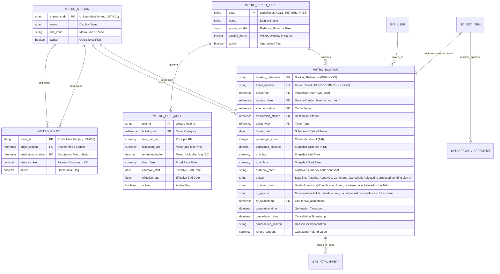

# Metro Ticket Generating System in ServiceNow
## Phase 1 Deliverable: Data Model Architecture & Field Dictionary

| Document Metadata | Value |
| :--- | :--- |
| **Document ID** | MTTS-DOC-04 |
| **Project Name** | Metro Ticket Generating System in ServiceNow |
| **Current Phase** | Phase 1: Requirement Analysis & Project Planning |
| **Author / Role** | ServiceNow Principal Data Architect & Technical Planner |
| **Status** | Phase 1 Blueprint Complete (Pending Stakeholder Sign-Off) |
| **Application Scope Identifier** | `x_mtts` (Proposed Scoped Schema Namespace) |

---

### 1. Conceptual Data Architecture & ERD

The data architecture separates five main business tables (station, route, ticket type, fare rule, and booking/ticket) from a proposed technical numbering-support table (`x_mtts_daily_sequence`). It links these records to core ServiceNow records (`sys_user`, `sc_req_item`, `sysapproval_approver`, and `sys_attachment`). The numbering table is a support mechanism, not a sixth business domain.

---

### 2. Approval & Attachment Architecture Integration

#### 2.1 Approval Inheritance Analysis & Architectural Decision
In ServiceNow, platform approvals (`sysapproval_approver`) operate natively against tables that extend **`task`** (via the `sysapproval` and `approval_for` reference fields).
- **Evaluation of Custom Table Inheritance:** Having `x_mtts_booking_ticket` extend `task` would inherit over 60 generic task fields (e.g., `priority`, `urgency`, `assigned_to`, `cmdb_ci`), introducing schema bloat and potential custom table licensing implications.
- **Architectural Decision:** `x_mtts_booking_ticket` is implemented as a lightweight, clean standalone table. Platform approvals are anchored natively on the parent **`sc_req_item`** (which extends `task`).
  1. The catalog submission creates `sc_req_item`.
  2. A Service Catalog trigger is associated only with the `Metro Ticket Booking` catalog item; it is not a generic RITM-insert trigger.
  3. The flow validates the catalog variables and creates exactly one `x_mtts_booking_ticket` with `request_item` referencing the RITM; a unique/idempotent link prevents duplicate booking records. A booking-create service recalculates price server-side before insert.
  4. Only after the booking record exists does the flow run **Ask for Approval** against `sc_req_item` and route it to Station Approvers.
  5. The flow synchronizes the decision to the booking record. `Rejected` is used only if stakeholders approve the proposed fifth status; otherwise the fallback policy applies.

#### 2.2 Attachment Storage (`sys_attachment`) Integration
When the ticket fulfillment process generates the digital QR image:
1. The graphic (SVG or PNG) is written to `sys_attachment` using `GlideSysAttachment.write(bookingRecord, 'ticket_qr.svg', 'image/svg+xml', svgString)`.
2. The attachment record is automatically linked via `table_name = 'x_mtts_booking_ticket'` and `table_sys_id = bookingRecord.sys_id`.
3. To enable fast O(1) widget rendering without repeated attachment queries, the generated attachment's sys_id is stored in `x_mtts_booking_ticket.qr_attachment`.

#### 2.3 Pass Bookings Route & Distance Specification
For `Pass` ticket bookings:
- Pricing is derived from the applicable configured fixed tariff (`x_mtts_fare_rule.fixed_fare`), without a distance-based calculation.
- The `calculated_distance` field is snapshotted as `0.00` to mean “not used for pricing,” not as a physical zero-distance journey.
- Source and destination are retained because they are part of the baseline booking inputs, but their meaning and whether a Pass is route-limited remain pending stakeholder policy. Do not infer “home station,” “all zones,” or a specific validity duration until DEC-07 is approved.

---

### 3. Comprehensive Field Data Dictionary

#### 3.1 Table: Metro Station (`x_mtts_station`)
- **Purpose:** Stores the definitive master catalog of all physical metro stations, interchanges, and operational lines.
- **Scope Technical Name:** `x_mtts_station`
- **Target Creation Phase:** Phase 2 (Backend Development)

| Field Name | Field Label | Data Type | Length | Req? | Default Value | Reference / Choice | Unique / Validation Rule | Read / Write ACL |
| :--- | :--- | :--- | :---: | :---: | :--- | :--- | :--- | :--- |
| `station_code` | Station Code | String | 20 | Yes | None | None | **Unique Key** (Index). Uppercase alphanumeric (`^[A-Z0-9_-]{3,20}$`). | Read: All; Write: `x_mtts.admin` |
| `name` | Station Name | String | 100 | Yes | None | None | Display Value (`display=true`). Mandatory. | Read: All; Write: `x_mtts.admin` |
| `line_zone` | Line / Zone | Choice | 40 | Yes | `Blue` | `Blue Line`, `Red Line`, `Green Line`, `Airport Express` | Mandatory choice list. | Read: All; Write: `x_mtts.admin` |
| `active` | Active | True/False | - | Yes | `true` | None | Controls visibility in catalog drop-downs. | Read: All; Write: `x_mtts.admin` |
| `order` | Sequence Order | Integer | - | No | `0` | None | Geographic route sequence index. | Read: All; Write: `x_mtts.admin` |

---

#### 3.2 Table: Metro Route (`x_mtts_route`)
- **Purpose:** Represents the physical or logical route segment connecting station pairs and stores the authoritative travel distance in kilometers.
- **Scope Technical Name:** `x_mtts_route`
- **Target Creation Phase:** Phase 2 (Backend Development)
- **Routing Directionality Architecture:**
  - Route records represent directed pairs (`origin` $\rightarrow$ `destination`). 
  - To support bidirectional journeys with identical distances, administrators create symmetrical route pairs ($A \rightarrow B$ and $B \rightarrow A$), or server-side lookup queries both directions.
  - A unique composite index is enforced on `[origin_station, destination_station]`.

| Field Name | Field Label | Data Type | Length | Req? | Default Value | Reference / Choice | Unique / Validation Rule | Read / Write ACL |
| :--- | :--- | :--- | :---: | :---: | :--- | :--- | :--- | :--- |
| `route_id` | Route Identifier | String | 30 | Yes | None | None | **Unique Key**. Pattern: `RT-XXXXXX`. | Read: All; Write: `x_mtts.admin` |
| `origin_station` | Origin Station | Reference | 32 | Yes | None | `x_mtts_station` | Ref Qualifier: `active=true`. | Read: All; Write: `x_mtts.admin` |
| `destination_station` | Destination Station | Reference | 32 | Yes | None | `x_mtts_station` | Ref Qualifier: `active=true`. Cannot equal origin. | Read: All; Write: `x_mtts.admin` |
| `distance_km` | Journey Distance (km) | Decimal | 6,2 | Yes | `0.00` | None | Must be $> 0.00$. Max value 500.00. | Read: All; Write: `x_mtts.admin` |
| `active` | Active | True/False | - | Yes | `true` | None | Only active routes are searchable. | Read: All; Write: `x_mtts.admin` |
| `line_name` | Metro Line | String | 50 | No | None | None | Optional line grouping metadata. | Read: All; Write: `x_mtts.admin` |

---

#### 3.3 Table: Metro Ticket Type (`x_mtts_ticket_type`)
- **Purpose:** Governs supported ticket classifications, validity duration, and pricing model categorization.
- **Scope Technical Name:** `x_mtts_ticket_type`
- **Target Creation Phase:** Phase 2 (Backend Development)

| Field Name | Field Label | Data Type | Length | Req? | Default Value | Reference / Choice | Unique / Validation Rule | Read / Write ACL |
| :--- | :--- | :--- | :---: | :---: | :--- | :--- | :--- | :--- |
| `code` | Ticket Type Code | String | 20 | Yes | None | None | **Unique Key**. Values: `SINGLE`, `RETURN`, `PASS`. | Read: All; Write: `x_mtts.admin` |
| `name` | Display Name | String | 50 | Yes | None | None | Configure display names for `Single Journey`, `Return Ticket`, and `Pass`; avoid assuming a specific pass duration in its name until DEC-07 is approved. | Read: All; Write: `x_mtts.admin` |
| `pricing_model` | Pricing Model | Choice | 30 | Yes | None | `Distance_Based`, `Fixed` | Must be configured per ticket type (Single/Return normally distance-based; Pass fixed-fare only after policy approval). No implicit default. | Read: All; Write: `x_mtts.admin` |
| `validity_hours` | Validity Window (Hours) | Integer | - | No | None | None | Optional until DEC-07 defines approved validity semantics; do not use a hardcoded 24-hour default. Make required only for ticket types whose approved policy needs it. | Read: All; Write: `x_mtts.admin` |
| `active` | Active | True/False | - | Yes | `true` | None | Controls availability in booking catalog. | Read: All; Write: `x_mtts.admin` |

---

#### 3.4 Table: Metro Fare Rule (`x_mtts_fare_rule`)
- **Purpose:** Stores configurable, time-bounded fare parameters, base rates, minimum thresholds, return multipliers, and fixed pass tariffs.
- **Scope Technical Name:** `x_mtts_fare_rule`
- **Target Creation Phase:** Phase 2 (Backend Development)

| Field Name | Field Label | Data Type | Length | Req? | Default Value | Reference / Choice | Unique / Validation Rule | Read / Write ACL |
| :--- | :--- | :--- | :---: | :---: | :--- | :--- | :--- | :--- |
| `rule_id` | Rule Identifier | String | 30 | Yes | None | None | **Unique Key**. Pattern: `FR-YYYYMM-XXX`. | Read: All; Write: `x_mtts.admin` |
| `ticket_type` | Ticket Type | Reference | 32 | Yes | None | `x_mtts_ticket_type` | Foreign Key to ticket type classification. | Read: All; Write: `x_mtts.admin` |
| `rate_per_km` | Rate Per Kilometer | Decimal | 6,2 | No | None | None | Must be explicitly configured and approved for distance-based pricing; mandatory when `pricing_model == Distance_Based`. No active default. | Read: All; Write: `x_mtts.admin` |
| `minimum_fare` | Minimum Floor Fare | Decimal | 6,2 | No | None | None | Must be explicitly configured and approved for the applicable distance-based rule; no active default. | Read: All; Write: `x_mtts.admin` |
| `return_multiplier`| Return Multiplier | Decimal | 3,2 | No | None | None | Must be explicitly configured and approved for Return tickets; no active default is assumed. | Read: All; Write: `x_mtts.admin` |
| `fixed_fare` | Fixed Pass Fare | Decimal | 6,2 | No | None | None | Must be explicitly configured and approved for fixed-fare Pass pricing; mandatory when `pricing_model == Fixed`; must be positive. | Read: All; Write: `x_mtts.admin` |
| `currency` | Currency Code | Choice | 5 | Yes | None | Candidate values: `USD`, `EUR`, `INR`, `GBP` (confirm supported choices) | One approved operating currency must be selected before active fare rules are loaded; no currency default is approved. | Read: All; Write: `x_mtts.admin` |
| `effective_start` | Effective Start Date | Date | - | Yes | None | None | Rule valid on/after this date. | Read: All; Write: `x_mtts.admin` |
| `effective_end` | Effective End Date | Date | - | No | None | None | Rule valid on/before this date (or open-ended if blank). | Read: All; Write: `x_mtts.admin` |
| `active` | Active | True/False | - | Yes | `true` | None | Overlapping active rules for same ticket type prevented. | Read: All; Write: `x_mtts.admin` |

---

#### 3.5 Table: Metro Booking / Ticket (`x_mtts_booking_ticket`)
- **Purpose:** Primary transactional entity recording commuter booking details, financial snapshots, workflow states, unique ticket tokens, QR payloads, and cancellation histories.
- **Scope Technical Name:** `x_mtts_booking_ticket`
- **Target Creation Phase:** Phase 2 (Backend Development)

| Field Name | Field Label | Data Type | Length | Req? | Default Value | Reference / Choice | Unique / Validation Rule | Read / Write ACL |
| :--- | :--- | :--- | :---: | :---: | :--- | :--- | :--- | :--- |
| `booking_reference` | Booking Reference | String | 30 | Yes | None | None | **Unique Key**. Pattern: `BKG-YYYYMMDD-XXXX`. | Read: All auth; Write: System |
| `ticket_number` | Ticket Number | String | 30 | No | None | None | **Unique Key** (Index). Assigned upon approval: `TKT-YYYYMMDD-XXXXXX`. Immutable once populated. | Read: All auth; Write: System |
| `passenger` | Passenger | Reference | 32 | Yes | `javascript:gs.getUserID()` | `sys_user` | Commuter identity. Mandatory. | Read: Own/Admin/Approver; Write: System |
| `request_item` | Request Item (RITM) | Reference | 32 | Yes | None | `sc_req_item` | Link to parent Service Catalog request item. | Read: Own/Admin/Approver; Write: System |
| `source_station` | Source Station | Reference | 32 | Yes | None | `x_mtts_station` | Origin station reference. | Read: Own/Admin/Approver; Write: System |
| `destination_station`| Destination Station | Reference | 32 | Yes | None | `x_mtts_station` | Destination station reference. | Read: Own/Admin/Approver; Write: System |
| `ticket_type` | Ticket Type | Reference | 32 | Yes | None | `x_mtts_ticket_type` | Selected ticket category. | Read: Own/Admin/Approver; Write: System |
| `travel_date` | Travel Date | Date | - | Yes | None | None | Date of travel. Must be $\ge$ current date. | Read: Own/Admin/Approver; Write: System |
| `passenger_count` | Number of Passengers | Integer | - | Yes | `1` | None | Positive integer not exceeding the owner-approved configurable limit. A limit of 6 is provisional until DEC-08 sign-off. | Read: Own/Admin/Approver; Write: System |
| `calculated_distance`| Distance (km) | Decimal | 6,2 | Yes | `0.00` | None | **Calculation Snapshot**. `0.00` is a not-applicable sentinel for fixed-fare Pass pricing, not a statement that the journey is physically zero distance. | Read: Own/Admin/Approver; Write: System |
| `unit_fare` | Unit Fare | Decimal | 8,2 | Yes | None | None | **Financial Snapshot**. Must be populated by authoritative server calculation before booking persistence; never trust client-submitted unit fare. | Read: Own/Admin/Approver; Write: System |
| `total_fare` | Total Fare | Decimal | 8,2 | Yes | None | None | **Financial Snapshot**. Must be populated by authoritative server calculation before booking persistence; never trust client-submitted totals. | Read: Own/Admin/Approver; Write: System |
| `currency_code` | Currency Code Snapshot | String | 3 | Yes | None | Approved ISO currency code | Store the approved rule currency with the booking so historic fares remain interpretable if configuration changes. Populate from the authoritative fare rule before insert. | Read: Own/Admin/Approver; Write: System |
| `status` | Booking Status | Choice | 20 | Yes | `Pending` | Baseline: `Pending`, `Approved`, `Generated`, `Cancelled`. Proposed: `Rejected` pending written sign-off. | Workflow state. Enforced by State Machine. | Read: Own/Admin/Approver; Write: System/Flow |
| `qr_token_hash` | QR Verification Token Hash | String | 128 | No | None | None | Hash of a cryptographically random token; raw token is not stored in this field. Keep this hash unchanged after cancellation; verification must also require `status == Generated`. | Read: Verification Service/Admin; Write: System |
| `qr_payload` | QR Payload Metadata | String | 1000 | No | None | None | Non-PII metadata only. Raw verification token is included only in the delivered QR artifact and is not persisted in this field. | Read: Own/Admin; Write: System |
| `qr_attachment` | QR Graphic Asset | Reference | 32 | No | None | `sys_attachment` | Direct link to generated QR image asset in `sys_attachment`. | Read: Own/Admin; Write: System |
| `generation_time` | Ticket Generated Time | DateTime | - | No | None | None | Populated upon state change to `Generated`. | Read: Own/Admin; Write: System |
| `cancellation_time` | Cancelled Time | DateTime | - | No | None | None | Populated upon state change to `Cancelled`. | Read: Own/Admin; Write: System |
| `cancellation_reason`| Cancellation Reason | String | 255 | No | None | None | Commuter justification for cancellation. | Read: Own/Admin; Write: System |
| `refund_amount` | Calculated Refund | Decimal | 8,2 | No | None | None | Populated only after an approved cancellation/refund policy is applied; do not infer a zero refund from a missing policy. | Read: Own/Admin; Write: System |

---

#### 3.6 Technical Support Table: Daily Ticket Number Sequence (`x_mtts_daily_sequence`)

- **Purpose:** Stores the proposed per-day sequence state for ticket numbers in the requested `TKT-YYYYMMDD-XXXXXX` format. This is a technical support table, not a business-domain table.
- **Target Creation Phase:** Phase 2, only if the ticket-number feasibility spike confirms the approach.
- **Important limitation:** A normal read-increment-write sequence using GlideRecord must **not** be assumed atomic. Implement only after the target instance demonstrates concurrency safety. If a safe allocation primitive cannot be demonstrated, revise the numbering design before release.

| Field Name | Field Label | Data Type | Length | Required? | Default | Unique / Validation Rule | Read / Write ACL |
| :--- | :--- | :--- | :---: | :---: | :--- | :--- | :--- |
| `date_key` | Sequence Date Key | String | 8 | Yes | None | Unique index; `YYYYMMDD` in the agreed business timezone. One counter row per date. | Read: `x_mtts.admin` only; Write: allocation service only |
| `last_sequence` | Last Allocated Sequence | Integer | - | Yes | `0` | Non-negative; range must not exceed `999999` per date. Increment mechanism must be validated under concurrent requests. | Read: `x_mtts.admin` only; Write: allocation service only |
| `allocation_status` | Allocation Status | Choice | 20 | Yes | `Ready` | Proposed diagnostic choice: `Ready`, `RetryRequired`, `Exhausted`; no direct user edits. | Read: `x_mtts.admin` only; Write: allocation service only |

**Required integrity safeguards:**
1. Unique index on `date_key`.
2. Unique index on `x_mtts_booking_ticket.ticket_number` as final duplicate prevention.
3. Server-side allocation only; passengers and ordinary approvers receive no table access.
4. If a collision or sequence conflict occurs, retry by re-reading/reallocating through the validated mechanism; do not set the booking status to `Generated` until ticket number and QR data persist successfully.
5. Phase 2 test `TC-020` must execute concurrent allocations on the target instance. A theoretical description is not evidence that allocation is atomic.
