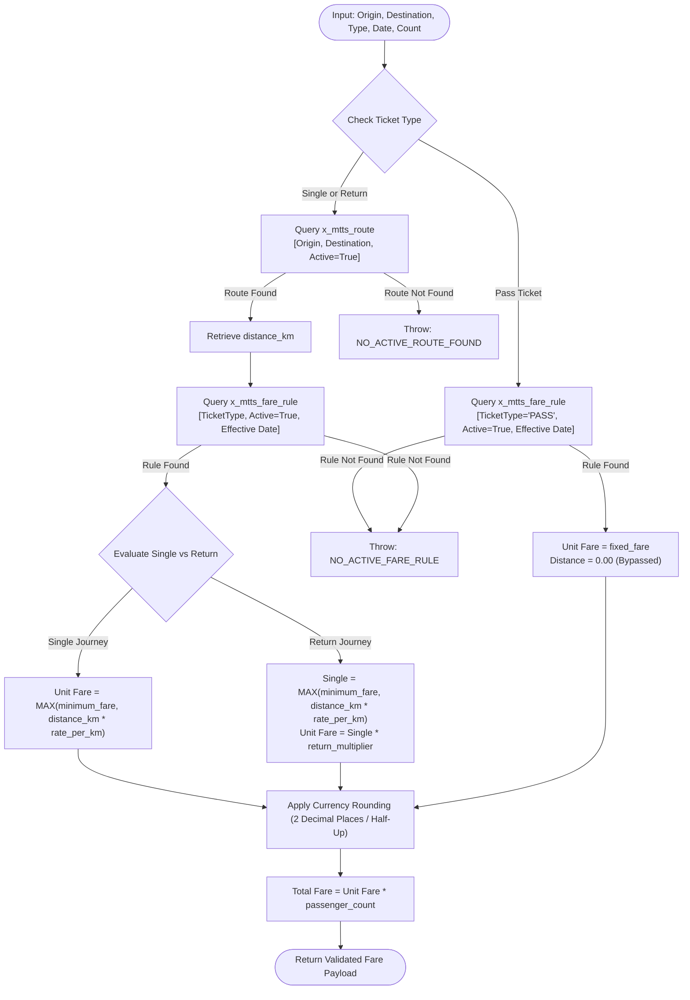

# Metro Ticket Generating System in ServiceNow
## Phase 1 Deliverable: Fare Calculation Engine & Validation Rules

| Document Metadata | Value |
| :--- | :--- |
| **Document ID** | MTTS-DOC-05 |
| **Project Name** | Metro Ticket Generating System in ServiceNow |
| **Current Phase** | Phase 1: Requirement Analysis & Project Planning |
| **Author / Role** | ServiceNow Pricing Architect & Technical Planner |
| **Status** | Phase 1 Blueprint Complete (Pending Stakeholder Sign-Off) |

---

### 1. Architectural Principles of Fare Derivation

The fare calculation engine is governed by three foundational architectural axioms:
1. **Zero Client Trust:** All financial calculations originating in client-side scripts (browsers, mobile views) are treated exclusively as **provisional user previews**. Authoritative pricing is computed and locked exclusively by a server-side Script Include (`MetroFareCalculator`) during transactional processing.
2. **Master Data Determinism:** Fare rates, distance coefficients, minimum thresholds, return multipliers, and pass rates are dynamically resolved from the `x_mtts_fare_rule` and `x_mtts_route` tables. No pricing constants or multipliers may be hardcoded into JavaScript logic.
3. **Historical Immutability (Snapshotting):** Once a booking record is committed to the database, its `calculated_distance`, `unit_fare`, and `total_fare` fields are permanently preserved as immutable financial snapshots. Future adjustments to master fare tables do not modify historic records.

---

### 2. Fare Algorithms by Ticket Type



#### 2.1 Single Journey Pricing Algorithm
Single Journey tickets are priced proportionally based on the validated route distance in kilometers, subject to an administrative minimum fare floor.

$$\text{Distance-Based Fare} = \text{Journey Distance (km)} \times \text{Rate Per Kilometer}$$

$$\text{Unit Fare}_{\text{Single}} = \max\left(\text{Minimum Fare}, \, \text{Distance-Based Fare}\right)$$

*Illustrative test fixture only — these values are synthetic examples, not approved fare policy and must not be loaded as production defaults:*
- Origin: Metro Station Alpha (`STN-01`)
- Destination: Metro Station Echo (`STN-05`)
- Route Distance: $14.20\text{ km}$
- Fare Rule: Rate per km = $\$2.50$, Minimum Fare = $\$10.00$
- Distance-based Fare = $14.20 \times 2.50 = \$35.50$
- $\max(\$10.00, \$35.50) = \$35.50$
- **Unit Fare:** $\$35.50$

#### 2.2 Return Ticket Pricing Algorithm
Return tickets grant a round-trip journey between the chosen origin and destination stations. The fare is derived from the single journey calculation multiplied by a configurable administrative factor (`return_multiplier`).

$$\text{Unit Fare}_{\text{Return}} = \text{Unit Fare}_{\text{Single}} \times \text{Return Multiplier}$$

*Operational Rules:*
- The return multiplier is configured in `x_mtts_fare_rule.return_multiplier` and must be explicitly approved/configured; no default value is assumed.
- A discount multiplier (if any) must be defined by the fare-policy owner; do not activate an illustrative value such as `1.80` without approval.
- The multiplier is resolved dynamically at runtime from master data.

#### 2.3 Pass Pricing Algorithm
Pass tickets provide transit privileges for a specific validity window (e.g., Daily Pass).
- **Pricing Method:** Flat / Fixed Tariff.
- **Formula:**
  $$\text{Unit Fare}_{\text{Pass}} = \text{Configured Fixed Fare}$$
- **Route & Distance Handling:** Route distance lookup is bypassed during Pass fare calculation. The `calculated_distance` snapshot is set to `0.00`. Origin and destination selections are retained as baseline booking inputs, but their meaning and whether a Pass is route-limited remain pending stakeholder policy. Do not assume home-station semantics, all-zone coverage, or a specific validity duration.

#### 2.4 Total Booking Fare
For all ticket types, the total booking amount is calculated strictly as:

$$\text{Total Fare} = \text{Unit Fare} \times \text{Number of Passengers}$$

Where:
- $\text{Number of Passengers} \in \mathbb{Z}, \quad 1 \le \text{Passenger Count} \le \text{Max Limit}$. The maximum is configurable via `x_mtts.max_passengers_per_booking`; the candidate limit 6 remains provisional until DEC-08 is approved.

---

### 3. Currency, Rounding & Financial Representation

1. **Operating Currency:** No currency is approved yet. The owner must select one operating currency before fare rules or sample records are activated. Candidates such as USD (`$`), INR (`₹`), EUR (`€`), or GBP (`£`) are options for review, not active defaults. Store the approved code in `x_mtts.default_currency` and snapshot it to each booking.
2. **Rounding Convention:** The owner must approve the currency precision convention. The recommended approach is two-decimal half-up rounding using a decimal-safe method validated on the target ServiceNow instance. Client-side floating-point calculations are preview-only; server-side validated calculation is authoritative.
3. **Zero / Negative or Unconfigured Fare Rejection:** Any calculated unit or total fare $\le 0.00$, or a missing required pricing input, produces a controlled validation failure (for example, `INVALID_OR_UNCONFIGURED_FARE`) and blocks the transaction without creating a partial booking.

---

### 4. Mandatory Validation Invariants & Rules

The calculation and booking subsystem enforces 11 mandatory validation invariants:

| Rule ID | Invariant Condition | Enforcement Point | Error Response to Commuter |
| :--- | :--- | :--- | :--- |
| **VR-01** | `source_station != destination_station` | Client Script + Server Script Include | "Origin and destination stations cannot be identical. Please choose a different destination." |
| **VR-02** | `source_station.active == true` AND `destination_station.active == true` | Reference Qualifier + Server Script Include | "One or more selected stations are currently inactive or undergoing maintenance." |
| **VR-03** | For Single/Return only, route record exists and `route.active == true`; Pass pricing does not require a route-distance lookup unless approved Pass policy makes it route-specific | GlideAjax Preview + server-side booking validation | "No active transit route exists between the selected stations for this distance-based ticket. Please contact metro support." |
| **VR-04** | Every ticket type must have an applicable active fare rule where `effective_start <= travel_date` and (`effective_end` is blank or `travel_date <= effective_end`); Pass uses its configured fixed-fare rule | Server Script Include | "Applicable fare rules for the selected travel date are unavailable. Contact operations." |
| **VR-05** | `1 <= passenger_count <= max_passengers` | Client Validation + Server Script Include | "Passenger count must be a positive integer within the configured booking limit." |
| **VR-06** | `travel_date >= today()` AND `travel_date <= today() + advance_days` | Client Validation + Server Script Include | "Travel date cannot be in the past or beyond the allowable advance booking window." |
| **VR-07** | Client-submitted fare payload is completely discarded | Scoped Script Include (`MetroFareCalculator`) | Transparent server recalculation (Anti-Tampering). |
| **VR-08** | Station records referenced must physically exist in `x_mtts_station` | Foreign Key Integrity Validator | "Invalid station reference supplied." |
| **VR-09** | Concurrency conflict check on Fare Rules | Administrative Pre-Save Business Rule | "Another active fare rule already covers this ticket type for the selected effective date range." |
| **VR-10** | Calculated Unit Fare must be $\ge$ Minimum Fare (Distance-Based) | Calculation Engine Post-Condition | Unit fare raised to configured `minimum_fare`. |
| **VR-11** | Zero-distance route rejection (`distance_km > 0.00` for Single/Return) | Route Data Dictionary Constraint | "Route distance must be greater than zero kilometers." |

---

### 5. Server-Side Execution Architecture: `MetroFareCalculator`

The Script Include `x_mtts.MetroFareCalculator` executes server-side pricing. The contract specification below governs its input and output:

```javascript
/**
 * @typedef {Object} FareCalculationRequest
 * @property {string} sourceStationId - sys_id of source x_mtts_station
 * @property {string} destStationId   - sys_id of destination x_mtts_station
 * @property {string} ticketTypeId    - sys_id of selected x_mtts_ticket_type
 * @property {string} travelDate      - YYYY-MM-DD string
 * @property {number} passengerCount  - Integer between 1 and 6
 * 
 * @typedef {Object} FareCalculationResult
 * @property {boolean} success        - True if calculated successfully
 * @property {number} distanceKm      - Route distance in KM (0.00 means not applicable to fixed-fare Pass pricing; do not interpret as physical journey distance)
 * @property {number} unitFare        - Calculated unit fare
 * @property {number} totalFare       - Total fare (unitFare * passengerCount)
 * @property {string} currencyCode    - owner-approved operating currency code
 * @property {string} ruleId          - sys_id of applied x_mtts_fare_rule
 * @property {string} errorMessage    - Populated if success is false
 */
```

#### 5.1 Client-to-Server GlideAjax Protocol
1. **Trigger:** `onChange` of `source_station`, `destination_station`, `ticket_type`, or `passenger_count`.
2. **Payload:** Asynchronously dispatches parameters via GlideAjax to `MetroFareCalculatorClient`.
3. **Response Handling:** On receipt of a successful response, client scripts populate the read-only `calculated_distance`, `unit_fare`, and `total_fare` catalog variables and refresh the HTML Fare Summary Card.
4. **Error Handling:** If `success === false`, fields are blanked, an inline alert displays `result.errorMessage`, and the "Submit" action is disabled.
