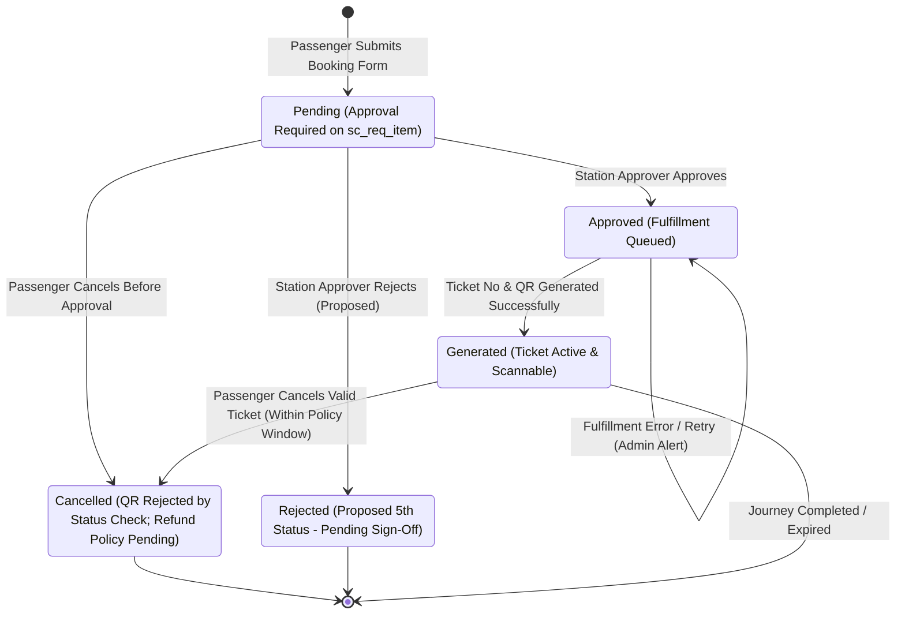

# Metro Ticket Generating System in ServiceNow
## Phase 1 Deliverable: Booking Lifecycle State Machine & Workflow Specification

| Document Metadata | Value |
| :--- | :--- |
| **Document ID** | MTTS-DOC-06 |
| **Project Name** | Metro Ticket Generating System in ServiceNow |
| **Current Phase** | Phase 1: Requirement Analysis & Project Planning |
| **Author / Role** | ServiceNow Workflow Architect & Solution Designer |
| **Status** | Phase 1 Blueprint Complete (Pending Stakeholder Sign-Off) |

---

### 1. State Machine Definition & Lifecycle Stages

The lifecycle of a metro booking transitions through strictly sequenced operational states governed by ServiceNow Flow Designer. A Service Catalog trigger is restricted to the specific `Metro Ticket Booking` item; it must not run for unrelated catalog requests.



#### 1.1 Formal State Definitions
1. **`Pending`:** The booking request has been validated, financial snapshots recorded, and the record created in `x_mtts_booking_ticket`. It is awaiting review by the designated Station Approval Group on the parent `sc_req_item`. No ticket number or QR code exists yet.
2. **`Approved`:** An authorized Station Approver has reviewed and approved the request on `sc_req_item`. Flow Designer has updated the booking status to `Approved`, and the record has entered the fulfillment queue.
3. **`Generated`:** The fulfillment engine (`MetroTicketGenerator`) has assigned a unique ticket number (`TKT-YYYYMMDD-XXXXXX`), created a verification token using a supported secure-random mechanism (pending target-instance proof), generated the QR representation, and committed the required record data. The ticket is eligible for verification subject to the approved travel/validity rules.
4. **`Cancelled`:** The booking has been terminated by an authorized passenger action or administrative process. The token hash remains unchanged; the verification service rejects the QR because the authoritative booking status is no longer `Generated`. Refund handling follows the separately approved policy.

---

### 2. Design Gap Evaluation: The Approval Rejection Handling

> [!IMPORTANT]
> **Architectural Finding & Design Recommendation:**
> The baseline project specification defined four passenger-facing statuses: `Pending`, `Approved`, `Generated`, and `Cancelled`. 
>
> **The Operational Gap:** When an authorized Station Approver rejects a booking on `sc_req_item` (e.g., due to station overcrowding, severe weather, or maintenance), forcing the booking into `Cancelled` conflates commuter-initiated voluntary cancellations with administrative refusals, corrupting refund metrics and audit accuracy.
>
> **Recommended Resolution:** Introduce an explicit 5th lifecycle status: **`Rejected` (Proposed — Pending Formal Stakeholder Sign-Off)**.
> - **Behavior if Approved:** Approver rejection on `sc_req_item` transitions `x_mtts_booking_ticket.status` to `Rejected`. Rejection comments are mandatory. Commuter receives notification NOTIF-05.
> - **Baseline Fallback if Declined:** If stakeholders require retaining strictly the 4 baseline statuses, rejected items will close the parent `sc_req_item` as *Closed Incomplete*, and transition `x_mtts_booking_ticket.status` to `Cancelled` with mandatory field `cancellation_reason = 'Administrative Rejection: <comments>'`. The reporting dashboard must separate voluntary cancellations from administrative rejections using this field.

---

### 3. Step-by-Step End-to-End Baseline Lifecycle (Steps 1–12)

| Step | Lifecycle Stage | Actor / Engine | Description | Data State Transition |
| :---: | :--- | :--- | :--- | :--- |
| **1** | Parameter Entry | Passenger | Commuter selects Origin Station, Destination Station, Travel Date, Ticket Type, and Passenger Count on the Service Portal. | In-Memory Browser State |
| **2** | Dynamic Validation | Client Script | Checks that origin $\neq$ destination, the date is within the approved configurable booking window, and passenger count is within the approved configurable limit. Dispatches GlideAjax request to server. | Validation Passed |
| **3** | Dynamic Fare Preview | `MetroFareCalculator` | Server derives distance, resolves active fare rule, calculates Unit Fare and Total Fare, and returns values to the portal summary card. | UI Fare Summary Rendered |
| **4** | Booking Submission | Passenger | Commuter confirms fare breakdown and clicks "Submit Booking". Request sent to ServiceNow Service Catalog processor. | `sc_request` & `sc_req_item` Created |
| **5** | Record Persistence | Scoped Business Rule | The catalog-specific Flow validates variables and creates one `x_mtts_booking_ticket` linked to `sc_req_item`; server-side booking validation recalculates and snapshots the fare. Sets status to `Pending`. | Status $\rightarrow$ `Pending` |
| **6** | Approval Routing | Flow Designer | Only after the linked booking exists, Flow Designer creates approval task in `sysapproval_approver` targeting `sc_req_item`, routed to `Metro Station Approvers`. Dispatches NOTIF-02. | `sysapproval_approver` Created |
| **7** | Manager Approval | Station Approver | Station Approver reviews journey parameters and approves request. Flow Designer triggers fulfillment action. | Status $\rightarrow$ `Approved` |
| **8** | Ticket Generation | `MetroTicketGenerator` | System allocates unique sequential ticket number `TKT-YYYYMMDD-XXXXXX` and creates verification token. | Ticket Number Generated |
| **9** | QR Payload & Attachment | `MetroTicketGenerator` | Generates QR image matrix, saves image to `sys_attachment` linked to booking record, stores sanitized JSON in `qr_payload`. | Status $\rightarrow$ `Generated` |
| **10** | Commuter Notification | Notification Engine | Automated HTML email dispatched to commuter with booking summary and embedded digital QR ticket. | Email Dispatched (NOTIF-04) |
| **11** | Commuter Inspection | Passenger | Commuter views ticket in "My Bookings" portal page, displaying active QR code for boarding. | Ticket Active |
| **12** | Permitted Cancellation | Passenger / Flow | Commuter requests cancellation before departure window. System validates policy, transitions status to `Cancelled`, invalidates the QR ticket through the authoritative `Cancelled` status check and dispatches cancellation email; the stored token hash remains unchanged. | Status $\rightarrow$ `Cancelled` |

---

### 4. Technical Fulfillment Failure & Recovery Architecture

> [!CAUTION]
> A technical failure during ticket-number allocation or QR generation must **never** be treated as a passenger cancellation. Treating technical failures as cancellations distorts passenger cancellation metrics and prematurely cancels valid travel intentions.

#### Recovery Workflow on Fulfillment Exception:
1. If `MetroTicketGenerator` throws an exception (e.g., sequence allocation lock timeout, attachment write error):
   - The database transaction rolls back the failed partial generation.
   - The booking record status **remains `Approved`**.
   - An incident/alert notification (`NOTIF-07`) is dispatched to `Metro Operations Administrators` with the error trace and `booking_reference`.
   - Flow Designer schedules an automated retry attempt (up to 3 retries at 2-minute intervals).
   - If retries are exhausted, the record remains flagged in the administrative fulfillment exception queue for manual remediation.

---

### 5. Legal vs. Illegal State Transition Matrix

| Current State | Target: `Pending` | Target: `Approved` | Target: `Generated` | Target: `Cancelled` | Target: `Rejected` (Proposed) |
| :--- | :---: | :---: | :---: | :---: | :---: |
| **`Pending`** | - | **Legal** (Approver) | Illegal (Bypasses Approval) | **Legal** (Passenger Cancel) | **Legal** (Approver Reject) |
| **`Approved`** | Illegal (Re-pending blocked) | - | **Legal** (Fulfillment Engine) | **Legal** (Passenger Cancel) | Illegal (Already Approved) |
| **`Generated`** | Illegal (Issued ticket) | Illegal (Already Issued) | - | **Legal** (Policy Cancel) | Illegal (Already Issued) |
| **`Cancelled`** | Illegal (Terminal State) | Illegal (Terminal State) | Illegal (Terminal State) | - | Illegal (Terminal State) |
| **`Rejected`** | Illegal (Terminal State) | Illegal (Terminal State) | Illegal (Terminal State) | Illegal (Terminal State) | - |

---

### 6. Configurable Cancellation & Refund Policy Engine

**Policy gate:** The cancellation windows, eligibility rules, fee percentages, and refund-rounding choices below are proposed design points only. They must not be activated until the project owner approves a written policy.

#### 6.1 Cancellation Eligibility Windows
1. **`Pending` Stage Cancellation:** Commuter may cancel immediately without administrative intervention.
2. **`Generated` Stage Cancellation:** Permitted only if the scheduled travel date is in the future ($\ge \text{current date}$) and requested prior to the departure cutoff window. Once the travel date/window has elapsed, cancellation is blocked.
3. **`Pass` Ticket Cancellation:** Permitted only prior to the start of the effective pass validity date.

#### 6.2 Configurable Refund Calculation Architecture
Cancellation fees and refund percentages are managed via configurable application properties rather than hardcoded scripts:

$$\text{Refund Amount} = \text{Total Fare} \times \left(1.00 - \frac{\text{Configured Cancellation Fee Percentage}}{100}\right)$$

*Policy values intentionally not set:* The owner must approve cancellation eligibility, cutoff windows, fees, refund percentages, and rounding before implementation. No illustrative percentage schedule is an active default.

*Note:* Once an approved cancellation/refund policy exists, its calculated refund amount is captured on `x_mtts_booking_ticket.refund_amount` for administrative ledger reconciliation. Real banking cash transfers remain out of scope for the baseline release.

#### 6.3 Status-Based QR Invalidation Protocol
When a ticket enters `Cancelled` status:
1. Keep `x_mtts_booking_ticket.qr_token_hash` unchanged for audit integrity.
2. If the QR code is scanned after cancellation, the verifier checks the authoritative booking status; because it is no longer `Generated`, the token is rejected and returns:
   ```json
   {
     "valid": false,
     "error": "TICKET_REVOKED_OR_CANCELLED",
     "cancellation_time": "2026-10-15 14:30:00"
   }
   ```
