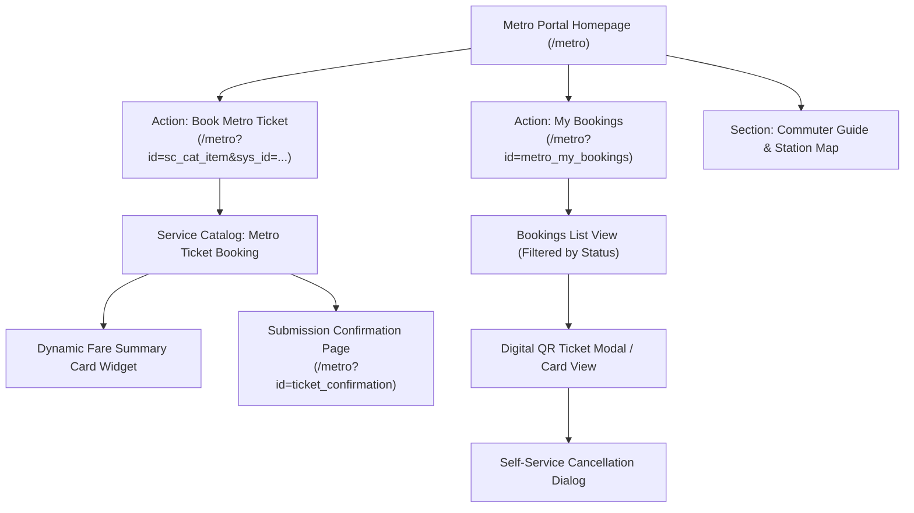

# Metro Ticket Generating System in ServiceNow
## Phase 1 Deliverable: Service Portal & Service Catalog UI/UX Specification

| Document Metadata | Value |
| :--- | :--- |
| **Document ID** | MTTS-DOC-07 |
| **Project Name** | Metro Ticket Generating System in ServiceNow |
| **Current Phase** | Phase 1: Requirement Analysis & Project Planning |
| **Author / Role** | ServiceNow UI/UX Architect & Portal Specialist |
| **Status** | Phase 1 Blueprint Complete (Pending Stakeholder Sign-Off) |

---

### 1. Service Portal Information Architecture

The commuter digital experience is hosted within the ServiceNow Service Portal framework under the application path `/metro` (or embedded into the enterprise Employee Center `/esc` as a dedicated Transportation taxonomy page).



#### 1.1 Portal Homepage Layout (`/metro`)
- **Header:** Metro branding logo, dynamic breadcrumb navigation, Language Selector, and User Profile menu (`gs.getUserDisplayName()`).
- **Hero Banner:** "Fast, Seamless Metro Commuter Ticketing" with quick CTA button: `[ Book Your Journey Now ]`.
- **Primary Grid (Two Columns):**
  - *Left Column (70% width):* Interactive Journey Search / Quick Booking Shortcut.
  - *Right Column (30% width):* Active Commuter Status Card (e.g., "You have 1 active ticket for today: Station A $\rightarrow$ Station B").
- **Footer:** Operational transit advisory alerts, station helpline contact, accessibility disclaimer, and terms of transit.

---

### 2. Service Catalog Item: "Metro Ticket Booking"

- **Catalog Item Technical Name:** `sc_cat_item_metro_ticket`
- **Category:** Transportation & Commuter Services
- **Target Implementation Phase:** Phase 3 (UI/UX Development)

#### 2.1 Catalog Variables Specification

| Variable Name | Label | Type | Mandatory? | Read Only? | Default Value | Reference / Choice Source | Validation & Dynamic Behavior |
| :--- | :--- | :--- | :---: | :---: | :--- | :--- | :--- |
| `source_station` | Origin (Source) Station | Reference | Yes | No | None | `x_mtts_station` | Ref Qualifier: `active=true`. OnChange triggers route & fare calculation. |
| `destination_station` | Destination Station | Reference | Yes | No | None | `x_mtts_station` | Ref Qualifier: `active=true`. Blocked if equal to `source_station`. |
| `travel_date` | Travel Date | Date | Yes | No | `javascript:gs.now()` | None | Client Script enforces date $\ge$ today and within the owner-approved `x_mtts.max_advance_booking_days` setting. |
| `ticket_type` | Ticket Type | Reference | Yes | No | None | `x_mtts_ticket_type` | Ref Qualifier: `active=true`. Choices: Single Journey, Return, Pass. |
| `passenger_count` | Number of Passengers | Integer | Yes | No | `1` | None | Positive integer up to the owner-approved configurable maximum; a maximum of 6 is pending DEC-08 approval. Enforced on input change. |
| `calculated_distance`| Journey Distance (km) | Decimal | No | **Yes** | Blank until calculated | None | Auto-populated by server calculation. Read-only; for fixed-fare Pass show “Not applicable,” not a physical zero-distance journey. |
| `unit_fare` | Unit Fare | Decimal | No | **Yes** | Blank until calculated | None | Auto-populated by server calculation. Read-only; never display zero as an implied quote while calculation is pending. |
| `total_fare` | Total Booking Fare | Decimal | No | **Yes** | Blank until calculated | None | Auto-populated by server calculation. Read-only; never display zero as an implied quote while calculation is pending. |
| `fare_summary_macro` | Fare Breakdown | Custom / Macro | No | **Yes** | None | Widget: `metro_fare_summary` | Visual card displaying real-time pricing breakdown. |

---

### 3. Dynamic Fare Summary Component

When all mandatory variables are populated, a dynamic Service Portal widget (`metro_fare_summary`) renders an intuitive breakdown card directly beneath the input form:

```
┌─────────────────────────────────────────────────────────┐
│ 🚆 JOURNEY & FARE BREAKDOWN                             │
├─────────────────────────────────────────────────────────┤
│ Origin:        Central Station (STN-01)                 │
│ Destination:   Technology Park (STN-08)                 │
│ Journey Route: Blue Line Transit Corridor               │
│ Distance:      [distance or Not applicable for Pass]   │
│ Ticket Type:   Single Journey                           │
│ Passengers:    2 Adults                                 │
├─────────────────────────────────────────────────────────┤
│ Base Rate:     [approved rate] / km                     │
│ Unit Fare:     [server-calculated unit fare] [currency] │
│ Total Fare:    [server-calculated amount] [currency]    │
└─────────────────────────────────────────────────────────┘
```

#### 3.1 Error & Warning State Messaging
- **Identical Stations:** Banners render an alert: 
  `⚠️ Origin and Destination stations cannot be identical. Please select a valid destination.`
- **Missing Route:** If the route lookup returns null:
  `❌ Direct route between selected stations is not configured in the active matrix. Please contact Metro Operations.`
- **Expired/Missing Fare Rule:**
  `⚠️ Fares for the selected travel date are currently under administrative review. Please select an earlier date.`

---

### 4. Submission & Confirmation Flow

```mermaid
sequenceDiagram
    autonumber
    actor Commuter as Passenger (Browser)
    participant Portal as Service Portal / Catalog
    participant Server as Script Include (MetroFareCalculator)
    participant DB as ServiceNow Database
    
    Commuter->>Portal: Enters Station A, Station B, Date, 2 Passengers
    Portal->>Server: GlideAjax: calculateFare(A, B, Single, Date, 2)
    Server-->>Portal: Returns {distance: [test fixture], unitFare: [test fixture], totalFare: [test fixture], currencyCode: [approved currency]}
    Portal->>Commuter: Renders fare summary using configured fare data
    Commuter->>Portal: Clicks "Submit Booking"
    Portal->>Server: Submits sc_cat_item request
    Server->>Server: Item-specific flow creates one linked booking; server recalculates fare before insert
    Server->>DB: Submits catalog item and creates sc_req_item
    Note over Server,DB: Item-specific flow creates one linked booking before approval
    DB-->>Portal: Confirms insertion (BKG-YYYYMMDD-XXXX)
    Portal->>Commuter: Redirects to /metro?id=ticket_confirmation
```

#### 4.1 Post-Submission Confirmation Screen (`/metro?id=ticket_confirmation`)
- **Display Elements:**
  - Success Icon & Title: "Booking Submitted Successfully!"
  - **Booking Reference:** `BKG-YYYYMMDD-XXXX`
  - **Status Badge:** `Pending Approval` (Yellow warning badge).
  - Explicit Commuter Advisory:
    > "Your booking has been forwarded to Station Approvers for fulfillment. Your digital QR ticket will be generated and emailed to you immediately upon approval. You can track this request in **My Bookings**."
  - Action Buttons: `[ View in My Bookings ]` and `[ Book Another Journey ]`.
  - **Zero Premature Ticket Display:** The QR ticket is strictly hidden; no placeholder or dummy barcode is shown while in `Pending` state.

---

### 5. Passenger Portal: "My Bookings" Module

- **Portal Page ID:** `metro_my_bookings`
- **Widget ID:** `x_mtts_commuter_bookings`
- **Target Implementation Phase:** Phase 3 (UI/UX Development)

#### 5.1 List View Specifications
- **Filters:** Tabbed pill navigation: `[ All Bookings ]`, `[ Active / Generated ]`, `[ Pending ]`, `[ Cancelled ]`.
- **Columns:**
  - Booking Reference (`BKG-XXXX`)
  - Ticket Number (`TKT-XXXX` or *Awaiting Approval*)
  - Travel Date
  - Route (`Station Alpha → Station Beta`)
  - Passengers
  - Total Fare
  - Status Badge (`Pending` = Yellow, `Approved` = Blue, `Generated` = Green, `Cancelled` = Gray, `Rejected` = Red)
  - Action: `[ View Ticket ]` or `[ Cancel ]`

#### 5.2 Digital Ticket Card Modal (`x_mtts_ticket_modal`)
When the commuter clicks "View Ticket" on any `Generated` record, a modal renders the digital ticket card:
- Metro Brand Header with dynamic Status Indicator (`ACTIVE TICKET`).
- High-contrast, scannable QR Code image (rendered from `sys_attachment` or SVG canvas).
- Unique Ticket Number: `TKT-YYYYMMDD-XXXXXX`.
- Journey Details: Origin, Destination, Travel Date, Passengers.
- Cryptographic Token Verification Fingerprint (first 8 characters of token hash).
- Action Buttons: `[ Download Ticket PDF ]` and `[ Cancel Booking ]`.

#### 5.3 UI Component States
- **Loading State:** Shimmering skeleton cards while GlideAjax queries retrieve commuter records.
- **Empty State:** If zero records exist:
  - Graphic of an empty train platform.
  - Heading: "No Metro Bookings Found".
  - Subtext: "You haven't booked any journeys yet. Ready to travel?"
  - Button: `[ Book Your First Ticket ]`.
- **Error State:** If network or ACL errors occur:
  - Alert banner: "Unable to load your bookings at this time. Please refresh your browser or try again shortly."
