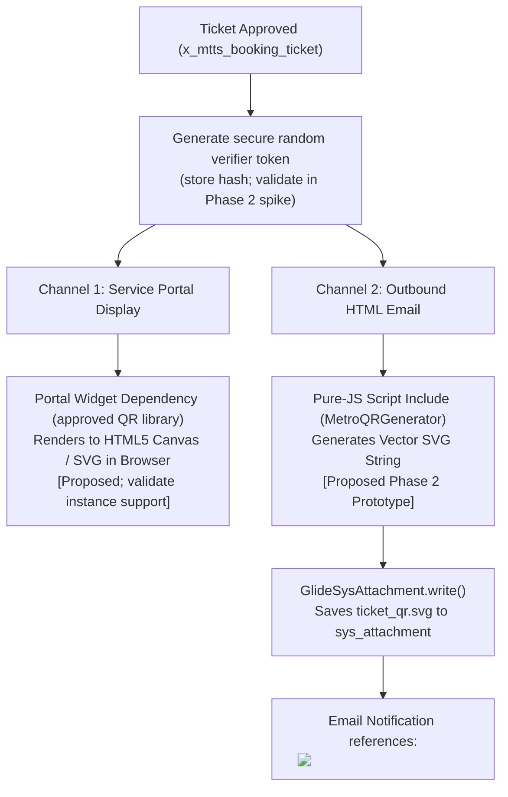

# Metro Ticket Generating System in ServiceNow
## Phase 1 Deliverable: Digital QR Ticket & Automated Notification Specification

| Document Metadata | Value |
| :--- | :--- |
| **Document ID** | MTTS-DOC-08 |
| **Project Name** | Metro Ticket Generating System in ServiceNow |
| **Current Phase** | Phase 1: Requirement Analysis & Project Planning |
| **Author / Role** | ServiceNow Notification Architect & Technical Security Specialist |
| **Status** | Phase 1 Blueprint Complete (Pending Stakeholder Sign-Off) |

---

### 1. Digital Ticket Architecture & Visual Presentation

The digital ticket is presented as an interactive responsive card in the Service Portal and formatted as an HTML card in commuter emails. The diagram below is an illustrative layout only; the block pattern is not a scannable QR code, the identifiers are placeholders, and the project baseline does not include metro turnstile integration.

```
┌───────────────────────────────────────────────────────────────┐
│ 🚆 METRO TRANSIT AUTHORITY — DIGITAL PASSENGER TICKET          │
├───────────────────────────────────────────────────────────────┤
│ TICKET NUMBER:    TKT-YYYYMMDD-XXXXXX     STATUS: ACTIVE      │
│ BOOKING REF:      BKG-YYYYMMDD-XXXX       ISSUED: [timestamp] │
├───────────────────────────────────────────────────────────────┤
│ ORIGIN:           [selected active station]                   │
│ DESTINATION:      [selected active station]                   │
│ TRAVEL DATE:      [approved travel date]                      │
│ TICKET TYPE:      [selected type]          PASSENGERS: [n]    │
│ TOTAL FARE:       [calculated amount] [approved currency]     │
├───────────────────────────────────────────────────────────────┤
│                                                               │
│                   ██████████████  ██████████████              │
│                   ██          ██  ██          ██              │
│                   ██  ██████  ██  ██  ██████  ██              │
│                   ██  ██████  ██  ██  ██████  ██              │
│                   ██          ██  ██          ██              │
│                   ██████████████  ██████████████              │
│                   ████  ██████████████  ████████              │
│                   ██████████  ████████  ████████              │
│                   ██████████████████████████████              │
│                                                               │
│            DEMO QR MATRIX (ILLUSTRATIVE ONLY)                 │
│    Verify only with the supported server-side verifier       │
├───────────────────────────────────────────────────────────────┤
│ Terms: Follow the approved ticket validity and use policy.    │
│ Cancelled tickets fail the server-side status check.          │
└───────────────────────────────────────────────────────────────┘
```

---

### 2. QR Code Payload & Cryptographic Architecture

#### 2.1 Privacy & Security Mandate
> [!CAUTION]
> The QR code must **never** encode raw Personally Identifiable Information (PII) such as the commuter's full name, email address, national identity number, or payment card details. Storing plaintext PII in public QR codes exposes commuters to eavesdropping and identity harvesting.

#### 2.2 Standardized JSON Payload Structure
The QR artifact encodes a compact, URL-safe payload containing non-PII ticket metadata and a placeholder for a secure random verification token. The example below is illustrative, not a generated credential:

```json
{
  "tkt": "TKT-YYYYMMDD-XXXXXX",
  "bkg": "BKG-YYYYMMDD-XXXX",
  "src": "STN-01",
  "dst": "STN-08",
  "dt": "YYYY-MM-DD",
  "typ": "SINGLE",
  "pax": 2,
  "verify_token": "<random-token-in-QR-artifact-only>"
}
```

#### 2.3 Verification Token Design & Platform Feasibility

`GlideDigest` documents message-digest methods including SHA-256. A plain construction such as `SHA256(secret + separator + payload)` is **not HMAC-SHA256** and must not be described as a keyed signature. The current project does not require us to claim a particular cryptographic API before it has been verified in the target instance.

**Preferred baseline design:**
- Generate a cryptographically random, unguessable bearer token using a ServiceNow-supported secure-random facility that is explicitly verified during Phase 2.
- Store only a one-way hash of that token in `x_mtts_booking_ticket.qr_token_hash`; do not store the raw token in this field or in the persistent `qr_payload` metadata field.
- Include the raw token only in the QR artifact produced for the passenger. It must contain no passenger PII. The verifier hashes the submitted token, looks up the corresponding record, and accepts it only when the booking exists, the hash matches, the status is `Generated`, and the ticket is otherwise valid.
- If a supported secure-random facility cannot be demonstrated, stop issuance design and select a supported platform mechanism before implementing QR verification. Do not replace it with timestamps, predictable IDs, a homemade pseudo-random generator, or an unkeyed hash.
- A keyed MAC/signature may be evaluated only if a documented, supported implementation is available and the project explicitly requires it.

**Phase 2 technical gate:** Prototype secure token generation, hash comparison, authorization, replay behavior, and cancellation invalidation on the target instance. Record the tested platform release and evidence. Until then, token generation/verification is proposed, not proven.

---

### 3. QR Generation Feasibility: Proposed Dual Native Strategy

Do not assume that the target instance exposes a native QR-encoding API. The architectural strategy distinguishes browser rendering as a candidate approach from proposed server-side generation, and requires both to be validated in the actual instance:



| Channel | Implementation Method | Feasibility & Dependencies | Governance Status |
| :--- | :--- | :--- | :--- |
| **Service Portal ("My Bookings")** | A supported client-side QR library embedded as a Service Portal Widget Dependency, rendering to HTML5 `<canvas>` or inline SVG. | Browser rendering is technically plausible, but library availability, licensing, and scoped widget integration must be tested on the target instance. | **Proposed; Phase 2/3 validation required** |
| **Email Notifications & Attachments** | Pure JavaScript Script Include (`MetroQRGenerator`) executing within the scoped Rhino/Nashorn engine to compute QR matrix and generate an SVG XML string, attached via `GlideSysAttachment`. | **Requires Phase 2 Prototype.** Script Include execution speed and memory limits must be benchmarked against 100 concurrent issuances. | **Proposed Implementation (Subject to Phase 2 Prototype)** |
| **External REST QR Service** | Outbound HTTP call to external QR generation API. | **Rejected.** Introduces external network failure points, latency, and privacy compliance concerns. | **Excluded from Scope** |

---

### 4. Enterprise Ticket Number Generation (`TKT-YYYYMMDD-XXXXXX`)

#### 4.1 Platform Limitation & Architecture Solution
Standard ServiceNow Number Maintenance (`sys_number`) generates sequential numbers with static prefixes (e.g., `TKT000100`). It does **not** natively inject dynamic current dates (`YYYYMMDD`) into the middle of the number sequence.

#### 4.2 Proposed Implementation Design: `MetroNumberFormatter`

The requested display format remains `TKT-YYYYMMDD-XXXXXX`; the implementation is provisional until Phase 2 validates it against the target instance.

1. **Date key:** Establish the business timezone with stakeholders and derive the `YYYYMMDD` key using a supported ServiceNow date API. Test midnight and timezone-boundary behavior.
2. **Counter schema:** Use the proposed `x_mtts_daily_sequence` table documented in `04-data-model-and-field-dictionary.md`: unique `date_key`, `last_sequence`, and `allocation_status`.
3. **Concurrency safety:** A normal GlideRecord read-increment-write sequence is not assumed atomic. Implement only an allocation mechanism that can be demonstrated as concurrency-safe in the target instance. A unique index on `x_mtts_booking_ticket.ticket_number` provides final duplicate protection, but it does not by itself prove the counter is race-free.
4. **Reservation / retry:** If allocation conflicts or a duplicate ticket number is detected, do not mark the booking Generated. Retry through the validated allocator; keep the ticket Approved until a unique number and QR artifact are committed. Define behavior when sequence `999999` is exhausted.
5. **Required validation:** `TC-020` and `TC-NFR-09` must test simultaneous requests, including concurrent first-time creation of a date counter. Record the target platform release and observed results. A design description alone is not proof of atomicity.

---

### 5. Automated Notification Matrix

The system automates communications across 7 distinct lifecycle events using ServiceNow Notifications (`sysevent_email_action`) and Mail Scripts.

| Event ID | Event Name / Trigger | Recipient | Email Subject Line | Content Summary & Key Variables | Anti-Duplicate Condition | Failure & Recovery Policy |
| :--- | :--- | :--- | :--- | :--- | :--- | :--- |
| **NOTIF-01** | **Booking Submitted**<br>(Insert on `x_mtts_booking_ticket`, status=`Pending`) | Passenger (`passenger.email`) | `Metro Booking Received: ${booking_reference}` | Confirms booking receipt. States status is `Pending Approval`. Displays selected stations, date, passenger count, and total fare. Explicitly advises that QR ticket will follow upon approval. | Only on `previous.status == null` | Retry up to 3 times via ServiceNow Email Engine (`sys_email`). |
| **NOTIF-02** | **Approval Requested**<br>(Insert on `sysapproval_approver` targeting `sc_req_item`) | Members of `Metro Station Approvers` | `ACTION REQUIRED: Metro Booking Approval Request ${booking_reference}` | Informs station duty officers of pending booking. Displays route, passenger count, travel date, and provides standard approval portal links. | Triggered once per approver task. | Escalates to Admin if unapproved after 4 hours. |
| **NOTIF-03** | **Booking Approved**<br>(Update to `Approved`) | Passenger (`passenger.email`) | `Metro Booking Approved: ${booking_reference}` | Informs commuter of approval and advises that digital QR ticket generation has commenced. | Triggered only on `changesTo('Approved')`. | Logged in `sys_email`. |
| **NOTIF-04** | **Digital Ticket Generated**<br>(Update to `Generated`) | Passenger (`passenger.email`) | `YOUR DIGITAL METRO TICKET: ${ticket_number} (Ref: ${booking_reference})` | Full digital ticket card. Contains journey details, fare receipt, embedded scannable QR Code image, and portal link to "My Bookings". | Triggered only on `changesTo('Generated')` AND `ticket_number IS NOT EMPTY`. | If email fails, ticket remains accessible via portal. |
| **NOTIF-05** | **Booking Rejected (Proposed)**<br>(Update to `Rejected`) | Passenger (`passenger.email`) | `Metro Booking Update: Request ${booking_reference} Declined` | Informs passenger of booking decline with mandatory approver comments/reasons. | Triggered only on `changesTo('Rejected')`. | Logged in `sys_email`. |
| **NOTIF-06** | **Booking Cancelled**<br>(Update to `Cancelled`) | Passenger (`passenger.email`) | `Cancellation Confirmed: Metro Booking ${booking_reference}` | Confirms cancellation. Declares associated ticket number invalid because the server-side verifier rejects records whose status is no longer `Generated`. Displays calculated refund amount and reason. | Triggered only on `changesTo('Cancelled')`. | Logged in `sys_email`. |
| **NOTIF-07** | **Automation Exception**<br>(Fulfillment/Pricing Failure) | Group: `Metro Operations Administrators` | `ALERT: Automation Failure on Metro Booking ${booking_reference}` | Diagnostic notification to platform administrators detailing script execution failure, stack trace, and failed record sys_id. | Triggered by Flow Designer error handler. | Record remains `Approved`; alert logged for admin. |
