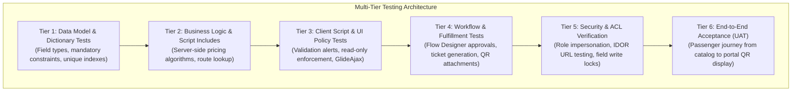

# Metro Ticket Generating System in ServiceNow
## Phase 1 Deliverable: Test Strategy & Acceptance Criteria Framework

| Document Metadata | Value |
| :--- | :--- |
| **Document ID** | MTTS-DOC-11 |
| **Project Name** | Metro Ticket Generating System in ServiceNow |
| **Current Phase** | Phase 1: Requirement Analysis & Project Planning |
| **Author / Role** | ServiceNow QA Architect & Test Automation Lead |
| **Status** | Phase 1 Blueprint Complete (Pending Stakeholder Sign-Off) |

---

### 1. Test Strategy Overview & Framework

The testing strategy validates all functional, architectural, performance, and security requirements across Phases 2 through 4 using the native **ServiceNow Automated Test Framework (ATF)** supplemented by manual end-to-end user acceptance testing (UAT). All monetary values in these test cases are synthetic test fixtures; the operating currency and production fare values must be approved and configured before they are used outside tests.

---

### 2. Comprehensive Acceptance Test Cases (Given-When-Then)

Every test case below provides explicit Preconditions (Given), Test Actions (When), Expected Results (Then), and Pass/Fail Acceptance Criteria. The test design maps each FR-001 through FR-030 to a dedicated test ID; execution coverage remains pending until tests run on the target instance.

#### TC-001: Metro Station Master Data Management (CRUD)
- **Requirement Reference:** FR-001
- **Given:** An authenticated user with role `x_mtts.admin`.
- **When:** The administrator creates a new station record (`station_code='STN-10'`, `name='Airport Central'`, `line_zone='Airport Express'`, `active=true`), updates its name, and subsequently marks it `active=false`.
- **Then:** The record is inserted, updated, and deactivated successfully in `x_mtts_station`.
- **Pass/Fail Criteria:** Pass if all database operations persist with zero errors and deactivated station is hidden from catalog lookups.

#### TC-002: Station Code Uniqueness & Format Validation
- **Requirement Reference:** FR-002
- **Given:** Station record with `station_code='STN-01'` already exists.
- **When:** An administrator attempts to insert another station record with `station_code='STN-01'`.
- **Then:** ServiceNow unique database index rejects the insertion and displays a duplicate key error banner.
- **Pass/Fail Criteria:** Pass if duplicate insertion is blocked and transaction rolls back cleanly.

#### TC-003: Metro Route Matrix & Journey Distance Management
- **Requirement Reference:** FR-003
- **Given:** Active stations `STN-01` and `STN-02`.
- **When:** Administrator inserts a route with origin `STN-01`, destination `STN-02`, and `distance_km=8.50`.
- **Then:** Route record persists in `x_mtts_route` with `active=true`.
- **Pass/Fail Criteria:** Pass if the distance-based route query returns the configured distance and zero/negative distances are rejected.

#### TC-004: Configurable Fare Rule Management
- **Requirement Reference:** FR-004
- **Given:** An administrator user accessing `x_mtts_fare_rule`.
- **When:** Administrator configures a rule for Single Journey: `rate_per_km=2.50`, `minimum_fare=10.00`, `effective_start=today()`.
- **Then:** Record commits successfully and is available for dynamic pricing queries.
- **Pass/Fail Criteria:** Pass if fare rules enforce mandatory rates and prevent conflicting overlapping active dates.

#### TC-005: Ticket Type Category Support
- **Requirement Reference:** FR-005
- **Given:** Table `x_mtts_ticket_type` populated with baseline categories: `Single Journey`, `Return`, and `Pass`.
- **When:** Commuter opens the booking catalog item.
- **Then:** All three active categories appear in the `ticket_type` drop-down.
- **Pass/Fail Criteria:** Pass if all three options are selectable and map to their respective pricing models.

#### TC-006: Service Catalog Item Input Prompts
- **Requirement Reference:** FR-006
- **Given:** Commuter navigates to the "Metro Ticket Booking" catalog item.
- **When:** The form loads in the Service Portal.
- **Then:** Mandatory fields for Origin Station, Destination Station, Travel Date, Ticket Type, and Number of Passengers are displayed with appropriate labels.
- **Pass/Fail Criteria:** Pass if all mandatory variables are visible and submission without them is blocked.

#### TC-007: Dynamic Reference Qualifiers on Station Variables
- **Requirement Reference:** FR-007
- **Given:** Stations `STN-01` (Active) and `STN-99` (Inactive).
- **When:** Commuter opens the Origin or Destination Station reference lookup.
- **Then:** Only active stations appear; `STN-99` is excluded from the selection list.
- **Pass/Fail Criteria:** Pass if zero inactive stations are selectable.

#### TC-008: Identical Origin and Destination Blocking
- **Requirement Reference:** FR-008
- **Given:** Commuter selects `STN-01` as Origin Station.
- **When:** Commuter selects `STN-01` as Destination Station.
- **Then:** Client script immediately clears Destination Station, displays alert *"Origin and destination stations cannot be identical"*, and disables the submit button. Server-side validation throws an exception if bypassed.
- **Pass/Fail Criteria:** Pass if identical station selections are blocked at both client and server tiers.

#### TC-009: Travel Date Validation Horizon
- **Requirement Reference:** FR-009
- **Given:** The approved advance-booking window is configured in the test instance.
- **When:** Commuter enters yesterday's date and then a date one day beyond the configured maximum.
- **Then:** Form displays a validation error and blocks both submissions.
- **Pass/Fail Criteria:** Pass if past dates and dates beyond the configured window are rejected; use 30 days only if that candidate value has been approved for the test environment.

#### TC-010: Dynamic GlideAjax Fare Preview
- **Requirement Reference:** FR-010
- **Given:** Commuter enters valid stations (`STN-01` to `STN-05`), date, Single Journey, and 2 passengers.
- **When:** The client script triggers GlideAjax to `MetroFareCalculatorClient`.
- **Then:** The configured test distance, server-derived unit fare, total fare, and configured currency code populate the read-only fields and Fare Summary card within 1.5 seconds.
- **Pass/Fail Criteria:** Pass if preview renders accurate values dynamically without page reload.

#### TC-011: Authoritative Server-Side Fare Recalculation (Anti-Tampering)
- **Requirement Reference:** FR-011
- **Given:** A valid booking submission where true calculated fare is $\$50.00$.
- **When:** A malicious client alters client-side variables to submit `total_fare=0.01`.
- **Then:** Server-side Pre-Insert Business Rule executes `MetroFareCalculator`, completely discards client fare variables, overrides fields with $\$50.00$, and logs an audit warning.
- **Pass/Fail Criteria:** Pass if database stores $\$50.00$ and zero tampered fares are committed.

#### TC-012: Single Journey Fare Calculation Algorithm
- **Requirement Reference:** FR-012
- **Given:** Route distance $14.20\text{ km}$, rate/km = $\$2.50$, minimum fare = $\$10.00$.
- **When:** `MetroFareCalculator.calculate()` is executed for Single Journey.
- **Then:** Distance fare computed as $\$35.50$; Unit Fare derived as $\max(\$10.00, \$35.50) = \$35.50$.
- **Pass/Fail Criteria:** Pass if derived unit fare equals $\$35.50$ (and enforces minimum floor on short trips).

#### TC-013: Return Ticket Pricing Algorithm
- **Requirement Reference:** FR-013
- **Given:** Single fare of $\$20.00$ and configured `return_multiplier=1.80`.
- **When:** `MetroFareCalculator.calculate()` is executed for Return Journey.
- **Then:** Unit fare derived as $\$20.00 \times 1.80 = \$36.00$.
- **Pass/Fail Criteria:** Pass if return fare mathematically matches single fare multiplied by configured factor.

#### TC-014: Pass Ticket Fixed Fare Derivation
- **Requirement Reference:** FR-014
- **Given:** Ticket Type `Pass` configured with Fixed Fare = $\$50.00$.
- **When:** Commuter selects `Pass` for 2 passengers.
- **Then:** Distance calculation is bypassed; `calculated_distance=0.00`; Unit Fare = $\$50.00$; Total Fare = $\$100.00$.
- **Pass/Fail Criteria:** Pass if fixed tariff is applied and route distance calculation is cleanly bypassed.

#### TC-015: Total Fare Calculation
- **Requirement Reference:** FR-015
- **Given:** Derived Unit Fare of $\$35.50$ and passenger count = 3.
- **When:** Fare engine computes Total Fare.
- **Then:** Total Fare is calculated as $\$35.50 \times 3 = \$106.50$.
- **Pass/Fail Criteria:** Pass if Total Fare strictly equals Unit Fare $\times$ Passenger Count.

#### TC-016: Financial & Distance Snapshot Persistence
- **Requirement Reference:** FR-016
- **Given:** A committed test booking with snapshotted distance, unit fare, total fare, and `currency_code` from its active test fare rule.
- **When:** Administrator alters the active fare rule rate per km from $\$2.50$ to $\$4.00$.
- **Then:** The historic booking retains its original distance, unit fare, total fare, and `currency_code` snapshot despite master-rule changes.
- **Pass/Fail Criteria:** Pass if historic records remain 100% immutable against master data modifications.

#### TC-017: Initial Lifecycle State Assignment
- **Requirement Reference:** FR-017
- **Given:** Commuter submits a valid booking request via Service Catalog.
- **When:** The record inserts into `x_mtts_booking_ticket`.
- **Then:** `status` is automatically initialized to `Pending`.
- **Pass/Fail Criteria:** Pass if newly created booking records always enter `Pending` state.

#### TC-018: Approval Task Routing on Parent `sc_req_item`
- **Requirement Reference:** FR-018
- **Given:** A new request for the exact `Metro Ticket Booking` catalog item is submitted.
- **When:** Its associated Service Catalog-triggered flow runs.
- **Then:** The flow creates exactly one linked booking record first, then creates an approval against that request item and routes it to `Metro Station Approvers`. Requests for unrelated catalog items do not start this flow.
- **Pass/Fail Criteria:** Pass if the RITM/booking link is unique, the booking exists before approval creation, and unrelated catalog items are not processed.

#### TC-019: Approval Decision Transition to `Approved`
- **Requirement Reference:** FR-019
- **Given:** A pending approval record assigned to a station approver.
- **When:** Approver approves the request.
- **Then:** `sc_req_item.approval` updates to `approved`, and Flow Designer updates `x_mtts_booking_ticket.status` to `Approved`.
- **Pass/Fail Criteria:** Pass if booking status transitions to `Approved` immediately upon approval commit.

#### TC-020: Unique Sequential Ticket Number Allocation
- **Requirement Reference:** FR-020
- **Given:** A booking in `Approved` status entering fulfillment and a clean test date key.
- **When:** At least 20 concurrent requests allocate ticket numbers, including a separate run for simultaneous first use of a new date key.
- **Then:** Each accepted ticket number matches `TKT-YYYYMMDD-XXXXXX`; every allocation is unique, and sequence state remains consistent.
- **Pass/Fail Criteria:** Pass only if no duplicates, overwritten/lost allocations, counter corruption, or duplicate booking tickets occur. If this test has not run against the target instance, mark the result **Not Run**, not Passed.

#### TC-021: Secure QR Verification Token & Payload Generation
- **Requirement Reference:** FR-021
- **Given:** An approved booking with a unique ticket number and a supported secure-random token facility confirmed on the target instance.
- **When:** Fulfillment generates the QR artifact and stores the one-way token hash.
- **Then:** The QR contains no PII; raw token is not stored in `qr_token_hash` or persistent `qr_payload`; a valid token resolves to the ticket through server-side verification. Unsupported pseudo-random or salted-hash-as-signature designs are rejected.
- **Pass/Fail Criteria:** Pass only if secure token generation is demonstrated, matching succeeds, tampered/unknown tokens fail, and verification rejects cancelled/non-Generated tickets. Mark Not Run until the feasibility test executes.

#### TC-022: State Transition to `Generated`
- **Requirement Reference:** FR-022
- **Given:** Ticket number and QR token successfully generated and attached.
- **When:** Database transaction commits.
- **Then:** Booking status transitions from `Approved` to `Generated`, and `generation_time` is stamped.
- **Pass/Fail Criteria:** Pass if status changes to `Generated` only after verified ticket number and QR commit.

#### TC-023: Outbound HTML Email Notification Dispatch
- **Requirement Reference:** FR-023
- **Given:** Booking status transitions to `Generated`.
- **When:** Notification engine processes event `x_mtts.ticket.generated`.
- **Then:** Email NOTIF-04 is generated in `sys_email` addressed to `passenger.email` with embedded QR ticket.
- **Pass/Fail Criteria:** Pass if email record is created with correct subject, recipient, and valid CID QR attachment.

#### TC-024: Service Portal "My Bookings" Commuter View
- **Requirement Reference:** FR-024
- **Given:** Authenticated commuter with 3 historical bookings.
- **When:** Commuter navigates to `/metro?id=metro_my_bookings`.
- **Then:** Widget lists all 3 records filtered by status tabs; records belonging to other users are hidden.
- **Pass/Fail Criteria:** Pass if portal displays own records with accurate status badges and details.

#### TC-025: Digital Ticket Modal Expansion & Scannable QR Display
- **Requirement Reference:** FR-025
- **Given:** A booking in `Generated` status in "My Bookings".
- **When:** Commuter clicks "View Ticket".
- **Then:** Modal expands displaying high-contrast scannable QR code, ticket number, route, and date.
- **Pass/Fail Criteria:** Pass if QR graphic renders clearly and matches stored payload.

#### TC-026: Commuter Self-Service Cancellation (Within Policy Window)
- **Requirement Reference:** FR-026
- **Given:** An issued booking in `Generated` status with future travel date.
- **When:** Authenticated commuter clicks "Request Cancellation" and submits a cancellation reason.
- **Then:** Status transitions to `Cancelled`, cancellation timestamp and reason are logged, and refund calculation is stored.
- **Pass/Fail Criteria:** Pass if booking status updates to `Cancelled` and refund calculation commits.

#### TC-027: QR Verification Rejection after Cancellation
- **Requirement Reference:** FR-027
- **Given:** A booking transitioning to `Cancelled`.
- **When:** Cancellation transaction completes.
- **Then:** `qr_token_hash` remains unchanged; the verifier returns `TICKET_REVOKED_OR_CANCELLED` because the booking is no longer `Generated`.
- **Pass/Fail Criteria:** Pass if cancelled ticket QR scans as invalid in verification engine.

#### TC-028: Administrator Access Control Enforcement
- **Requirement Reference:** FR-028
- **Given:** User assigned role `x_mtts.admin`.
- **When:** User navigates to Station, Route, Fare Rule, or Ticket Type tables.
- **Then:** Full Create, Read, Write, and Delete permissions are granted.
- **Pass/Fail Criteria:** Pass if administrative CRUD operations succeed without ACL denial.

#### TC-029: Commuter Privacy & IDOR Record Protection
- **Requirement Reference:** FR-029
- **Given:** Commuter A owns ticket `BKG-001`.
- **When:** Commuter B attempts to access `BKG-001` via direct portal URL or REST API.
- **Then:** ServiceNow row-level ACL evaluates to `false`; request is aborted with HTTP 403 Forbidden.
- **Pass/Fail Criteria:** Pass if zero cross-user records can be accessed or viewed.

#### TC-030: Fallback Pricing & Graceful Abort on Missing Master Data
- **Requirement Reference:** FR-030
- **Given:** Run separate cases: (A) Single Journey/Return with no active route; (B) any ticket type with no active fare rule for the travel date; (C) Pass with a valid fixed-fare rule but no route-distance record.
- **When:** Server-side fare calculation and booking submission execute.
- **Then:** Cases A and B abort with a helpful error and diagnostic log; case C is allowed to use the configured fixed fare if the approved Pass policy does not require a route.
- **Pass/Fail Criteria:** Pass if no invalid booking is created for A/B and C is not incorrectly rejected solely for missing distance data.

---

### 3. Non-Functional Acceptance Test Cases (`TC-NFR-01` to `TC-NFR-10`)

| Test ID | NFR Ref | Category | Test Verification Method | Pass/Fail Criteria |
| :--- | :--- | :--- | :--- | :--- |
| **TC-NFR-01** | NFR-001 | Security | ATF Impersonation: Test read/write across admin, approver, passenger, guest. | Zero unauthorized reads or writes. |
| **TC-NFR-02** | NFR-002 | Anti-Tamper | Automated REST Injection: Post payload with tampered `$0.01` price. | Server overrides with true calculated price. |
| **TC-NFR-03** | NFR-003 | Integrity | Database Constraint Test: Attempt deleting station with active routes. | Deletion blocked by referential constraint. |
| **TC-NFR-04** | NFR-004 | Performance | Browser Network Profiler: Measure GlideAjax round-trip latency (50 iterations). | 95th percentile response time $< 1.5$ seconds. |
| **TC-NFR-05** | NFR-005 | Usability | Emulation Test: Test portal form on mobile (375px), tablet, desktop viewports. | Zero horizontal scrolling; responsive layout. |
| **TC-NFR-06** | NFR-006 | Accessibility | Automated Axe/Lighthouse Scan: Audit booking catalog item & widgets. | Zero WCAG 2.1 AA violations; contrast $\ge 4.5:1$. |
| **TC-NFR-07** | NFR-007 | Maintainability | ServiceNow Instance Scan: Scoped code linter on Script Includes and Flows. | Zero high-priority code standard defects. |
| **TC-NFR-08** | NFR-008 | Error Handling | Exception Injection: Inject null route and inspect user UI and `sys_log`. | Friendly banner shown; stack trace logged. |
| **TC-NFR-09** | NFR-009 | Concurrency | Run concurrent fare-rule updates and at least 20 simultaneous ticket-number allocations, including first-use counter initialization. | No silent fare-rule overwrite, duplicate ticket numbers, lost counter increments, or corrupted records. |
| **TC-NFR-10** | NFR-010 | Scalability | SQL Execution Plan: Query route matrix across 500 station records. | Query utilizes index; constant execution time. |

---

### 4. Comprehensive Requirements-to-Test Traceability Matrix

| Requirement ID | Requirement Category | Test Case ID | Test Category | Automation Target |
| :--- | :--- | :---: | :--- | :--- |
| **FR-001** | Master Data Management | **TC-001** | Functional / CRUD | ATF Form Test |
| **FR-002** | Station Code Uniqueness | **TC-002** | Data Integrity | ATF Server Test |
| **FR-003** | Route Matrix & Distances | **TC-003** | Functional | ATF Server Test |
| **FR-004** | Configurable Fare Rules | **TC-004** | Functional | ATF Server Test |
| **FR-005** | Ticket Type Categories | **TC-005** | Functional | ATF Form Test |
| **FR-006** | Catalog Booking Inputs | **TC-006** | Usability / UI | ATF Service Catalog |
| **FR-007** | Active Station Qualifiers | **TC-007** | Client / Data | ATF Service Catalog |
| **FR-008** | Block Identical Stations | **TC-008** | Client / Security | ATF Client Script |
| **FR-009** | Travel Date Horizon | **TC-009** | Client / Validation | ATF Client Script |
| **FR-010** | Dynamic GlideAjax Preview | **TC-010** | Integration / UI | ATF Service Catalog |
| **FR-011** | Authoritative Server Pricing | **TC-011** | Security / Anti-Tamper | ATF Server Test |
| **FR-012** | Single Fare Algorithm | **TC-012** | Mathematical | ATF Script Include |
| **FR-013** | Return Fare Multiplier | **TC-013** | Mathematical | ATF Script Include |
| **FR-014** | Pass Fixed Fare | **TC-014** | Mathematical | ATF Script Include |
| **FR-015** | Total Fare Derivation | **TC-015** | Mathematical | ATF Script Include |
| **FR-016** | Financial Snapshotting | **TC-016** | Data Integrity | ATF Server Test |
| **FR-017** | Initial State Pending | **TC-017** | Lifecycle | ATF Server Test |
| **FR-018** | Approval Routing (sc_req_item)| **TC-018** | Workflow | Flow Designer Test |
| **FR-019** | Approval Decision (Approved) | **TC-019** | Workflow | Flow Designer Test |
| **FR-020** | Ticket Number Pattern | **TC-020** | Functional | ATF Server Test |
| **FR-021** | Cryptographic QR Token | **TC-021** | Cryptographic | ATF Server Test |
| **FR-022** | Generated State Commit | **TC-022** | Lifecycle | ATF Server Test |
| **FR-023** | Outbound HTML Email | **TC-023** | Notification | ATF Server Test |
| **FR-024** | My Bookings Portal View | **TC-024** | UI / Portal | Manual / Cypress |
| **FR-025** | Digital Ticket Modal Display | **TC-025** | UI / Portal | Manual / Cypress |
| **FR-026** | Self-Service Cancellation | **TC-026** | Lifecycle | ATF Portal Test |
| **FR-027** | QR Verification Rejection after Cancellation | **TC-027** | Security | ATF Script Include |
| **FR-028** | Administrator Access Control | **TC-028** | Security / ACL | ATF Security Suite |
| **FR-029** | Commuter Privacy (IDOR) | **TC-029** | Security / ACL | ATF Security Suite |
| **FR-030** | Missing Data Fallback | **TC-030** | Error Handling | ATF Script Include |
