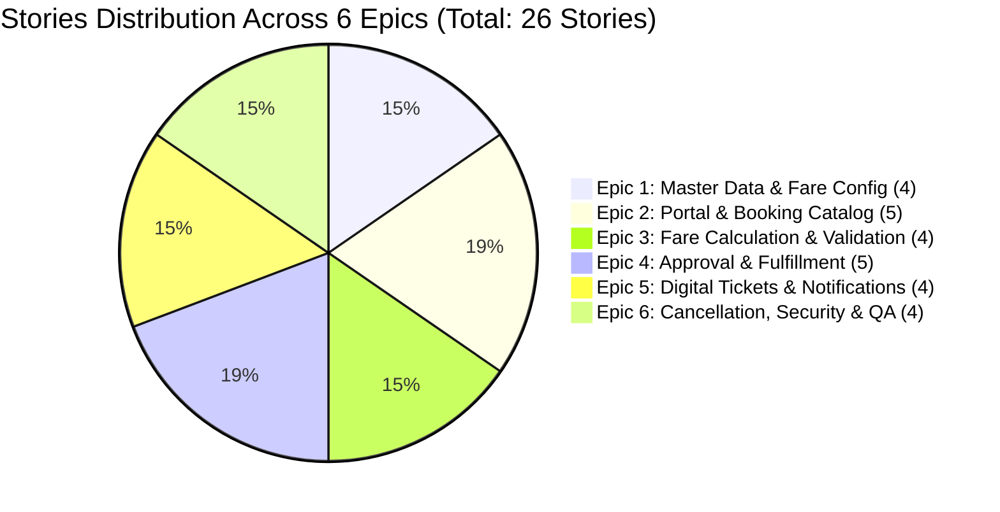

# Metro Ticket Generating System in ServiceNow
## Phase 1 Deliverable: Implementation Backlog & Work Breakdown Structure

| Document Metadata | Value |
| :--- | :--- |
| **Document ID** | MTTS-DOC-12 |
| **Project Name** | Metro Ticket Generating System in ServiceNow |
| **Current Phase** | Phase 1: Requirement Analysis & Project Planning |
| **Author / Role** | ServiceNow Agile Project Manager & Scrum Lead |
| **Baseline Metrics** | **5 Phases \| 6 Epics \| 26 Stories/Tasks \| 12 Subtasks** |
| **Status** | Phase 1 Blueprint Complete (Pending Stakeholder Sign-Off) |

---

### 1. Backlog Governance & Baseline Reconciliation

This backlog formally establishes and reconciles the project baseline metrics:
- **Total Implementation Phases:** 5
- **Total Epics:** 6
- **Total User Stories / Tasks:** 26
- **Total Subtasks:** 12
- **Reported Baseline Progress:** 33% conceptual progress (Phase 1 Architecture, Planning, and Technical Specifications complete; implementation phases 2–5 structured for sprint delivery).

---

### 2. Comprehensive Work Breakdown: Epics, Stories & Subtasks

#### Epic 1: Master Data and Fare Configuration (`EPC-01`)
*Focus: Implementation and administration of stations, routes, fare rules, and ticket types.*

| Story ID | Subtask ID | Story / Task Description | Target Phase | Req Ref | Priority | Dependencies | Acceptance Criteria & Test Link | Status |
| :--- | :--- | :--- | :---: | :---: | :---: | :---: | :--- | :---: |
| **ST-101** | - | **Create Scoped Metro Station Table (`x_mtts_station`)** Define fields (`station_code`, `name`, `line_zone`, `active`, `order`) with unique constraints. | Phase 2 | FR-001, FR-002 | High | None | Table created in scope `x_mtts`; station_code unique key enforced; display value set to name. Verified by **TC-001, TC-002**. | Planned |
| - | **SUB-01** | Configure station list views, form layouts, and reference qualifiers for catalog consumption. | Phase 2 | FR-001 | Medium | ST-101 | Active stations visible in list; form layout organized with operational sections. Verified by **TC-001**. | Planned |
| **ST-102** | - | **Create Scoped Metro Route Table (`x_mtts_route`)** Define route pairs, distance in kilometers, active flag, and directional index. | Phase 2 | FR-003, VR-03 | High | ST-101 | Origin and destination reference `x_mtts_station`; composite unique index enforced; distance $> 0.00$. Verified by **TC-003**. | Planned |
| - | **SUB-02** | Seed demonstration route distance matrix for Blue Line and Red Line station pairs. | Phase 2 | FR-003 | Medium | ST-102 | Minimum 10 active station pairs loaded with accurate physical distances. Verified by **TC-003**. | Planned |
| **ST-103** | - | **Create Scoped Ticket Type Table (`x_mtts_ticket_type`)** Configure Single Journey, Return, and Pass classifications with validity windows. | Phase 2 | FR-005 | High | None | Three baseline records created; pricing models mapped to distance vs fixed. Verified by **TC-005**. | Planned |
| **ST-104** | - | **Create Scoped Fare Rule Table (`x_mtts_fare_rule`)** Configure rate per km, minimum fare, return multiplier, fixed fare, and date validity. | Phase 2 | FR-004, VR-04 | High | ST-103 | Currency fields configured; overlapping active rules for same ticket type prevented. Verified by **TC-004**. | Planned |

---

#### Epic 2: Service Portal and Booking Catalog (`EPC-02`)
*Focus: Portal navigation, catalog variables, fare summaries, and commuter booking views.*

| Story ID | Subtask ID | Story / Task Description | Target Phase | Req Ref | Priority | Dependencies | Acceptance Criteria & Test Link | Status |
| :--- | :--- | :--- | :---: | :---: | :---: | :---: | :--- | :---: |
| **ST-201** | - | **Configure "Metro Ticket Booking" Service Catalog Item** Create catalog item, taxonomy category, and define commuter input variables. | Phase 3 | FR-006, FR-007 | High | ST-101, ST-103 | Variables created for origin, destination, date, ticket type, passenger count. Verified by **TC-006, TC-007**. | Planned |
| - | **SUB-03** | Apply Reference Qualifiers restricting station drop-downs to `active=true`. | Phase 3 | FR-007 | High | ST-201 | Decommissioned stations excluded from commuter selection. Verified by **TC-007**. | Planned |
| **ST-202** | - | **Develop Dynamic Fare Summary Portal Widget** Build widget rendering real-time route distance, unit fare, and total fare preview. | Phase 3 | FR-010 | High | ST-201 | Widget dynamically updates upon station or passenger count changes within 1.5s. Verified by **TC-010, TC-NFR-04**. | Planned |
| - | **SUB-04** | Build responsive CSS styling adhering to transit branding and WCAG 2.1 AA standards. | Phase 3 | NFR-005, NFR-006 | Medium | ST-202 | Zero horizontal scrolling on mobile; color contrast $\ge 4.5:1$. Verified by **TC-NFR-05, TC-NFR-06**. | Planned |
| **ST-203** | - | **Build Order Confirmation Portal Page** Create confirmation view displaying booking reference and Pending status notification. | Phase 3 | FR-017 | Medium | ST-201 | Renders booking reference and advisory; does NOT prematurely show QR code. Verified by **TC-017**. | Planned |
| **ST-204** | - | **Develop "My Bookings" Commuter Portal Module** Create portal page listing historical commuter bookings filtered by status tabs. | Phase 3 | FR-024 | High | ST-201 | Commuters view only their own records; status pill badges rendered. Verified by **TC-024, TC-029**. | Planned |
| **ST-205** | - | **Develop Digital Ticket Modal Card Component** Build expandable ticket modal displaying scannable QR code and journey summary. | Phase 3 | FR-025 | High | ST-204 | Modal displays active ticket details; provides download/cancel actions. Verified by **TC-025**. | Planned |

---

#### Epic 3: Fare Calculation and Validation (`EPC-03`)
*Focus: Server-side pricing engine, route resolvers, anti-tampering, and client validation.*

| Story ID | Subtask ID | Story / Task Description | Target Phase | Req Ref | Priority | Dependencies | Acceptance Criteria & Test Link | Status |
| :--- | :--- | :--- | :---: | :---: | :---: | :---: | :--- | :---: |
| **ST-301** | - | **Develop Server-Side Script Include `MetroFareCalculator`** Implement mathematical algorithms for Single, Return, and Pass pricing models. | Phase 2 | FR-011, FR-012, FR-013, FR-014 | Critical | ST-102, ST-104 | Pricing engine passes unit tests for single, return, and minimum fare edge cases. Verified by **TC-011, TC-012, TC-013, TC-014**. | Planned |
| - | **SUB-05** | Implement currency rounding and currency configuration handling. | Phase 2 | FR-015 | Medium | ST-301 | Fares round to 2 decimal places using half-up arithmetic; total = unit * pax. Verified by **TC-015**. | Planned |
| **ST-302** | - | **Develop Client-Callable Script Include `MetroFareCalculatorClient`** Expose secure GlideAjax endpoint for asynchronous portal fare calculation. | Phase 3 | FR-010 | High | ST-301 | Returns JSON payload `{distance, unitFare, totalFare}` in $< 1.5$ seconds. Verified by **TC-010, TC-NFR-04**. | Planned |
| - | **SUB-06** | Enforce session authentication check (`isLoggedIn`) and parameter sanitization. | Phase 3 | NFR-001 | High | ST-302 | Unauthenticated calls rejected; SQL injection / XSS payload strings sanitized. Verified by **TC-NFR-01**. | Planned |
| **ST-303** | - | **Implement Catalog Client Validation Scripts** Validate identical stations, future dates, and passenger bounds (1–6). | Phase 3 | FR-008, FR-009, VR-01 | High | ST-201 | Identical stations blocked with alert; past travel dates prevented. Verified by **TC-008, TC-009**. | Planned |
| **ST-304** | - | **Implement Server-Side Booking Validation & Financial Snapshotting** Recalculate fare on server before booking insert and handle missing master data without creating corrupt records. | Phase 2 | FR-011, FR-016, FR-030 | Critical | ST-301, ST-102, ST-104 | Client fares are ignored; distance and fares are snapshotted; Single/Return without an active route and any ticket type without an applicable fare rule fail safely. Pass with a valid fixed-fare rule is not rejected solely for missing route distance. Verified by **TC-011, TC-016, TC-030**. | Planned |

---

#### Epic 4: Approval and Fulfillment Automation (`EPC-04`)
*Focus: Flow Designer orchestration, approval routing, status management, and ticket numbering.*

| Story ID | Subtask ID | Story / Task Description | Target Phase | Req Ref | Priority | Dependencies | Acceptance Criteria & Test Link | Status |
| :--- | :--- | :--- | :---: | :---: | :---: | :---: | :--- | :---: |
| **ST-401** | - | **Configure Station Approval Group & Membership** Create `Metro Station Approvers` group and link role `x_mtts.approver`. | Phase 2 | FR-018 | High | None | Group created; role inherited; approver accounts assigned. Verified by **TC-018**. | Planned |
| - | **SUB-07** | Configure approval escalation rules and backup routing for unattended tasks. | Phase 2 | EX-08 | Medium | ST-401 | Tasks unapproved after 4 hours auto-escalate to Operations Admins. Verified by **TC-018**. | Planned |
| **ST-402** | - | **Design Catalog-Specific Flow Designer Fulfillment Workflow** Orchestrate submission $\rightarrow$ linked booking creation $\rightarrow$ approval on `sc_req_item` $\rightarrow$ generation $\rightarrow$ notification. | Phase 2 | FR-017, FR-018, FR-019 | Critical | ST-401; catalog item shell must exist before activation (full catalog UI is ST-201 in Phase 3) | Service Catalog trigger is associated only with the exact `Metro Ticket Booking` item; flow idempotently creates the linked booking before approval; unrelated catalog items never enter this workflow. Verified by **TC-017, TC-018, TC-019**. | Planned |
| - | **SUB-08** | Implement Approval Rejection subflow handling `Rejected` state transition. | Phase 2 | FR-019, EX-08 | High | ST-402 | Rejection sets status to `Rejected` (proposed); captures comments; notifies commuter. Verified by **TC-019**. | Planned |
| **ST-403** | - | **Prototype and Implement Ticket Number Generator (`MetroNumberFormatter`)** Validate a concurrency-safe daily sequence allocator for `TKT-YYYYMMDD-XXXXXX`. | Phase 2 | FR-020 | High | Technical table `x_mtts_daily_sequence` | Implement only after target-instance spike proves concurrent allocation; unique ticket-number index is the final integrity guard, not proof of atomic counter updates. Verified by **TC-020, TC-NFR-09**. | Planned |
| **ST-404** | - | **Develop Fulfillment Script Include `MetroTicketGenerator`** Execute ticket number assignment and orchestrate QR generation. | Phase 2 | FR-020, FR-021, FR-022 | Critical | ST-402, ST-403 | Updates status to `Generated` only after ticket number and QR token commit. Verified by **TC-020, TC-021, TC-022**. | Planned |
| **ST-405** | - | **Enforce Lifecycle State Machine Transition Constraints** Implement Data Policy / Business Rule blocking illegal state transitions. | Phase 2 | FR-017, FR-022 | High | ST-402 | Bypassing approval or editing terminal states throws platform error. Verified by **TC-017, TC-022**. | Planned |

---

#### Epic 5: Digital Tickets and Notifications (`EPC-05`)
*Focus: QR payload generation, ticket tokenization, and multi-channel email notifications.*

| Story ID | Subtask ID | Story / Task Description | Target Phase | Req Ref | Priority | Dependencies | Acceptance Criteria & Test Link | Status |
| :--- | :--- | :--- | :---: | :---: | :---: | :---: | :--- | :---: |
| **ST-501** | - | **Prototype Secure QR Verification Token & QR Artifact** Use a supported secure-random token, store only a one-way hash server-side, and generate a zero-PII QR artifact. | Phase 2 | FR-021 | Critical | ST-404 | Token generation and verification are proven on the target instance; tampered, unknown, cancelled, and non-Generated tokens are rejected. QR encoder feasibility is separately demonstrated. Verified by **TC-021, TC-027**. | Planned |
| - | **SUB-09** | Store generated QR SVG graphic in `sys_attachment` linked to booking record. | Phase 2 | FR-021 | High | ST-501 | SVG attachment saved and linked to `x_mtts_booking_ticket.qr_attachment`. Verified by **TC-021**. | Planned |
| **ST-502** | - | **Configure Commuter Notification: Booking Submitted (`NOTIF-01`)** Create email notification triggered on `Pending` status. | Phase 4 | FR-023 | Medium | ST-402 | Commuter receives submission receipt with booking reference. Verified by **TC-023**. | Planned |
| - | **SUB-10** | Configure Approver Notification (`NOTIF-02`) targeting Station Approvers on `sc_req_item`. | Phase 4 | FR-018 | High | ST-401 | Station duty officers receive actionable approval notification. Verified by **TC-018**. | Planned |
| **ST-503** | - | **Configure Commuter Notification: Ticket Generated (`NOTIF-04`)** Build responsive HTML email template embedding QR ticket card. | Phase 4 | FR-023 | Critical | ST-501 | Email renders scannable QR graphic via CID attachment across email clients. Verified by **TC-023**. | Planned |
| **ST-504** | - | **Configure Commuter Notification: Cancellation (`NOTIF-06`)** Create email notification confirming cancellation and refund calculations. | Phase 4 | FR-027 | Medium | ST-402 | Dispatches cancellation confirmation with calculated refund breakdown. Verified by **TC-027**. | Planned |

---

#### Epic 6: Cancellation, Security, and Quality Assurance (`EPC-06`)
*Focus: Cancellation policies, QR revocation, security ACLs, and ATF test execution.*

| Story ID | Subtask ID | Story / Task Description | Target Phase | Req Ref | Priority | Dependencies | Acceptance Criteria & Test Link | Status |
| :--- | :--- | :--- | :---: | :---: | :---: | :---: | :--- | :---: |
| **ST-601** | - | **Implement Commuter Self-Service Cancellation Engine** Build cancellation dialog and server-side policy validator. | Phase 3 | FR-026 | High | ST-204 | Validates travel date window; transitions status to `Cancelled`. Verified by **TC-026**. | Planned |
| - | **SUB-11** | Implement configurable refund calculation logic after policy approval. | Phase 3 | FR-026 | Medium | ST-601; approved cancellation/refund policy | Records the approved calculation on the booking record; no illustrative percentages are active before policy sign-off. Verified by **TC-026**. | Planned |
| **ST-602** | - | **Implement QR Ticket Invalidation on Cancellation** Make verification reject cancelled tickets based on authoritative booking status. | Phase 2 | FR-027 | Critical | ST-501, ST-601 | Do not mutate the token hash as a cancellation marker; server verifier returns `TICKET_REVOKED_OR_CANCELLED` whenever status is not `Generated`. Verified by **TC-027**. | Planned |
| - | **SUB-12** | Implement Scripted REST verification endpoint for conductor ticket scanning. | Phase 4 | FR-021, FR-027 | Low | ST-602 | REST endpoint returns `{valid: true/false, status: ...}` for handheld scanners. Verified by **TC-021, TC-027**. | Planned |
| **ST-603** | - | **Configure Scoped Access Control Lists (ACLs)** Enforce table, row (IDOR prevention), and field-level write protection. | Phase 4 | FR-028, FR-029, NFR-001 | Critical | ST-101, ST-104 | Passengers cannot read other records; financial fields locked. Verified by **TC-028, TC-029, TC-NFR-01**. | Planned |
| **ST-604** | - | **Build & Execute Automated Test Framework (ATF) Test Suites** Implement automated test suites covering positive, negative, and security tests. | Phase 4 | All FR / NFR | High | All Stories | All ATF test suites execute with $100\%$ pass rate. Verified by **TC-001 to TC-030 and TC-NFR-01 to TC-NFR-10**. | Planned |

---

### 3. Verification of Backlog Integrity & Metric Counts

| Metric Category | Target Baseline | Documented Backlog Total | Reconciliation Status |
| :--- | :---: | :---: | :---: |
| **Implementation Phases** | **5** | **5** (Phase 1 Planning to Phase 5 Deployment) | **100% Reconciled** |
| **Core Epics** | **6** | **6** (`EPC-01` through `EPC-06`) | **100% Reconciled** |
| **User Stories / Tasks** | **26** | **26** (`ST-101` through `ST-604`) | **100% Reconciled** |
| **Technical Subtasks** | **12** | **12** (`SUB-01` through `SUB-12`) | **100% Reconciled** |
| **Conceptual Progress** | **33%** | **33%** (Phase 1 Specifications Complete) | **100% Reconciled** |
