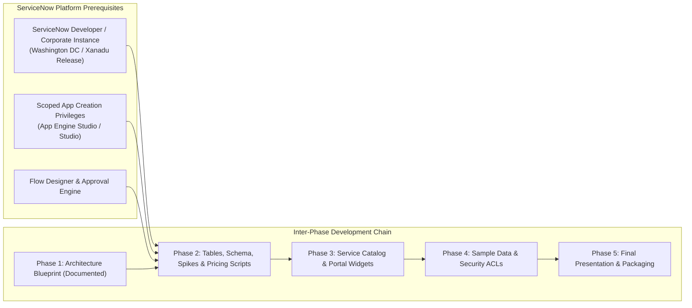

# Metro Ticket Generating System in ServiceNow
## Phase 1 Deliverable: Assumptions, Open Decisions & Dependency Register

| Document Metadata | Value |
| :--- | :--- |
| **Document ID** | MTTS-DOC-13 |
| **Project Name** | Metro Ticket Generating System in ServiceNow |
| **Current Phase** | Phase 1: Requirement Analysis & Project Planning |
| **Author / Role** | ServiceNow Lead Enterprise Architect |
| **Status** | Phase 1 Blueprint Complete (Pending Stakeholder Sign-Off) |

---

### 1. Register of Critical Decisions Requiring Validation

The table below catalogs 12 foundational architectural assumptions and open decisions. Each item documents the architectural impact, recommended default decision, prerequisite dependencies, and the target phase by which formal stakeholder sign-off is mandatory.

| Item ID | Architectural Decision Topic | Description & Operational Context | Architectural Impact | Recommended Decision / Provisional Approach | Prerequisite Dependency | Must Resolve By |
| :---: | :--- | :--- | :--- | :--- | :--- | :---: |
| **DEC-01** | **Application Scope Boundary** | Whether the application is built in a private scoped namespace or the Global scope. | Affects table prefixing, cross-scope access, and update set portability. | **Scoped Application (`x_mtts`)**. Adheres to modern ServiceNow best practices and eliminates global script namespace collisions. | ServiceNow App Engine Studio or Studio access | **Phase 2 (Start)** |
| **DEC-02** | **Technical Table Naming** | Exact schema prefix and database table naming conventions. | Governs database schema and future Script Include references. | Use namespace prefix for five business tables: `x_mtts_station`, `x_mtts_route`, `x_mtts_fare_rule`, `x_mtts_ticket_type`, `x_mtts_booking_ticket`, plus the proposed technical counter table `x_mtts_daily_sequence` if its Phase 2 feasibility test passes. | Confirmation of application scope (DEC-01) | **Phase 2 (Start)** |
| **DEC-03** | **Route Distance Source** | Authoritative source for inter-station journey distances (in km). | Inaccurate distances distort dynamic fare calculations. | Use an explicit source-destination route matrix. For demonstration, use clearly labelled synthetic distances unless an authorized, verified route-distance source is supplied. | Metro station list finalized | **Phase 2** |
| **DEC-04** | **Target QR Generation Mechanism** | Technical approach for generating scannable QR images in ServiceNow. | Risk of dependency failure on uninstalled plugins or restricted outbound web calls. | **QR Feasibility Gate:** Portal QR library integration and server-side QR artifact generation must be tested in the target instance. Secure random token issuance and verification against a server-side hash are mandatory; no unsupported signature or randomness API may be assumed. | Service Portal widget dependency loading & Phase 2 spike | **Phase 2** |
| **DEC-05** | **Approval Policy & Rejection Gap** | Mandatory station approval vs auto-approval thresholds, and handling of rejected requests. | Operational latency during peak hours; audit handling of declined bookings. | **Proposed 5th status `Rejected` (Pending Stakeholder Approval)**. Rejection comments mandatory if the status is approved. Do not implement automatic approval thresholds unless a separate requirement is expressly approved. Fallback: parent `sc_req_item` closes as Closed Incomplete and booking status uses the documented `Cancelled` fallback with administrative rejection notes. | Stakeholder sign-off on 5th status | **Phase 2** |
| **DEC-06** | **Cancellation Window & Refund Schedule** | Time cutoff for self-service cancellation and ledger refund deduction tiers. | Affects commuter self-service rights and financial reconciliation. | **Configurable Platform Properties**. Refund percentages, cancellation fees, cutoff windows, and rounding rules remain unset until the project owner approves a written cancellation/refund policy. Do not seed illustrative percentages as active defaults. | Approval of operational cancellation policy | **Phase 2** |
| **DEC-07** | **Pass Validity & Route Scope** | Geographic validity and duration restrictions for Pass tickets. | Dictates whether passes cover specific routes or all network zones. | Recommended option for review: a fixed-duration Pass with explicitly defined route/zone coverage. Do not assume a 24-hour duration, all-zone coverage, or home-station semantics until stakeholders approve the Pass policy; fixed fare bypasses distance-based pricing. | Ticket Type configuration | **Phase 2** |
| **DEC-08** | **Booking Limits (Passenger Count & Advance Window)** | Maximum passenger count per booking and maximum advance travel-date window. | Affects validation behavior in the catalog and server-side booking service. | Configure `x_mtts.max_passengers_per_booking` and `x_mtts.max_advance_booking_days`. Candidate values of 1–6 passengers and 30 advance days are for review only; no limit is active until the owner approves it. | Client and server validation configuration | **Phase 3** |
| **DEC-09** | **Currency & Rounding Convention** | Base operating currency code and mathematical rounding rule. | Rounding discrepancies across cashiers and digital ledgers. | The owner must approve one operating currency before fare rules are activated. Currency candidates are configuration options, not defaults. Half-up rounding to two decimal places is a proposed technical convention requiring sign-off. | System Property `x_mtts.default_currency` | **Phase 2** |
| **DEC-10** | **Notification Dispatch Channel** | Protocol for dispatching commuter confirmations and ticket attachments. | Production email delivery requires active SMTP server configuration. | Use native ServiceNow Email Engine (`sys_email`). In test/academic instances, route to platform mailbox (`sys_email.list`) for demonstration review. | Instance email sending enabled or mocked | **Phase 4** |
| **DEC-11** | **Demonstration vs. Live Transit Data** | Whether master tables utilize real municipal transit data or synthetic data. | Real GIS data requires external data ingestion; synthetic data is immediately self-contained. | **Structured Synthetic Demonstration Dataset** covering a 10-station transit network across two intersecting lines (Blue Line & Red Line). | Completion of Phase 2 schema | **Phase 4** |
| **DEC-12** | **Service Portal Hosting Architecture** | Whether to build a dedicated portal (`/metro`) or embed as a page in Employee Center (`/esc`). | Affects header navigation, CSS theming, and portal URL entry points. | Create a dedicated scoped portal **`/metro`** with customized transit branding, with responsive fallback to Employee Center taxonomy. | Service Portal Designer access | **Phase 3** |

---

### 2. External Technical & Environmental Dependencies

#### 2.1 Instance Prerequisites
- **Target ServiceNow Release:** Washington DC or Xanadu (Vancouver compatible).
- **Core Plugins Required:**
  - `com.glide.service-portal` (Service Portal core).
  - `com.glide.service_catalog` (Service Catalog platform engine).
  - `com.glide.hub.flow_engine` (Flow Designer runtime).
  - `com.glide.automated_test_framework` (ATF testing suite).
  - *No third-party paid store plugins required.*

#### 2.2 Environmental Constraints & Feasibility Spikes
- **QR and Secure-Token Feasibility Spike (Phase 2):** Validate a supported QR encoder and cryptographically secure random token source; prove server-side hash verification and cancellation rejection.
- **Ticket Number Dynamic Sequence Spike (Phase 2):** Validate the daily sequence table (`x_mtts_daily_sequence`) under concurrent first-use and allocation conditions. Do not assume a normal GlideRecord read-increment-write sequence is atomic.
- **Email Sandbox Constraint:** In instances with restricted outbound SMTP, outbound email notifications are verified directly via the system email queue (`sys_email.list`), satisfying academic and technical validation without live internet mail servers.
