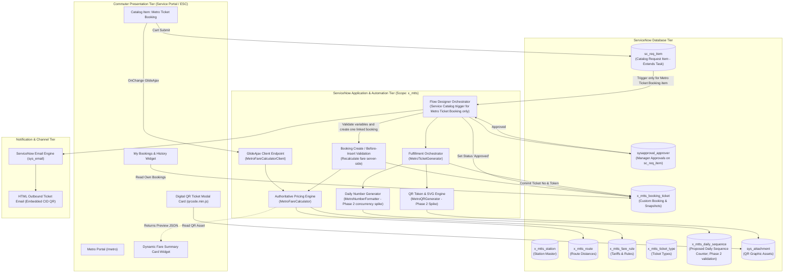
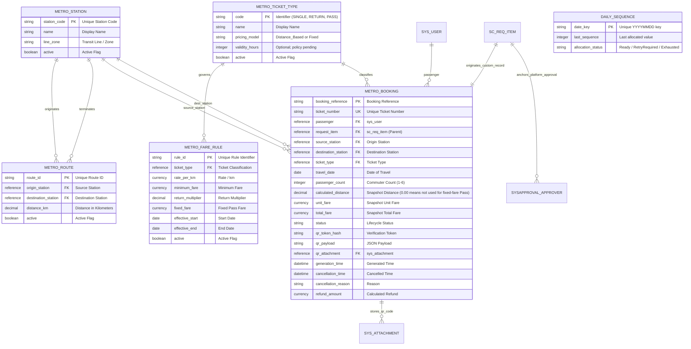
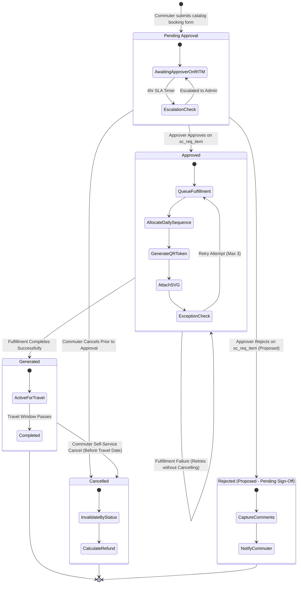

# Metro Ticket Generating System in ServiceNow
## Phase 1 Deliverable: Visual Architecture & Process Diagrams

| Document Metadata | Value |
| :--- | :--- |
| **Document ID** | MTTS-DOC-14 |
| **Project Name** | Metro Ticket Generating System in ServiceNow |
| **Current Phase** | Phase 1: Requirement Analysis & Project Planning |
| **Author / Role** | ServiceNow Principal Solution Architect & Visual Modeler |
| **Status** | Phase 1 Blueprint Complete (Pending Stakeholder Sign-Off) |

---

### 1. High-Level Multi-Tier System Architecture



---

### 2. Entity-Relationship Diagram (ERD)



---

### 3. End-to-End Booking Sequence Diagram

```mermaid
sequenceDiagram
    autonumber
    actor Commuter as Passenger (Browser)
    participant Portal as Service Portal / Catalog
    participant AJAX as GlideAjax (MetroFareCalculatorClient)
    participant Engine as Script Include (MetroFareCalculator)
    participant DB as ServiceNow Database
    participant Flow as Flow Designer Runtime
    actor Approver as Station Approver
    participant Fulfill as Fulfillment (MetroTicketGenerator)
    participant Notif as Notification Engine (sys_email)

    Commuter->>Portal: Selects Origin, Destination, Type, Date, Pax Count
    Portal->>AJAX: calculateFare(src, dst, type, date, pax)
    AJAX->>Engine: resolveRouteAndPricing(...)
    Engine->>DB: Query active route & fare rule
    DB-->>Engine: Returns distance_km & pricing rule
    Engine->>Engine: Computes Unit Fare & Total Fare
    Engine-->>AJAX: Returns JSON {distance, unitFare, totalFare}
    AJAX-->>Portal: Asynchronous callback
    Portal->>Commuter: Renders Dynamic Fare Summary Card

    Commuter->>Portal: Clicks "Submit Booking"
    Portal->>DB: Submits Metro Ticket Booking catalog item; sc_req_item is created
    DB-->>Portal: Confirms insert (BKG-YYYYMMDD-XXXX)
    Portal->>Commuter: Displays Confirmation Page with Booking Ref

    DB->>Flow: Starts catalog-specific flow for Metro Ticket Booking
    Flow->>DB: Validates variables and creates one linked booking (status=Pending)
    Flow->>Notif: Dispatches NOTIF-01 ("Booking Submitted")
    Notif-->>Commuter: Sends submission receipt email
    Flow->>DB: After booking exists, creates sysapproval_approver on sc_req_item
    Flow->>Notif: Dispatches NOTIF-02 ("Approval Required")
    Notif-->>Approver: Sends approval request email / portal notification

    Approver->>DB: Reviews & Approves task on sc_req_item
    DB->>Flow: Resumes Flow on sc_req_item approved
    Flow->>DB: Updates x_mtts_booking_ticket.status = 'Approved'
    Flow->>Fulfill: Executes generateTicket(booking_id)
    Fulfill->>DB: Requests next sequence from validated allocator (TKT-YYYYMMDD-XXXXXX; concurrency proof required)
    Fulfill->>Fulfill: Generates secure random verifier token; stores token hash and zero-PII QR artifact (Phase 2 spike)
    Fulfill->>DB: Saves QR SVG to sys_attachment
    Fulfill->>DB: Updates status='Generated', stores ticket_number, token hash & qr_attachment
    Flow->>Notif: Dispatches NOTIF-04 ("Digital Ticket Generated")
    Notif-->>Commuter: Outbound HTML email with embedded QR Ticket

    Commuter->>Portal: Navigates to "My Bookings"
    Portal->>DB: Retrieves commuter's active ticket
    Portal->>Commuter: Renders active scannable Digital Ticket Card
```

---

### 4. Lifecycle State Machine Diagram



---

### 5. Self-Service Cancellation & Token Revocation Flowchart

```mermaid
flowchart TD
    Start(["Commuter clicks 'Request Cancellation' in My Bookings"]) --> CheckAuth{"Is current user == record.passenger?"}
    
    CheckAuth -->|No (IDOR Attempt)| Deny403["Throw HTTP 403 Forbidden\nLog Security Audit Alert"]
    CheckAuth -->|Yes| CheckState{"Is status == 'Pending' or 'Generated'?"}
    
    CheckState -->|No (Already Cancelled/Closed)| ErrState["Alert: Booking cannot be cancelled in current state"]
    CheckState -->|Yes| CheckTime{"Is travel_date in the future?"}
    
    CheckTime -->|No (Past Date)| ErrPast["Alert: Cannot cancel ticket after scheduled travel date"]
    CheckTime -->|Yes| PromptReason["Prompt commuter for cancellation reason"]
    
    PromptReason --> ConfirmCancel["Commuter confirms cancellation dialog"]
    ConfirmCancel --> CalcRefund["Compute refund from configurable policy properties\n(x_mtts.cancellation_tier...)"]
    
    CalcRefund --> StatusCheck["Verifier checks authoritative booking status\nReject unless status == Generated; token hash unchanged"]
    StatusCheck --> UpdateDB["Update x_mtts_booking_ticket:\nstatus = 'Cancelled'\nrefund_amount = calculated_value"]
    
    UpdateDB --> DispatchNotif["Trigger Notification Engine: NOTIF-06\n(Cancellation & Refund Confirmation Email)"]
    DispatchNotif --> End(["Display cancellation confirmation banner in Portal"])
```
