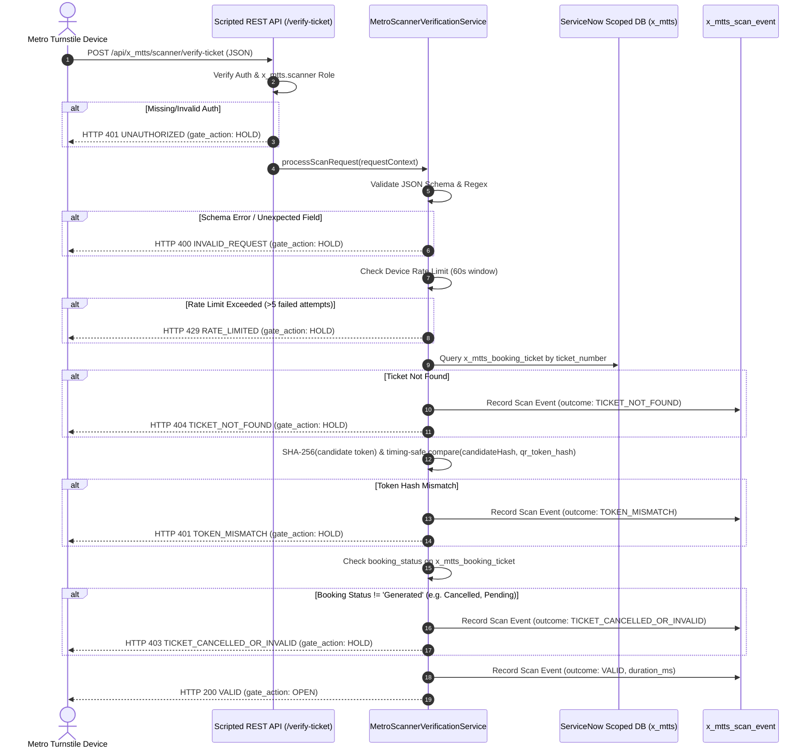

# Scripted REST API Specification: QR Ticket Verification
## Application Scope: `x_mtts` | Resource Path: `/api/x_mtts/scanner/verify-ticket`

---

### 1. API Overview

The **Metro Ticket Verification API** provides a secure, high-throughput, low-latency interface designed for physical metro station turnstiles and handheld optical inspection devices. Operating within the `x_mtts` scoped namespace, the endpoint authenticates scanning hardware, validates cryptographically unguessable bearer tokens, verifies passenger booking states, enforces rate limits, logs audit events, and returns deterministic gate actuation commands (`OPEN` vs. `HOLD`).

- **Namespace Scope:** `x_mtts`
- **Web Service Definition (sys_ws_definition):** `x_mtts_scanner_api.xml`
- **Resource Operation (sys_ws_operation):** `verify_ticket_resource.xml`
- **HTTP Method:** `POST`
- **Resource Path:** `/api/x_mtts/scanner/verify-ticket`
- **Consumes:** `application/json`
- **Produces:** `application/json`

---

### 2. Request Specification

#### 2.1 Request Headers

| Header | Type | Required | Description |
| :--- | :--- | :---: | :--- |
| `Content-Type` | String | **Yes** | Must be set to `application/json`. |
| `Authorization` | String | **Yes** | Standard HTTP Basic or Bearer token credentials for a user possessing `x_mtts.scanner`. |
| `X-Correlation-ID` | String | No | Client-supplied tracing identifier (UUID or device sequence ID). If omitted, generated automatically. |

#### 2.2 Request Payload Schema

```json
{
  "ticket_number": "TKT-20261025-000001",
  "token": "4a7b9c2d1e0f3a8b7c6d5e4f3a2b1c0d",
  "device_id": "TURNSTILE-GATE-04A",
  "station_code": "STN-01",
  "turnstile_id": "GATE-04A"
}
```

#### 2.3 Field Validation Constraints

| Field | Type | Mandatory | Validation Pattern / Rule | Description |
| :--- | :--- | :---: | :--- | :--- |
| `ticket_number` | String | **Yes** | `^TKT-[0-9]{8}-[0-9]{6}$` | Canonical 23-character ticket numbering sequence. |
| `token` | String | **Yes** | `^[0-9a-fA-F]{32}$` | 128-bit unguessable random hex bearer token extracted from optical QR code. |
| `device_id` | String | **Yes** | Max 64 chars, non-empty | Hardware identifier of the turnstile reader. |
| `station_code` | String | **Yes** | Max 32 chars, non-empty | Operational station code where the scan event occurs. |
| `turnstile_id` | String | No | Max 32 chars | Specific gate lane or turnstile mechanism identifier. |

*Note: Extra or unexpected JSON properties result in immediate `HTTP 400 INVALID_REQUEST` rejection to prevent payload tampering and prototype poisoning.*

---

### 3. Server Processing & Security Lifecycle



---

### 4. Response Specifications & Status Codes

#### 4.1 Success Response: HTTP 200 OK
Returned when the ticket is authentic, the bearer token matches the cryptographic hash, the booking is in `Generated` status, and the gate is instructed to open.

```json
{
  "status": "SUCCESS",
  "validation_outcome": "VALID",
  "gate_action": "OPEN",
  "ticket_number": "TKT-20261025-000001",
  "travel_date": "2026-10-25",
  "source_station": "Central Station",
  "destination_station": "Airport Terminal",
  "ticket_type": "Single Journey",
  "scanned_at": "2026-10-25 08:30:15",
  "correlation_id": "c1f7a8b4-92d3-4e89-b1a6-5f8a9e7d2c3b"
}
```

#### 4.2 Client Error: HTTP 400 Bad Request
Returned when the request structure fails schema validation, required fields are missing, field lengths or regex constraints are violated, or unexpected properties are present.

```json
{
  "status": "ERROR",
  "error_code": "INVALID_REQUEST",
  "message": "Field 'ticket_number' does not match the canonical format ^TKT-[0-9]{8}-[0-9]{6}$.",
  "gate_action": "HOLD",
  "correlation_id": "c1f7a8b4-92d3-4e89-b1a6-5f8a9e7d2c3b"
}
```

#### 4.3 Authentication Error: HTTP 401 Unauthorized / Token Mismatch

##### Case A: Missing or Invalid API Credentials
```json
{
  "status": "ERROR",
  "error_code": "UNAUTHORIZED",
  "message": "User credentials missing or user lacks x_mtts.scanner role.",
  "gate_action": "HOLD",
  "correlation_id": "c1f7a8b4-92d3-4e89-b1a6-5f8a9e7d2c3b"
}
```

##### Case B: Token Mismatch (Counterfeit / Tampered Barcode)
```json
{
  "status": "ERROR",
  "error_code": "TOKEN_MISMATCH",
  "message": "Scanned bearer token does not match server-side security records.",
  "gate_action": "HOLD",
  "correlation_id": "c1f7a8b4-92d3-4e89-b1a6-5f8a9e7d2c3b"
}
```

#### 4.4 Authorization / Lifecycle Error: HTTP 403 Forbidden
Returned when the ticket exists and the token matches, but the booking lifecycle status is not `Generated` (e.g. `Cancelled`, `Pending`, or `Approved` prior to generation).

```json
{
  "status": "ERROR",
  "error_code": "TICKET_CANCELLED_OR_INVALID",
  "message": "Ticket cannot be used for travel. Current booking status is 'Cancelled'.",
  "gate_action": "HOLD",
  "correlation_id": "c1f7a8b4-92d3-4e89-b1a6-5f8a9e7d2c3b"
}
```

#### 4.5 Resource Error: HTTP 404 Not Found
Returned when the specified `ticket_number` does not exist in `x_mtts_booking_ticket`.

```json
{
  "status": "ERROR",
  "error_code": "TICKET_NOT_FOUND",
  "message": "Ticket number 'TKT-20261025-999999' not recognized in ticketing database.",
  "gate_action": "HOLD",
  "correlation_id": "c1f7a8b4-92d3-4e89-b1a6-5f8a9e7d2c3b"
}
```

#### 4.6 Rate Limiting: HTTP 429 Too Many Requests
Returned when a scanning device or client IP exceeds the configured maximum failed attempts (default 5 failures within a 60-second sliding window).

```json
{
  "status": "ERROR",
  "error_code": "RATE_LIMITED",
  "message": "Maximum failed scan attempts exceeded for device 'TURNSTILE-GATE-04A'. Device temporarily throttled.",
  "gate_action": "HOLD",
  "retry_after_seconds": 60,
  "correlation_id": "c1f7a8b4-92d3-4e89-b1a6-5f8a9e7d2c3b"
}
```

---

### 5. Cryptographic & Data Protection Contract

1. **Dual-Environment Timing-Safe Digest Verification:**
   - **ServiceNow Target Runtime (Rhino / Nashorn):** Native `crypto.timingSafeEqual` is unavailable in scoped JavaScript. The verification engine computes candidate SHA-256 via `GlideDigest.getSHA256Hex(candidateToken)`. It validates that both candidate and stored hashes strictly conform to 64-character lowercase hexadecimal format (`/^[0-9a-fA-F]{64}$/`). If length or formatting fails, the service fails closed with `TOKEN_MISMATCH` without evaluating digests. Verification is performed using a constant 64-iteration XOR loop without early returns (`diff |= a.charCodeAt(i) ^ b.charCodeAt(i)`).
   - **ServiceNow VM Timing Note:** Purely constant-time JavaScript in an interpreted/JIT VM cannot guarantee zero CPU jitter due to garbage collection and JVM string optimizations; however, the fixed 64-iteration loop provides the strongest software-level timing protection feasible within the scoped runtime.
   - **Node.js Local Simulated Test Harness:** Uses native `crypto.timingSafeEqual(bufA, bufB)` on 32-byte buffers for local automated verification.

2. **Zero Hash & Token Dissemination:**
   Neither the raw 128-bit token nor the stored SHA-256 digest is returned in any API response payload, error message, or system log string.

3. **PII Isolation:**
   Passenger identity (`passenger_name`, `email`, `sys_user` references) is strictly excluded from turnstile verification responses. The turnstile hardware receives only operational travel attributes (stations, travel date, ticket type) required for passenger journey validation.
