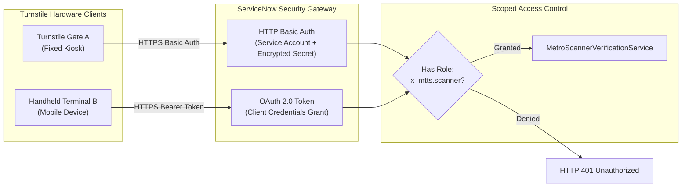

# Scanner Authentication and Security Architecture
## Application Scope: `x_mtts`

---

### 1. Security Overview

The **Metro Ticket Verification Service** bridges physical station turnstile readers with the ServiceNow scoped backend. Because turnstile endpoints operate at high volumes and face physical interaction from the public, they represent a critical security boundary. The authentication and security architecture enforces strict role separation, client identity verification, defense-in-depth authorization, brute-force mitigation, and total confidentiality of cryptographic tokens.

---

### 2. Authentication Mechanisms

The verification endpoint (`POST /api/x_mtts/scanner/verify-ticket`) requires explicit machine-to-machine authentication over TLS 1.3. Two authentication profiles are supported:



#### 2.1 OAuth 2.0 Client Credentials Grant (Production Recommendation)
- **Profile:** Machine-to-machine authentication via ServiceNow OAuth 2.0 Provider.
- **Client Configuration:**
  - `client_id`: Registered station turnstile application profile.
  - `client_secret`: 256-bit cryptographically secure key stored in physical hardware secure elements (TPM / HSM).
  - `scope`: `x_mtts.scanner`.
- **Token Characteristics:** Short-lived JWT bearer tokens (default lifetime: 1800 seconds) renewed via HTTPS refresh requests.

#### 2.2 HTTPS Basic Authentication (Development & Controlled Private WAN)
- **Profile:** Dedicated non-interactive technical service account (`svc_mtts_turnstile_scanner`).
- **User Record Restrictions:**
  - `web_service_only`: Set to `true` (prohibits interactive portal/workspace logins).
  - `locked_out`: Configured with automated directory lockouts.
  - Mandatory membership in the `Metro Turnstile Scanners` group.

---

### 3. Role Architecture & Principle of Least Privilege

To ensure that compromised turnstile hardware cannot pivot to other platform tables or access commuter data, the `x_mtts.scanner` role is isolated with minimal system permissions.

#### 3.1 Role Hierarchy & Isolation Matrix

| Capability / Entity | `x_mtts.passenger` | `x_mtts.approver` | `x_mtts.scanner` | `x_mtts.admin` |
| :--- | :---: | :---: | :---: | :---: |
| Execute `/verify-ticket` API | Denied | Denied | **Allowed** | **Allowed** |
| Query `x_mtts_booking_ticket` directly via REST | Own Records | Assigned Stations | **Denied** | All Records |
| Read Commuter PII (Name, Email) | Own Records | Assigned Stations | **Denied** | All Records |
| Create `x_mtts_scan_event` audit records | Denied | Denied | **Allowed** | **Allowed** |
| Read `x_mtts_scan_event` audit logs | Denied | Denied | **Denied (Admin Only)** | **Allowed** |
| Modify Financial Snapshots (`total_fare`) | Denied | Denied | **Denied** | Denied (Locked) |
| Read System Properties (`sys_properties`) | Denied | Denied | **Denied** | **Allowed** |

#### 3.2 Server-Side Encapsulation
The scanner technical user is **not** granted table-level read or write permissions to `x_mtts_booking_ticket`. Instead, database queries are strictly mediated by the server-side Script Include `MetroScannerVerificationService` executing with scoped script authority. This prevents SQL injection, arbitrary filtering, or bulk record extraction from the turnstile network.

---

### 4. Rate Limiting and Brute-Force Defense

To protect the verification API from brute-force dictionary attacks attempting to guess 128-bit bearer tokens, the system implements an in-memory sliding-window rate limiter within `MetroScannerVerificationService`.

```
Rate Limit Configuration:
• Property 'x_mtts.scanner.rate_limit_window_sec' : 60 seconds
• Property 'x_mtts.scanner.max_failed_attempts'    : 5 failures
```

#### 4.1 Throttling Workflow
1. The service tracks failed validation outcomes (`TOKEN_MISMATCH`, `TICKET_NOT_FOUND`, `INVALID_REQUEST`) keyed by client IP and `device_id`.
2. Successful validations (`VALID`) do not increment the failure counter and proceed without delay.
3. When failed attempts for a specific `device_id` exceed 5 within 60 seconds:
   - The device identifier is marked as throttled.
   - Incoming requests immediately return `HTTP 429 RATE_LIMITED` with `gate_action: "HOLD"`.
   - The incident is logged to `x_mtts_scan_event` with outcome `RATE_LIMITED`.
   - The lock expires automatically after the 60-second sliding window elapses without further failed attempts.

---

### 5. Side-Channel Mitigation & Zero-Leakage Contract

#### 5.1 Constant-Time Hash Comparison
Standard string equality operations (`strA === strB`) evaluate character-by-character and terminate upon the first mismatch, leaking information about the token digest through sub-millisecond network timing differences. The verification engine mitigates this via strict format pre-checks and constant-time evaluation:

```javascript
// Strict 64-character hexadecimal format check (fail-closed if malformed)
var hex64Regex = /^[0-9a-fA-F]{64}$/;
if (!hex64Regex.test(candidateHash) || !hex64Regex.test(expectedHash)) {
    return false; // Fail closed without evaluation
}

// 1. Node.js Local Simulated Test Environment
if (typeof crypto !== 'undefined' && crypto.timingSafeEqual) {
    var bufCandidate = Buffer.from(candidateHash, 'hex');
    var bufExpected = Buffer.from(expectedHash, 'hex');
    if (bufCandidate.length === 32 && bufExpected.length === 32) {
        return crypto.timingSafeEqual(bufCandidate, bufExpected);
    }
    return false;
}

// 2. ServiceNow Scoped Runtime (Rhino / Nashorn)
// Guaranteed fixed-length 64-iteration XOR loop without early exit
var diff = 0;
for (var i = 0; i < 64; i++) {
    diff |= candidateHash.charCodeAt(i) ^ expectedHash.charCodeAt(i);
}
return (diff === 0);
```

##### ServiceNow VM Timing Considerations
Pure constant-time execution cannot be strictly guaranteed at the microarchitectural CPU level in an interpreted or JIT-compiled virtual machine environment (Rhino/Nashorn/JVM) due to internal optimizations, garbage collection pauses, and variable string allocations. However, by enforcing strict 64-character length pre-validation and executing an invariant 64-iteration XOR comparison without conditional branches or early loop termination, `MetroScannerVerificationService` delivers the strongest software-level timing protection feasible within the scoped ServiceNow platform.

#### 5.2 Zero-Leakage Information Architecture
- **No Token Hash Disclosure:** The server never includes the SHA-256 digest (`qr_token_hash`) in any API response or error string.
- **No Raw Token Disclosure:** The 128-bit bearer token is never logged in ServiceNow system logs (`gs.log`/`gs.info`) or saved in the `x_mtts_scan_event` audit table.
- **Sanitized Error Messages:** Rejection messages indicate high-level validation states (e.g., "Scanned bearer token does not match server-side security records") without providing offset hints or platform error traces.
