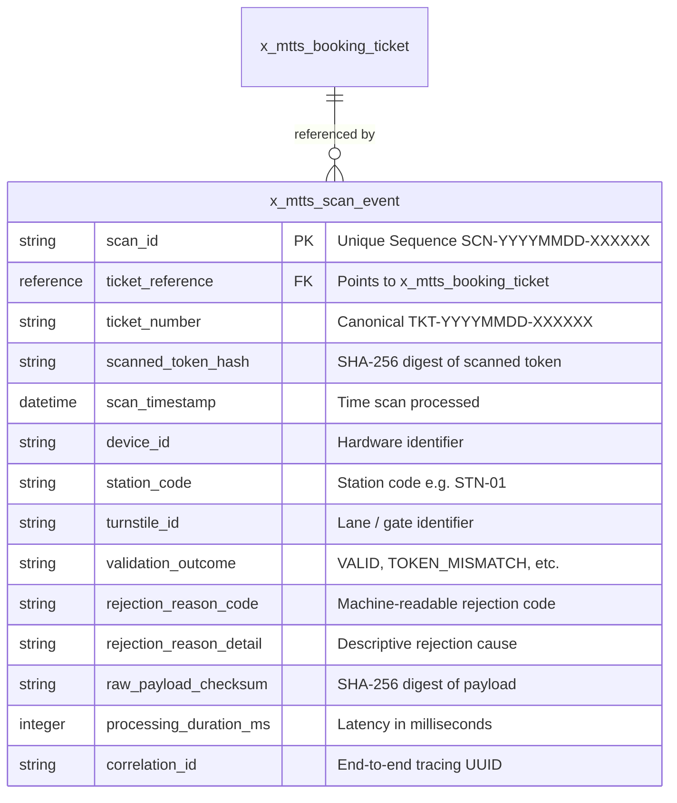

# Turnstile Verification Audit Logging Specification
## Table Name: `x_mtts_scan_event` | Scope: `x_mtts`

---

### 1. Architectural Purpose and Governance

To satisfy transit regulatory compliance, forensic fraud detection, station crowd analysis, and operational troubleshooting, all turnstile scan attempts must be durably recorded. The `x_mtts_scan_event` table serves as an immutable, high-throughput audit journal capturing verification outcomes, timing, and device telemetry.

#### Governance & Backlog Alignment
- **Backlog Mapping:** Governed under Subtask **`SUB-12`** ("Build API rate limiting and token validation services") and Story **`ST-602`** ("Implement Audit Logging and Security Controls").
- **Baseline Invariant Preservation:** The addition of `x_mtts_scan_event` as an operational technical table preserves the established project baseline of **5 phases, 6 epics, 26 stories/tasks, and 12 subtasks**, requiring no story renumbering or scope expansion.

---

### 2. Table Schema Definition

The physical table definition is declared in `sn_source/schema/x_mtts_scan_event.xml`.



#### 2.1 Detailed Column Definitions

| Column Name | Data Type | Length | Mandatory | Index | Description |
| :--- | :--- | :---: | :---: | :---: | :--- |
| `scan_id` | String | 32 | **Yes** | **Unique** | Canonical scan sequence identifier (`SCN-YYYYMMDD-NNNNNN`). |
| `ticket_reference` | Reference | 32 | No | Yes | Foreign key reference to `x_mtts_booking_ticket`. Null if ticket unknown. |
| `ticket_number` | String | 32 | No | Yes | Scanned ticket sequence string. |
| `scanned_token_hash` | String | 64 | No | Yes | SHA-256 hex digest of the presented token. *Never stores raw token.* |
| `scan_timestamp` | GlideDateTime | - | **Yes** | Yes | UTC timestamp recorded at server ingest. |
| `device_id` | String | 64 | **Yes** | Yes | Scanning hardware identifier (e.g. `TURNSTILE-GATE-04A`). |
| `station_code` | String | 32 | **Yes** | Yes | Metro station operational code (e.g. `STN-01`). |
| `turnstile_id` | String | 32 | No | No | Specific gate turnstile lane or mechanism. |
| `validation_outcome` | Choice | 32 | **Yes** | Yes | Enum outcome: `VALID`, `TOKEN_MISMATCH`, `TICKET_CANCELLED_OR_INVALID`, `TICKET_NOT_FOUND`, `INVALID_REQUEST`, `RATE_LIMITED`, `UNAUTHORIZED`, `SERVER_ERROR`. |
| `rejection_reason_code` | String | 64 | No | No | Diagnostic code for rejected gate attempts. |
| `rejection_reason_detail` | String | 255 | No | No | Human-readable explanation of rejection. |
| `raw_payload_checksum` | String | 64 | **Yes** | No | SHA-256 hash of the raw incoming JSON payload for non-repudiation. |
| `processing_duration_ms`| Integer | - | **Yes** | No | Internal execution duration from request receipt to response emission. |
| `correlation_id` | String | 64 | **Yes** | Yes | Tracing identifier linking API logs to audit records. |

---

### 3. Access Control (ACL) Enforcement

To protect passenger transit history and prevent turnstile tampering, strict access boundaries are enforced via `sn_source/security/acl_definitions.json`:

```
Access Control Rule Summary:
• CREATE : Granted to 'x_mtts.scanner' and 'x_mtts.admin'.
• READ   : Restricted exclusively to 'x_mtts.admin'.
• WRITE  : Restricted to 'x_mtts.admin' (records are immutable audit events).
• DELETE : Restricted to 'x_mtts.admin' (manual deletion prohibited; purged by scheduled job).
```

- **Passenger Isolation:** Passengers have zero visibility into `x_mtts_scan_event`.
- **Approver Isolation:** Station approvers cannot view scan events, preventing surveillance of passenger movements.
- **Scanner Isolation:** Scanner accounts can write (create) scan events via the API service layer but cannot read historical records.

---

### 4. Zero-Leakage & Privacy Compliance

1. **Zero Raw Token Storage:**
   The `x_mtts_scan_event` record stores only the SHA-256 digest (`scanned_token_hash`) of the presented token. If an attacker gains read access to the audit table, they cannot reconstruct the original 128-bit bearer tokens or forge valid tickets.

2. **Absence of Commuter PII:**
   The table explicitly excludes commuter identity columns (`user_sys_id`, `commuter_name`, `email`). Journey analysis correlates only to ticket sequence numbers and station nodes.

---

### 5. Data Retention & Archival Strategy

Because high-frequency metro turnstiles can produce tens of thousands of scan records daily, data volume management is essential. However, to prevent premature or unauthorized deletion of compliance records, strict governance controls are enforced:

#### 5.1 Retention Policy Governance Baseline
- **Default Status:** `x_mtts.audit.retention_policy_status = UNCONFIGURED`
- **Default Retention Window:** `x_mtts.audit.retention_days = 0`
- **Candidate Policy:** A 90-calendar-day rolling retention window has been designed and implemented as an **unapproved candidate policy**. It remains strictly dormant until formal sign-off from transit legal, compliance, and operational stakeholders.

#### 5.2 Implementation Engine (`MetroAuditRetentionService.js`)
Purging of audit logs is mediated exclusively through `MetroAuditRetentionService`:
- **Role Enforcement:** Execution requires the `x_mtts.admin` role. Commuters, approvers, and turnstile scanners are rejected with an authorization failure.
- **Policy Enforcement:** If `x_mtts.audit.retention_policy_status !== 'ACTIVE'` or retention days are `<= 0`, the service safely aborts with `POLICY_NOT_ACTIVE` and performs zero deletions.
- **Dry-Run Mode:** Supports `dryRun: true` allowing administrators to inspect counts and date cutoffs without modifying the database.
- **Administrative Audit Logging:** Every execution (simulation or commit) creates an audit event documenting the executing user, parameters, cutoff date, and deletion counts.

```javascript
// Example programmatic usage (Admin only)
var retentionService = new MetroAuditRetentionService();
var preview = retentionService.executeRetentionCleanup({ dryRun: true });
// If policy is active and approved:
// var result = retentionService.executeRetentionCleanup({ dryRun: false });
```

#### 5.3 Compliance Archival
For transit authorities requiring multi-year regulatory retention (e.g. 5–7 years for financial and fraud forensics), records scheduled for cleanup will be exported to long-term cold cloud storage (GCS/S3) via ServiceNow Data Archiving before any destructive purge is triggered.
