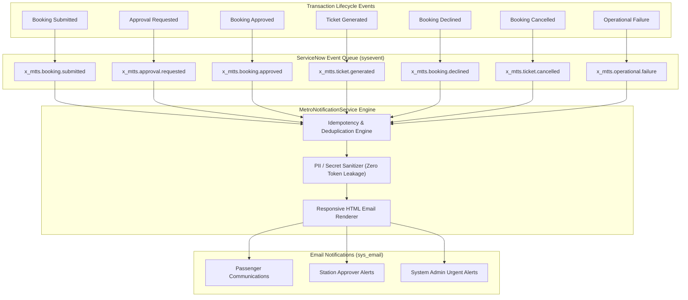

# Notification Events and Email Templates Specification
## Application Scope: `x_mtts`

---

### 1. Notification Architecture Overview

The **Metro Ticket Generating System** employs an asynchronous, event-driven notification architecture built upon the native ServiceNow Event Registry (`sysevent_register`) and Email Actions (`sysevent_email_action`). Managed via `MetroNotificationService`, notifications communicate critical transaction states to passengers, station approvers, and transit administrators without blocking synchronous user transactions.



---

### 2. Event Registry Declarations (`sysevent_register.json`)

Seven formal events are registered within the `x_mtts` scope:

| Event Name | Fired When | Table | Param 1 (`parm1`) | Param 2 (`parm2`) | Target Audience |
| :--- | :--- | :--- | :--- | :--- | :--- |
| `x_mtts.booking.submitted` | Commuter submits booking | `x_mtts_booking_ticket` | `booking_reference` | `passenger_email` | Passenger |
| `x_mtts.approval.requested` | Booking enters Pending status | `x_mtts_booking_ticket` | `booking_reference` | `source_station` | Metro Station Approvers |
| `x_mtts.booking.approved` | Approver approves booking | `x_mtts_booking_ticket` | `booking_reference` | `passenger_email` | Passenger |
| `x_mtts.ticket.generated` | QR ticket generated | `x_mtts_booking_ticket` | `ticket_number` | `passenger_email` | Passenger |
| `x_mtts.booking.declined` | Booking approval rejected | `x_mtts_booking_ticket` | `booking_reference` | `passenger_email` | Passenger |
| `x_mtts.ticket.cancelled` | Booking cancelled | `x_mtts_booking_ticket` | `booking_reference` | `passenger_email` | Passenger |
| `x_mtts.operational.failure` | Processing or gen failure | `x_mtts_booking_ticket` | `booking_reference` | Error Reason | System Administrators |

---

### 3. Email Notification Actions (`sysevent_email_action.json`)

#### 3.1 `MTTS - Booking Submission Received`
- **Trigger Event:** `x_mtts.booking.submitted`
- **Recipient:** Commuter (`parm2` or `passenger_email`)
- **Subject:** `Metro Booking Confirmation - ${booking_reference}`
- **Key Content:** Confirms receipt of booking request, route details, and total fare. *Explicitly omits ticket number since fulfillment has not yet occurred.*

#### 3.2 `MTTS - Approval Requested`
- **Trigger Event:** `x_mtts.approval.requested`
- **Recipient:** Group: `Metro Station Approvers`
- **Subject:** `Action Required: Metro Booking Approval Pending - ${booking_reference}`
- **Key Content:** Route, travel date, passenger count, total fare, and direct workspace link to approve or reject the request.

#### 3.3 `MTTS - Booking Approved`
- **Trigger Event:** `x_mtts.booking.approved`
- **Recipient:** Commuter (`passenger_email`)
- **Subject:** `Metro Booking Approved - ${booking_reference}`
- **Key Content:** Advises passenger of approval and informs them that automated ticket generation and QR issuance is currently running.

#### 3.4 `MTTS - Ticket Ready for Travel`
- **Trigger Event:** `x_mtts.ticket.generated`
- **Recipient:** Commuter (`passenger_email`)
- **Subject:** `Your Metro Travel Ticket is Ready - ${ticket_number}`
- **Key Content:** Complete travel details, departure station, destination station, validity period, inline booking summary, direct link to Service Portal ticket view, and embedded SVG QR ticket attachment.

#### 3.5 `MTTS - Booking Declined`
- **Trigger Event:** `x_mtts.booking.declined`
- **Recipient:** Commuter (`passenger_email`)
- **Subject:** `Notice Regarding Your Metro Booking - ${booking_reference}`
- **Key Content:** Notifies the commuter that the booking could not be approved due to operational station limits, with refund guidance and instructions to rebook.

#### 3.6 `MTTS - Ticket Cancellation Confirmed`
- **Trigger Event:** `x_mtts.ticket.cancelled`
- **Recipient:** Commuter (`passenger_email`)
- **Subject:** `Metro Ticket Cancellation Confirmed - ${booking_reference}`
- **Key Content:** Confirms ticket revocation, reminds passenger that the QR code will be rejected at turnstiles, and provides applicable refund details according to the active policy.

#### 3.7 `MTTS - Operational Failure Alert`
- **Trigger Event:** `x_mtts.operational.failure`
- **Recipient:** Group: `Metro Operations Administrators`
- **Subject:** `CRITICAL: Metro Ticket Generation Failed - ${booking_reference}`
- **Key Content:** System diagnostic details, error code, failure timestamp, and direct link to the affected booking record for manual intervention.

---

### 4. Notification Mail Scripts (`notification_mail_scripts.json`)

#### 4.1 `mtts_ticket_qr_embed`
Renders the visual ticket element into outgoing emails. Because some email clients restrict inline SVG scripts, this mail script attaches the vector SVG ticket as an email attachment (`sys_attachment`) while rendering a robust fallback link button to the mobile Service Portal ticket page:

```javascript
(function runMailScript(current, template, email, email_action, event) {
    var ticketNumber = event.parm1.toString();
    var portalUrl = gs.getProperty('glide.servlet.uri') + 'mtts?id=mtts_ticket_view&ticket=' + ticketNumber;
    
    template.print('<div style="margin: 20px 0; text-align: center;">');
    template.print('  <div style="font-size: 16px; font-weight: bold; color: #1e3a8a; margin-bottom: 8px;">Ticket Number: ' + ticketNumber + '</div>');
    template.print('  <p style="color: #4b5563; font-size: 14px;">Present your QR code at turnstile optical scanners or click below to view on mobile:</p>');
    template.print('  <a href="' + portalUrl + '" style="background-color: #2563eb; color: #ffffff; padding: 12px 24px; text-decoration: none; border-radius: 6px; font-weight: bold; display: inline-block;">View Live Ticket & QR Code</a>');
    template.print('</div>');
})(current, template, email, email_action, event);
```

#### 4.2 `mtts_booking_summary_table`
Generates a responsive HTML summary table detailing travel metadata and locked financial snapshots:

```html
<table style="width: 100%; border-collapse: collapse; margin-top: 15px; font-family: sans-serif;">
  <tr style="background-color: #f3f4f6;">
    <th style="padding: 10px; border: 1px solid #e5e7eb; text-align: left;">Booking Reference</th>
    <td style="padding: 10px; border: 1px solid #e5e7eb;">${booking_reference}</td>
  </tr>
  <tr>
    <th style="padding: 10px; border: 1px solid #e5e7eb; text-align: left;">Route</th>
    <td style="padding: 10px; border: 1px solid #e5e7eb;">${source_station} &rarr; ${destination_station}</td>
  </tr>
  <tr style="background-color: #f3f4f6;">
    <th style="padding: 10px; border: 1px solid #e5e7eb; text-align: left;">Travel Date</th>
    <td style="padding: 10px; border: 1px solid #e5e7eb;">${travel_date}</td>
  </tr>
  <tr>
    <th style="padding: 10px; border: 1px solid #e5e7eb; text-align: left;">Total Fare</th>
    <td style="padding: 10px; border: 1px solid #e5e7eb; font-weight: bold; color: #047857;">&#8377; ${total_fare}</td>
  </tr>
</table>
```

---

### 5. Idempotency & Master Switch Controls

1. **Duplicate Suppression:**
   In high-concurrency environments or upon transaction retries, duplicate events could cause repetitive emails. `MetroNotificationService` enforces an in-memory and transaction-keyed deduplication cache (`processed_events`). If an identical event for the same booking reference is queued within 30 seconds, the secondary dispatch is suppressed and logged.

2. **Master Kill Switch Baseline:**
   System property `x_mtts.notifications.enabled` (boolean, default: `false`) provides an emergency operational control to disable all outgoing transit emails. In local development and unconfigured environments, outbound notifications are disabled by default to avoid unintended transmissions.
   - **Verification Qualification:**
     - Event registration, payload formatting, mail script assembly, and dual-delivery links are **Passed in local simulated test**.
     - Live end-to-end SMTP mail transmission to passenger mailboxes is **Blocked — requires target instance**.
