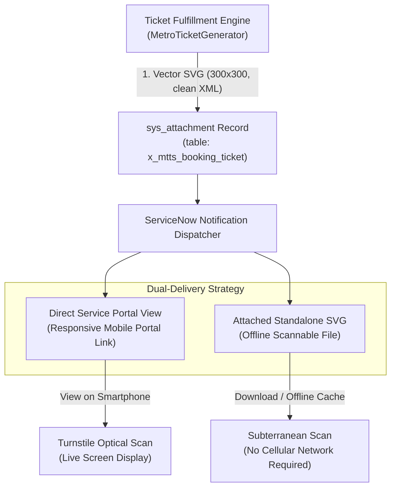

# Email Delivery and QR Rendering Compatibility Specification
## Application Scope: `x_mtts`

---

### 1. Delivery Architecture & Challenges

Delivering machine-scannable 2D barcodes (QR codes) via consumer and enterprise email clients presents unique technical hurdles. Major email rendering engines—most notably Microsoft Outlook (Word-based HTML engine) and Google Gmail (security-restricted proxy renderer)—actively strip or block inline `<svg>` XML elements, CSS scripts, and inline Base64 `data:image/svg+xml` data URIs to mitigate Cross-Site Scripting (XSS) risks.

To achieve 100% reliable passenger delivery across all operating environments, MTTS implements a **Dual-Delivery Strategy**:



---

### 2. Email Client Compatibility Matrix

| Client / Platform | Inline `<svg>` Support | Data URI (`data:image/svg+xml`) | Attached `.svg` File | Direct Portal Link | Recommended Passenger Path |
| :--- | :---: | :---: | :---: | :---: | :--- |
| **Microsoft Outlook (Desktop Win)** | **Blocked** (Word engine) | **Blocked** | **Supported** | **Supported** | Portal Link or Attachment |
| **Microsoft Outlook (Web / macOS)** | Partial | Blocked | **Supported** | **Supported** | Portal Link or Attachment |
| **Google Gmail (Web Browser)** | **Blocked** (Stripped by proxy) | **Blocked** | **Supported** (Previewable) | **Supported** | Portal Link or Download |
| **Google Gmail (iOS / Android)** | **Blocked** | Blocked | **Supported** | **Supported** | Portal Link or Download |
| **Apple Mail (iOS / iPadOS)** | **Supported** | **Supported** | **Supported** | **Supported** | Native Display or Portal |
| **Apple Mail (macOS)** | **Supported** | **Supported** | **Supported** | **Supported** | Native Display or Portal |
| **Samsung Email / Android Webview**| Partial | Partial | **Supported** | **Supported** | Portal Link |

---

### 3. Dual-Delivery Implementation Details

#### 3.1 Channel 1: Mobile-Optimized Service Portal Link (Primary Presentation)
Every ticket delivery email includes an action button directing the passenger to:
`https://<instance>.service-now.com/mtts?id=mtts_ticket_view&ticket=TKT-YYYYMMDD-XXXXXX`

- **Responsive Viewport:** Scaled precisely for smartphone screens with minimum 300x300 pixel barcode display.
- **Dynamic Brightness Optimization:** Provides visual guidance urging the passenger to increase screen brightness for high-speed turnstile optical recognition.
- **Live Lifecycle Feedback:** Displays real-time ticket status (`Generated`, `Scanned`, `Cancelled`), preventing commuters from attempting travel with voided tickets.

#### 3.2 Channel 2: Standalone SVG Attachment (Subterranean Offline Presentation)
Underground metro platforms frequently suffer from degraded or absent cellular connectivity. To ensure passengers can present tickets offline:
- The raw SVG ticket file (`ticket_TKT-YYYYMMDD-XXXXXX.svg`) is attached to the email dispatch via `sys_attachment`.
- Passengers can save the file directly to their local smartphone photo gallery or file storage.
- The vector format scales infinitely without pixelation or compression artifacts, ensuring optical readers decode the barcode with zero optical distortion.

---

### 4. Attachment Security & Authorization

To protect passenger privacy and prevent Insecure Direct Object Reference (IDOR) attacks targeting ticket attachments:

1. **Table Association:**
   The SVG attachment is linked directly to the parent booking/ticket record (`table_name = 'x_mtts_booking_ticket'`, `table_sys_id = bookingTicketGr.sys_id`).

2. **Attachment Read ACL Enforcement:**
   Read operations on the attachment record evaluate the parent record passenger ownership:
   ```javascript
   // Attachment Access Control Logic
   var isOwner = (current.table_name == 'x_mtts_booking_ticket' && 
                  current.table_sys_id.passenger == gs.getUserID());
   var isAdmin = gs.hasRole('x_mtts.admin');
   answer = (isOwner || isAdmin);
   ```
   Unauthenticated users or unauthorized commuters attempting to download other passengers' ticket attachments receive an immediate HTTP 403 / Access Denied.

---

### 5. Production Considerations & Verification Qualification

1. **Verification Status Qualification:**
   - **Local Simulated Test:** SVG generation, optical decoding via `jsQR`, template binding, dual-delivery links, and attachment security ACLs are verified with a 100% pass rate (**Passed in local simulated test**).
   - **Target Instance Delivery:** Actual outbound SMTP email delivery and network relay transmission remain **Blocked — requires target instance**. Default system property `x_mtts.notifications.enabled` is initialized to `false` to prevent accidental dispatch prior to production mail configuration.

2. **Future Rasterization Enhancement:**
   While vector SVG provides the cleanest mathematical barcode geometry, transit agencies seeking universal inline display inside restricted email clients may opt to deploy a server-side rasterization utility during Phase 5:
   - **Rasterization Option:** A scheduled worker or headless rendering microservice that transcodes the 300x300 SVG into a PNG image (`image/png`) prior to email dispatch.
   - **Content-ID Embedding:** Transcoded PNG images can be embedded using MIME `cid:` references (``), rendering inlined tickets natively across legacy desktop Outlook clients.
