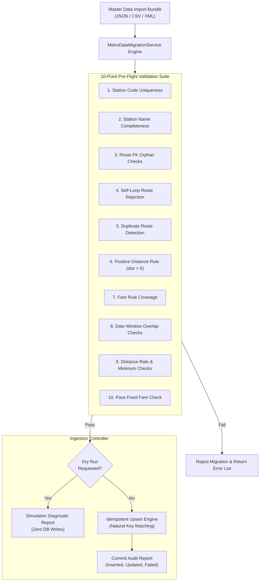

# Master Data Migration and Validation Specification
## Engine: `MetroDataMigrationService` | Application Scope: `x_mtts`

---

### 1. Migration Architecture and Governance

Master data—comprising metro stations (`x_mtts_station`), active transit routes (`x_mtts_route`), and fare tariff matrices (`x_mtts_fare_rule`)—forms the foundation of all downstream distance calculations, fare previews, and ticketing operations. Flawed or corrupted master data (e.g., self-looping routes, negative distances, overlapping fare schedules, or orphaned station references) can cause systemic financial discrepancies or system failures.

The `MetroDataMigrationService` engine provides automated pre-flight integrity verification, dry-run simulation, and idempotent upsert ingestion to ensure pristine master data quality before records are committed to ServiceNow tables.



---

### 2. The 10-Point Pre-Flight Validation Rules

| Rule # | Validation Check | Target Table | Validation Logic / Failure Condition |
| :---: | :--- | :--- | :--- |
| **1** | **Station Code Uniqueness** | `x_mtts_station` | Duplicate station codes detected in import batch or against existing database rows. |
| **2** | **Station Mandatory Fields** | `x_mtts_station` | Station name or station code is empty, null, or whitespace-only. |
| **3** | **Foreign Key Integrity** | `x_mtts_route` | Route origin or destination station code does not exist in station catalog. |
| **4** | **Self-Loop Rejection** | `x_mtts_route` | Origin station code matches destination station code (`source == destination`). |
| **5** | **Route Pair Uniqueness** | `x_mtts_route` | Multiple route records defined for the identical origin-destination pair. |
| **6** | **Strictly Positive Distance** | `x_mtts_route` | Route distance is zero, negative, or non-numeric (`distance_km <= 0`). |
| **7** | **Fare Rule Coverage** | `x_mtts_fare_rule` | An active route or ticket type lacks an applicable pricing schedule. |
| **8** | **Date Window Overlap** | `x_mtts_fare_rule` | Overlapping validity date ranges (`valid_from` to `valid_to`) for the same ticket type. |
| **9** | **Distance Rate & Minimum** | `x_mtts_fare_rule` | Distance-based rules (Single/Return) with `rate_per_km <= 0` or negative base fare. |
| **10** | **Pass Fixed Fare Check** | `x_mtts_fare_rule` | Pass rules (Daily/Weekly/Monthly) with `fixed_fare <= 0` or null. |
| **11** | **ISO-4217 Currency Format** | `x_mtts_fare_rule` | Currency code must be an approved 3-character uppercase alpha string (e.g., `INR`, `USD`). |

---

### 3. Dry-Run, Error Isolation & Reconciliation Reporting

#### 3.1 Two-Phase Execution (Dry-Run vs. Commit)
The migration service supports a boolean `dryRun` execution flag:
- `dryRun: true`: All 11 pre-flight checks are evaluated against the dataset. If validation fails, execution aborts immediately with zero database writes. If valid, the engine computes proposed changes and returns a simulation report.
- `dryRun: false`: Commits validated changes into the database within an isolated transaction.

#### 3.2 Row-Level Error Isolation (Partial-Failure Containment)
To prevent one corrupt row from corrupting the entire migration batch while maintaining strict accountability:
- Validation errors are isolated to a granular `rowErrors` collection identifying the exact table, record identifier, and rule violation.
- Non-corrupt entities proceed through upsert logic while failing rows are systematically flagged for remediation.

#### 3.3 Post-Import Reconciliation Reporting
Upon execution, `MetroDataMigrationService.generateReconciliationReport()` produces an audit report detailing:
- Total entities processed, inserted, updated, and skipped.
- Granular row error list and execution elapsed time.
- SHA-256 fingerprint of the ingested dataset for immutable non-repudiation.

#### 3.4 Natural Key Reconciliation (Idempotence)
To prevent duplicate records when re-running migrations, the engine matches incoming data using defined natural business keys:

| Table | Natural Key Fields | Resolution Strategy |
| :--- | :--- | :--- |
| `x_mtts_station` | `station_code` | If found: update name/active state; if missing: insert new. |
| `x_mtts_route` | `source_station` + `destination_station` | If found: update distance/duration; if missing: insert new. |
| `x_mtts_fare_rule` | `ticket_type` + `valid_from` | If found: update pricing rates; if missing: insert new. |

```javascript
// Idempotent upsert example for station catalog
var grStation = new GlideRecord('x_mtts_station');
grStation.addQuery('station_code', item.station_code);
grStation.query();
if (grStation.next()) {
    grStation.station_name = item.station_name;
    grStation.active = item.active !== false;
    grStation.update();
    stats.updated++;
} else {
    grStation.initialize();
    grStation.station_code = item.station_code;
    grStation.station_name = item.station_name;
    grStation.active = item.active !== false;
    grStation.insert();
    stats.inserted++;
}
```

---

### 4. Synthetic Test Data vs. Production Data Labeling

To prevent accidental mixing of simulated test records with official transit authority schedules, strict segregation controls are enforced:

1. **Synthetic Data Tagging:**
   All test stations, routes, and fare fixtures are explicitly labeled with `[SYNTHETIC_TEST_DATA]` in descriptions or prefixed with `MIG-` / `TEST-` codes.
2. **Production Mode Protection:**
   When running with `isProduction: true`, `MetroDataMigrationService` enforces a strict safety check: any dataset containing `[SYNTHETIC_TEST_DATA]` markers or `TEST-`/`MIG-` identifiers is immediately rejected before database processing begins.
3. **Production Seeding Procedure:**
   Official deployment requires an authorized transit operator data export validated through `MetroDataMigrationService.validateMasterData()` prior to production promotion.
