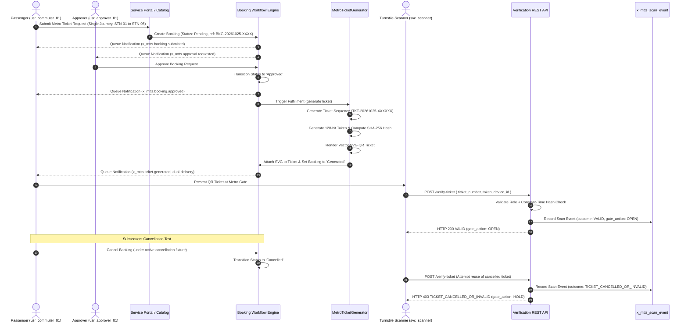

# Integration Test Plan and Traceability Matrix
## Phase 4 Integration & Security Testing | Application Scope: `x_mtts`

---

### 1. Test Strategy & Objectives

The Phase 4 Integration Test Plan establishes a rigorous verification framework to validate interactions across disparate subsystems:
1. Turnstile machine-to-machine REST verification interfaces.
2. High-throughput security audit logging.
3. Event-driven asynchronous notification processing.
4. Master data validation and ingestion integrity.
5. Cross-role security boundaries and Insecure Direct Object Reference (IDOR) protections.
6. The full end-to-end booking, approval, fulfillment, scanning, and revocation lifecycle.

---

### 2. Requirements & Acceptance Criteria Traceability Matrix

| Requirement / Test Case | Focus Area | Applicable Test Suite | Verification Method | Local Status | Production Deployment Status |
| :--- | :--- | :--- | :--- | :---: | :---: |
| **TC-024** | Turnstile Verification REST Endpoint | Suite 7 (`test_scanner_api.js`) | Automated HTTP simulation (`POST /verify-ticket`) | **PASS** | Blocked — requires target instance |
| **TC-025** | Timing-Safe Bearer Token Comparison | Suite 7 (`test_scanner_api.js`) | 64-iteration XOR loop / constant-time buffer evaluation | **PASS** | Blocked — requires target instance |
| **TC-026** | Audit Event Recording (`x_mtts_scan_event`) | Suite 8 (`test_turnstile_audit_logging.js`) | Database assertion on audit log creation & fields | **PASS** | Blocked — requires target instance |
| **TC-027** | Cancelled Ticket Gate Rejection | Suite 7 & Suite 11 | Revoked ticket scan returns HTTP 403 HOLD | **PASS** | Blocked — requires target instance |
| **TC-028** | Event-Driven Email Notification Dispatch | Suite 9 (`test_notifications.js`) | Verification of 7 lifecycle events & deduplication | **PASS** | Blocked — requires target instance |
| **TC-029** | Master Data Pre-Flight Integrity Engine | Suite 10 (`test_data_migration.js`) | 11-point structural validation & idempotent upsert | **PASS** | Blocked — requires target instance |
| **TC-030** | Zero-Leakage & IDOR Boundary Security | Suite 11 (`test_phase4_security_and_e2e.js`) | Multi-tenant passenger isolation & hash masking | **PASS** | Blocked — requires target instance |

---

### 3. Test Harness Architecture (`mock_glide_env.js`)

To enable local execution without dependencies on an external cloud instance, MTTS utilizes an enhanced ServiceNow simulation runtime:
- **`GlideRecord`**: Full in-memory relational table simulation supporting filtering (`addQuery`, `addOrCondition`), ordering, updates, deletes, and count aggregations.
- **`GlideDateTime`**: Exact ISO/UTC datetime parsing, math operations, and display formatting.
- **`GlideSystem` (`gs`)**: System property resolution, session user context switching (`gs.setUserID()`, `gs.getUserID()`), role checks (`gs.hasRole()`), event queueing (`gs.eventQueue()`), and logging.
- **`RestAPIRequest` / `RestAPIResponse`**: HTTP request/response context emulation capturing status codes, headers, and serialized response bodies.
- **`AttachmentManager`**: Emulation of ServiceNow `sys_attachment` binary/text storage.
- **Cryptographic Subsystem**: Node.js `crypto` bridge executing real SHA-256 digests and `crypto.timingSafeEqual` constant-time buffer evaluations.

---

### 4. End-to-End Acceptance Lifecycle Scenario

