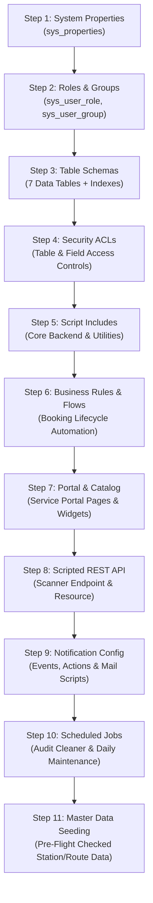

# Deployment and Disaster Recovery Guide
## Application Scope: `x_mtts` | ServiceNow Scoped Application

---

### 1. Pre-Deployment Prerequisites

Prior to importing or deploying the `x_mtts` scoped application onto a ServiceNow target instance (sub-production or production), verify the following administrative conditions:
1. **Administrative Privileges:** Target user account must possess `admin` and `security_admin` roles to register custom tables, schemas, and Access Control Lists (ACLs).
2. **Application Scope Isolation:** Ensure scope namespace `x_mtts` is available and not conflicting with an existing application package.
3. **Instance Compatibility:** Verified for ServiceNow Utah, Vancouver, Washington DC, and Xanadu releases.
4. **Outbound Email:** Verify SMTP email sending is enabled on the instance (`glide.email.smtp.active = true`) if live notifications are to be dispatched.
5. **REST API Ingestion:** Confirm inbound Scripted REST APIs are enabled on port 443 over TLS 1.2/1.3.

---

### 2. Sequential Deployment Order

Due to database foreign key constraints, script include dependencies, and security ACL inheritance, artifacts **must** be deployed in the exact sequence outlined below:



#### Step 1: System Properties (`sys_properties`)
Import all properties defined in `sn_source/sys_properties/system_properties.json`:
- `x_mtts.scanner.rate_limit_window_sec` (60)
- `x_mtts.scanner.max_failed_attempts` (5)
- `x_mtts.scanner.audit_logging_enabled` (true)
- `x_mtts.notifications.enabled` (`false` — default disabled to prevent unauthorized delivery)
- `x_mtts.cancellation.policy_status` (`UNCONFIGURED`)
- `x_mtts.lifecycle.enable_rejected_status` (`false`)
- `x_mtts.audit.retention_policy_status` (`UNCONFIGURED` — unapproved retention inactive)
- `x_mtts.audit.retention_days` (`0`)

#### Step 2: Security Roles & Groups
Import `sn_source/security/roles.json` and `groups.json`:
1. Roles: `x_mtts.passenger`, `x_mtts.approver`, `x_mtts.scanner`, `x_mtts.admin`.
2. Groups: `Metro Station Approvers`, `Metro Turnstile Scanners`, `Metro Operations Administrators`.
3. Provision service user `svc_mtts_turnstile_scanner`, assign role `x_mtts.scanner`, and enable `web_service_only`.

#### Step 3: Custom Data Table Schemas (`sys_db_object`)
Import XML definitions located in `sn_source/schema/` in this exact order:
1. `x_mtts_station.xml`
2. `x_mtts_route.xml`
3. `x_mtts_ticket_type.xml`
4. `x_mtts_fare_rule.xml`
5. `x_mtts_daily_sequence.xml`
6. `x_mtts_booking_ticket.xml`
7. `x_mtts_scan_event.xml`

#### Step 4: Access Control Lists (`sys_security_acl`)
Import table and field ACLs from `sn_source/security/acl_definitions.json`. Elevated privilege (`security_admin`) is required to activate field-level read/write restrictions.

#### Step 5: Server-Side Script Includes (`sys_script_include`)
Import JavaScript files from `sn_source/sys_script_include/`:
- `MetroFareCalculator.js`
- `MetroNumberFormatter.js`
- `MetroSequenceManager.js`
- `MetroTicketGenerator.js`
- `MetroBookingService.js`
- `MetroPortalService.js`
- `MetroScannerVerificationService.js`
- `MetroAuditRetentionService.js`
- `MetroNotificationService.js`
- `MetroDataMigrationService.js`

#### Step 6: Business Rules & Flow Designer Definitions
Import workflow definitions and business rules governing approval triggers, numbering hooks, and financial snapshot locking.

#### Step 7: Service Catalog & Service Portal UI
Import Service Catalog item (`Metro Ticket Booking`), catalog variables, client scripts, UI policies, and Service Portal widgets (`mtts_booking_widget`, `mtts_my_bookings_widget`, `mtts_ticket_view_widget`) into the `/mtts` portal path.

#### Step 8: Scripted REST API Definitions
1. Import `sn_source/sys_ws_definition/x_mtts_scanner_api.xml` (`/api/x_mtts/scanner`).
2. Import `sn_source/sys_ws_operation/verify_ticket_resource.xml` (`POST /verify-ticket`).
3. Bind processing script `verify_ticket_resource.js`.

#### Step 9: Notifications & Mail Scripts
1. Register 7 events from `sn_source/notifications/sysevent_register.json`.
2. Import mail scripts from `sn_source/notifications/notification_mail_scripts.json`.
3. Import email actions from `sn_source/notifications/sysevent_email_action.json`.

#### Step 10: Scheduled Maintenance Jobs
Register scheduled script execution `x_mtts_cleanup_scan_events`. Note that cleaner execution is guarded by `MetroAuditRetentionService` and requires `x_mtts.audit.retention_policy_status = 'ACTIVE'` with positive retention days. It remains dormant and will perform zero deletions by default.

#### Step 11: Master Data Migration & Seeding
Execute `MetroDataMigrationService.importMasterData(masterDataBundle, false)` within Background Scripts to seed official stations, routes, and fare schedules.

---

### 3. Post-Deployment Verification & Smoke Test Checklist

- [ ] **Table Check:** Navigate to `sys_db_object.list` and verify all 7 tables show green operational status with zero schema errors.
- [ ] **Role Verification:** Verify `svc_mtts_turnstile_scanner` has `x_mtts.scanner` and cannot log in via the web browser.
- [ ] **REST API Check:** Send verification probe via curl:
  ```bash
  curl -X POST https://<instance>.service-now.com/api/x_mtts/scanner/verify-ticket \
    -u svc_mtts_turnstile_scanner:<password> \
    -H "Content-Type: application/json" \
    -d '{"ticket_number":"TKT-20261025-000001","token":"00000000000000000000000000000000","device_id":"TEST","station_code":"STN-01"}'
  ```
  Expected: `HTTP 401 TOKEN_MISMATCH` or `HTTP 404 TICKET_NOT_FOUND` (Confirms REST endpoint is listening and authenticating).
- [ ] **Portal Check:** Access `https://<instance>.service-now.com/mtts` as a test commuter. Confirm fare preview calculates dynamically upon station selection.
- [ ] **End-to-End Booking:** Submit test booking, approve in workspace, verify ticket SVG generation, and confirm turnstile scan produces `HTTP 200 VALID / OPEN`.

---

### 4. Rollback and Disaster Recovery Procedures

#### 4.1 Update Set Back-Out Sequence
If critical failures occur during deployment:
1. Navigate to **System Update Sets > Retrieved Update Sets**.
2. Select the MTTS update set and click **Back Out**.
3. ServiceNow will automatically reverse schema additions, business rules, script includes, and REST API definitions in reverse order.

#### 4.2 Emergency Operational Kill Switches
In the event of an active production incident, platform administrators can invoke zero-downtime operational kill switches via System Properties:

| Incident Scenario | Action / Property Setting | Effect |
| :--- | :--- | :--- |
| **Email Storm / Flood** | Set `x_mtts.notifications.enabled = false` | Immediately suppresses all outgoing email notifications without breaking bookings. |
| **Turnstile Brute Force Attack** | Set `x_mtts.scanner.max_failed_attempts = 1` | Aggressively locks out attacking hardware devices after a single failure. |
| **Fraudulent Cancellation Wave** | Verify `x_mtts.cancellation.policy_status = UNCONFIGURED` | Blocks all automated refund and ticket cancellation attempts system-wide. |
