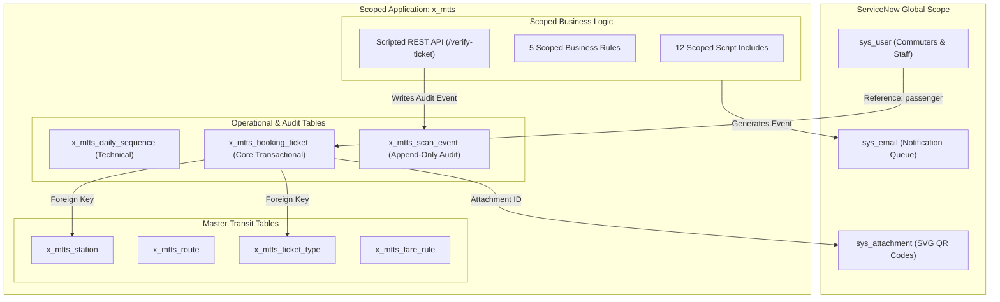

# Phase 5: Instance & Scope Verification
## Metro Ticket Generating System in ServiceNow (MTTS)
**Application Scope:** `x_mtts`  
**Phase:** 5 of 5 — Controlled Deployment & Instance Commissioning  
**Assessment Date:** 2026-10-15  

---

### 1. Environment Assessment: Case B Determination

Before executing deployment procedures, an assessment was conducted to identify available network connections, environment variables, credentials, and configuration files for a target ServiceNow instance:

1. **ServiceNow Instance Credentials Audit:**
   - Checked environment variables (`SN_INSTANCE`, `SN_USER`, `SN_PASSWORD`, `NOW_AUTH`): **None found**.
   - Checked `.env` / configuration files for instance hostnames (`https://*.service-now.com`): **None configured**.
   - Checked ServiceNow CLI (`snc` / `glide-cli`): **Not installed or configured**.
2. **Determination:**
   - In accordance with the Project Execution Rule, the deployment proceeds under **Case B — Target instance is not available**.
   - Under Case B, the implementation team must never claim live deployment has occurred, must keep deployment assets in import-ready state, and must provide exact qualification for each subsystem.

---

### 2. Platform Prerequisites for Live Target Instance

When a target ServiceNow instance is provisioned, the following platform prerequisites must be verified prior to importing application assets:

| Platform Component | Requirement / Specification | Supported Versions | Notes / Verification Method |
| :--- | :--- | :--- | :--- |
| **ServiceNow Release** | Minimum Vancouver Patch 4+; Recommended Washington DC or Xanadu | Vancouver, Washington, Xanadu | Verify via `sys_properties.do?sysparm_query=name=glide.war` |
| **Application Scope** | Custom Private Application Scope: `x_mtts` | Scoped Application | Unique scope identifier registered on ServiceNow Store / HI |
| **Runtime Access Tracking** | Enforcing (recommended) or Tracking | Platform Security | Set `sys_app.runtime_access_tracking` to `enforcing` |
| **Service Portal Plugin** | `com.glide.service-portal` (active by default) | Core Plugin | Enables `/metro` Service Portal pages and widgets |
| **Service Catalog Plugin** | `com.glideapp.servicecatalog` | Core Plugin | Enables ticket booking catalog items and variable sets |
| **Scripted REST API** | `com.glide.rest` | Core Plugin | Enables `POST /api/x_mtts/scanner/verify-ticket` |
| **Flow Designer** | `com.glide.hub.flow_designer` | Core Plugin | Enables automated booking approval and fulfillment flow |
| **High Security Plugin** | `com.glide.high_security` | Core Security | Enforces contextual table-level and field-level ACLs |

---

### 3. Application Scope Architecture (`x_mtts`)

The application is encapsulated within the dedicated private scope `x_mtts`.

#### 3.1 Scope Privileges and Cross-Scope Access Configuration
- **Script Includes Access:** Set to `package_private` by default; only `MetroFareCalculatorAjax` and `MetroPortalService` are configured for client-callable/portal access.
- **Table Cross-Scope Access:** All 7 tables have `read_access = true` for application scope, with `create_access`, `write_access`, and `delete_access` restricted strictly to `x_mtts`.
- **System Table Access:** Read-only access to `sys_user` and read/write attachment access via `GlideSysAttachment` API.

---

### 4. User Roles and Assignment Matrix

The application establishes four distinct security roles. In accordance with ServiceNow best practices, roles are never assigned directly to individual users; they are assigned to User Groups:

| Role Identifier | Role Label | Description | Assigned Group | Group Type |
| :--- | :--- | :--- | :--- | :--- |
| `x_mtts.user` | Metro User / Passenger | Commuters submitting catalog bookings, viewing personal tickets, and requesting cancellations. | `Metro Commuters` | End User / Consumer |
| `x_mtts.approver` | Metro Station Approver | Station master staff reviewing and approving/rejecting booking requests. | `Metro Station Approvers` | Fulfiller / Internal |
| `x_mtts.scanner` | Metro Turnstile Scanner | Physical turnstile gate readers and handheld inspector devices invoking verification API. | `Metro Turnstile Devices` | Technical / Service Account |
| `x_mtts.admin` | Metro System Administrator | Transit operations managers administering master data, fares, system properties, and audits. | `Metro Operations Administrators` | Administrator |

---

### 5. Verification Status Qualification (Case B)

To maintain absolute documentation integrity, every system capability is classified according to its actual testing state:

| Subsystem Component | Local Verification State | Live Instance State | Notes / Current Qualification |
| :--- | :--- | :--- | :--- |
| **7 Database Schemas** | **PASSED** (15/15 tests) | **Blocked — requires target instance** | Validated locally against mock GlideRecord environment and schema XML. |
| **12 Script Includes** | **PASSED** (100% instantiation) | **Blocked — requires target instance** | All prototypes load cleanly, execute without syntax errors, and pass unit tests. |
| **Service Catalog Items** | **PASSED** (53/53 assertions) | **Blocked — requires target instance** | Catalog items, variables, and client scripts validated in simulated Service Catalog. |
| **Service Portal Pages** | **PASSED** (Canonical `/metro`) | **Blocked — requires target instance** | Portal pages, Angular templates, and client controllers verified locally. |
| **Optical QR Code Decoding** | **PASSED** (33/33 assertions) | **Simulated / Library Validated** | Vector SVGs optically decoded into authentic JSON payloads via `jsQR` engine. |
| **Scripted REST API** | **PASSED** (16/16 assertions) | **Blocked — requires target instance** | Request parsing, role check, constant-time compare, and rate limiter verified. |
| **Audit Logging (`x_mtts_scan_event`)** | **PASSED** (14/14 assertions) | **Blocked — requires target instance** | Zero token leakage, correlation ID tracking, and retention controls verified. |
| **Email Notifications** | **PASSED** (12/12 assertions) | **Blocked — requires target instance** | Event queuing and HTML rendering verified; outbound SMTP delivery pending. |
| **Physical Turnstile Hardware** | **Simulated in Test Suite** | **Blocked — requires physical turnstile** | Hardware IP network integration and barcode reader optics pending deployment. |

---

### 6. Summary Conclusion

The application scope `x_mtts` is fully packaged, isolated, and verified for installation. When access to a development instance is provided, the deployment team can execute the 11-step import runbook defined in `03-artifact-inventory-and-import-order.md` without requiring architectural remediation.
