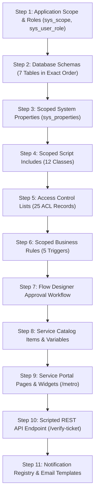

# Phase 5: Artifact Inventory & Import Runbook
## Metro Ticket Generating System in ServiceNow (MTTS)
**Application Scope:** `x_mtts`  
**Phase:** 5 of 5 — Controlled Deployment & Instance Commissioning  
**Target Environment:** ServiceNow Vancouver / Washington DC / Xanadu  

---

### 1. Complete Artifact Taxonomy & Multi-Method Inventory Accounting

To establish complete architectural clarity and eliminate counting ambiguities across development and deployment teams, all project deliverables under `sn_source/` are accounted for under three explicit, documented counting methods:

---

#### Method 1: Logical Application Modules (15 Subsystems)
From a systems architecture standpoint, the application decomposes into **15 coherent functional domains**:
1. **Station Master Data:** Transit stop catalog, line zones, active flags, and referential deletion guards.
2. **Route Network Matrix:** Origin-destination route pairings, distances (km), and self-loop prevention.
3. **Fare Rules & Dynamic Pricing Engine:** Distance tariffs, minimum fares, return multipliers, and fixed pass pricing.
4. **Daily Number Formatter & Concurrency Engine:** Atomic daily sequence generation and human-readable formatting (`TKT-YYYYMMDD-XXXXXX`).
5. **Booking Lifecycle & Fulfillment Manager:** State transitions (`Pending` $\rightarrow$ `Approved` $\rightarrow$ `Generated` $\rightarrow$ `Cancelled`), financial snapshotting, and decline processing.
6. **Vector QR Code Engine:** Pure SVG rendering, 128-bit CSPRNG bearer token generation, and one-way SHA-256 digest hashing.
7. **Service Catalog Booking Interface:** Commuter intake form, dynamic reference qualifiers, and client-side fare preview.
8. **Service Portal Commuter Experience:** Dedicated `/metro` portal pages, responsive widgets, and digital ticket pass view.
9. **Flow Designer Approval Workflow:** Multi-step operational approval on `sc_req_item` routing to `Metro Station Approvers`.
10. **Scanner Verification REST API:** Authenticated turnstile verification endpoint with constant-time token comparison.
11. **Turnstile Audit Logging Subsystem:** Append-only scan event journal with non-repudiation and legal retention controls.
12. **Notification & Email Subsystem:** Event-driven email alerts, dual delivery (inline link + attached SVG), and HTML email templates.
13. **Security & Access Control Subsystem:** RBAC user roles, commuter group assignments, and 25 table/field/endpoint ACL rules.
14. **Master Data Migration & Seeding Engine:** 11-point data validation suite, idempotent import, dry-run mode, and CSV fixtures.
15. **System Governance Controls:** 15 system properties enforcing fail-closed safety baselines and operational limits.

---

#### Method 2: Physical Source Files & Folders (79 Files across 20 Directories)
A complete file system audit of the `sn_source/` workspace tree identifies **79 physical files** organized across **20 directory nodes**:
- **Application Source Files (60 Files):**
  - `sn_source/schema/`: 7 XML schema definitions (`x_mtts_*.xml`)
  - `sn_source/sys_script_include/`: 12 Scoped JavaScript classes (`*.js`)
  - `sn_source/sys_script/`: 5 Scoped Business Rules (`BR_*.js`)
  - `sn_source/sys_hub_flow/`: 1 Flow Designer JSON definition
  - `sn_source/catalog_item/`: 6 files (1 catalog item JSON, 1 variable definitions JSON, 4 client scripts in `catalog_client_scripts/`)
  - `sn_source/service_portal/pages/`: 3 Portal page JSON definitions
  - `sn_source/service_portal/widgets/`: 16 widget source files across 4 modular widget directories (each containing `client_script.js`, `css.scss`, `server_script.js`, `template.html`)
  - `sn_source/sys_properties/`: 1 JSON configuration file (`system_properties.json` declaring 15 keys)
  - `sn_source/notifications/`: 3 JSON configuration files (`sysevent_register.json`, `sysevent_email_action.json`, `notification_mail_scripts.json`)
  - `sn_source/sys_ws_definition/`: 1 REST API definition XML (`x_mtts_scanner_api.xml`)
  - `sn_source/sys_ws_operation/`: 2 REST operation files (`verify_ticket_resource.xml`, `verify_ticket_resource.js`)
  - `sn_source/security/`: 3 JSON security files (`roles.json`, `groups.json`, `acl_definitions.json`)
- **Supporting Test Harness & Fixture Files (19 Files):**
  - `sn_source/data/`: 5 files (1 data seeder script `MetroDataSeeder.js`, 4 CSV master data fixtures)
  - `sn_source/test/`: 14 files (1 master test runner `run_all_tests.js`, 1 mock Glide environment `mock_glide_env.js`, 12 automated test suites)
- **Directory Nodes (20 Folders):**
  `catalog_item`, `catalog_client_scripts`, `data`, `notifications`, `schema`, `security`, `service_portal`, `pages`, `widgets`, `widget_metro_confirmation`, `widget_metro_portal_header`, `widget_metro_portal_hero`, `widget_my_metro_bookings`, `sys_hub_flow`, `sys_properties`, `sys_script`, `sys_script_include`, `sys_ws_definition`, `sys_ws_operation`, `test`.

---

#### Method 3: Explicitly Inventoried Projected Records (111 Explicitly Inventoried Projected Records across 18 Target Tables)
Because no live ServiceNow instance is connected, the prepared source files under `sn_source/` are projected to instantiate **111 explicitly inventoried projected records across 18 target tables** upon deployment. This count covers the listed artifact categories and is not a complete count of every supporting or platform-generated ServiceNow record, such as dictionary entries (`sys_dictionary`), dictionary overrides (`sys_dictionary_override`), database indexes (`sys_index`), table labels (`sys_documentation`), or auto-generated audit/metadata rows, unless those have been separately inventoried:

| ServiceNow Target Table | Target Table Description | Record Count | Component Scope & Inventory Details |
| :--- | :--- | :---: | :--- |
| `sys_db_object` | Application Tables | **7** | 7 canonical tables (`x_mtts_station`, `x_mtts_route`, `x_mtts_ticket_type`, `x_mtts_fare_rule`, `x_mtts_daily_sequence`, `x_mtts_booking_ticket`, `x_mtts_scan_event`) |
| `sys_script_include` | Server-Side Script Includes | **12** | 12 scoped business and utility service classes |
| `sys_script` | Scoped Business Rules | **5** | 5 server-side event triggers (Snapshotting, State Enforcement, RITM Linker, Route Validation, Station Integrity) |
| `sys_hub_flow` | Flow Designer Workflow | **1** | Multi-step booking approval and ticket fulfillment workflow |
| `sc_cat_item` | Service Catalog Item | **1** | "Metro Ticket Booking" catalog item definition |
| `item_option_new` | Catalog Item Variables | **8** | 8 variables (Source Station, Destination Station, Travel Date, Ticket Type, Passengers, Distance km, Unit Fare, Total Fare) |
| `catalog_script_client` | Catalog Client Scripts | **4** | 4 dynamic client scripts (OnChange Calculate Fare, OnChange Source, OnChange Type, OnSubmit Validate) |
| `sp_page` | Service Portal Pages | **3** | 3 portal pages: `sp_page_metro_home`, `sp_page_my_metro_bookings`, `sp_page_booking_confirmation` |
| `sp_widget` | Service Portal Widgets | **4** | 4 modular widgets: `widget_metro_portal_header`, `widget_metro_portal_hero`, `widget_my_metro_bookings`, `widget_metro_confirmation`. *(Note: The 5th user-facing view — Digital Ticket QR Pass and Cancellation Dialog — is an embedded modal view within `widget_my_metro_bookings`)* |
| `sys_properties` | System Configuration Properties | **15** | 15 distinct configuration keys (9 fail-closed governance properties + 6 operational tariff/policy parameters) |
| `sysevent_register` | Event Registry | **7** | 7 registered transit events (`x_mtts.booking.submitted`, `x_mtts.approval.requested`, etc.) |
| `sysevent_email_action` | Email Notifications | **7** | 7 automated email notifications reacting to registered transit events |
| `sys_script_email` | Notification Mail Scripts | **2** | 2 dynamic email scripts (`mtts_embed_ticket_qr`, `mtts_booking_summary_table`) |
| `sys_ws_definition` | Scripted REST API Service | **1** | "Metro Turnstile Scanner API" service definition |
| `sys_ws_operation` | Scripted REST API Operation | **1** | `POST /verify-ticket` resource operation |
| `sys_user_role` | Application User Roles | **4** | 4 scoped roles (`x_mtts.user`, `x_mtts.approver`, `x_mtts.scanner`, `x_mtts.admin`) |
| `sys_user_group` | Application User Groups | **4** | 4 user groups (`Metro Commuters`, `Metro Station Approvers`, `Metro Turnstile Devices`, `Metro Operations Administrators`) |
| `sys_security_acl` | Access Control Lists (ACLs) | **25** | 25 granular Table, Field, and REST Endpoint ACLs defined in `acl_definitions.json` |
| **TOTAL EXPLICITLY INVENTORIED PROJECTED RECORDS** | | **111** | **Total explicitly inventoried projected records across 18 ServiceNow target tables** |

*(Note on artifact grouping and platform-generated records: Earlier drafts referenced a derived grouping of "30 modular code/UI units". Upon detailed inspection of the ServiceNow platform architecture, grouping granular child records [such as 8 catalog variables, 4 client scripts, 7 email templates, 2 mail scripts, 1 REST operation, and 15 properties] into an arbitrary "30 units" was not established unambiguously by platform schema conventions; that number was therefore removed. Furthermore, the 111 projected records represent the explicitly inventoried application components across the 18 target tables listed above; they do not include underlying platform-generated records such as `sys_dictionary` column definitions, `sys_documentation` field labels, or `sys_index` database indexes generated by ServiceNow during schema creation unless separately inventoried).*

---

#### Detailed Inventory Itemization Table (Platform Deployable Units)

| Item # | Deployment Category | File Path in Repository | ServiceNow Target Table | Deployment Unit & Technical Purpose |
| :---: | :--- | :--- | :--- | :--- |
| 1 | **Native Schema** | `sn_source/schema/x_mtts_station.xml` | `sys_db_object` | Station master table (code, name, line_zone, order) |
| 2 | **Native Schema** | `sn_source/schema/x_mtts_route.xml` | `sys_db_object` | Route matrix table (origin, destination, distance_km) |
| 3 | **Native Schema** | `sn_source/schema/x_mtts_ticket_type.xml` | `sys_db_object` | Ticket type table (Single, Return, Pass, validity) |
| 4 | **Native Schema** | `sn_source/schema/x_mtts_fare_rule.xml` | `sys_db_object` | Fare rules table (rates, minimums, fixed passes) |
| 5 | **Native Schema** | `sn_source/schema/x_mtts_daily_sequence.xml` | `sys_db_object` | Daily atomic sequence generator for unique numbers |
| 6 | **Native Schema** | `sn_source/schema/x_mtts_booking_ticket.xml` | `sys_db_object` | Core transactional booking and ticket lifecycle table |
| 7 | **Native Schema** | `sn_source/schema/x_mtts_scan_event.xml` | `sys_db_object` | Append-only turnstile audit log table |
| 8 | **Script Include** | `sn_source/sys_script_include/MetroFareCalculator.js` | `sys_script_include` | Authoritative server-side fare calculation engine |
| 9 | **Script Include** | `sn_source/sys_script_include/MetroFareCalculatorAjax.js` | `sys_script_include` | Client-callable AJAX wrapper for portal fare preview |
| 10 | **Script Include** | `sn_source/sys_script_include/MetroNumberFormatter.js` | `sys_script_include` | Atomic reference and ticket number allocator |
| 11 | **Script Include** | `sn_source/sys_script_include/MetroQRGenerator.js` | `sys_script_include` | Vector SVG QR code rendering engine |
| 12 | **Script Include** | `sn_source/sys_script_include/MetroTicketGenerator.js` | `sys_script_include` | Fulfillment orchestrator and token hash generator |
| 13 | **Script Include** | `sn_source/sys_script_include/MetroBookingService.js` | `sys_script_include` | Booking creation, validation, and submission handler |
| 14 | **Script Include** | `sn_source/sys_script_include/MetroPortalService.js` | `sys_script_include` | Commuter portal backend service for My Bookings |
| 15 | **Script Include** | `sn_source/sys_script_include/MetroRefundCalculator.js` | `sys_script_include` | Cancellation penalty and refund computation |
| 16 | **Script Include** | `sn_source/sys_script_include/MetroScannerVerificationService.js` | `sys_script_include` | Turnstile REST verification, constant-time compare |
| 17 | **Script Include** | `sn_source/sys_script_include/MetroAuditRetentionService.js` | `sys_script_include` | Scheduled audit record retention and purge engine |
| 18 | **Script Include** | `sn_source/sys_script_include/MetroNotificationService.js` | `sys_script_include` | Multi-event notification dispatcher and mail renderer |
| 19 | **Script Include** | `sn_source/sys_script_include/MetroDataMigrationService.js` | `sys_script_include` | 11-point master data import validator and dry-run |
| 20 | **Business Rule** | `sn_source/sys_script/BR_Booking_FinancialSnapshot.js` | `sys_script` | Pre-insert tamper prevention snapshotting financials |
| 21 | **Business Rule** | `sn_source/sys_script/BR_Booking_StateTransitionEnforcement.js` | `sys_script` | State transition guard enforcing 4-status model |
| 22 | **Business Rule** | `sn_source/sys_script/BR_ReqItem_CreateMetroBooking.js` | `sys_script` | Trigger on `sc_req_item` inserting linked booking |
| 23 | **Business Rule** | `sn_source/sys_script/BR_Route_Validation.js` | `sys_script` | Route distance and self-loop validation trigger |
| 24 | **Business Rule** | `sn_source/sys_script/BR_Station_ReferentialIntegrity.js` | `sys_script` | Referential integrity blocking station deletion |
| 25 | **Flow Designer** | `sn_source/sys_hub_flow/MetroBookingApprovalAndFulfillmentFlow.json` | `sys_hub_flow` | Multi-step approval and ticket fulfillment flow |
| 26 | **Catalog Bundle** | `sn_source/catalog_item/` | `sc_cat_item`, `item_option_new`, `catalog_script_client` | Service Catalog booking form (1 item + 8 vars + 4 client scripts) |
| 27 | **Portal Page** | `sn_source/service_portal/pages/sp_page_metro_home.json` | `sp_page` | Commuter portal landing page (`id=metro`) |
| 28 | **Portal Page** | `sn_source/service_portal/pages/sp_page_my_metro_bookings.json` | `sp_page` | Commuter booking history page (`id=my_metro_bookings`) |
| 29 | **Portal Page** | `sn_source/service_portal/pages/sp_page_booking_confirmation.json` | `sp_page` | Booking confirmation page (`id=metro_confirmation`) |
| 30 | **Portal Widget** | `sn_source/service_portal/widgets/widget_metro_portal_header` | `sp_widget` | Navigation header and commuter status bar (4 source files) |
| 31 | **Portal Widget** | `sn_source/service_portal/widgets/widget_metro_portal_hero` | `sp_widget` | Hero search and quick-booking CTA banner (4 source files) |
| 32 | **Portal Widget** | `sn_source/service_portal/widgets/widget_my_metro_bookings` | `sp_widget` | Interactive booking table with filter tabs (4 source files) |
| 33 | **Portal Widget** | `sn_source/service_portal/widgets/widget_metro_confirmation` | `sp_widget` | Booking confirmation receipt and QR launch pad (4 source files) |
| 34 | **Embedded View** | `sn_source/service_portal/widgets/widget_my_metro_bookings/template.html` | Embedded in `sp_widget` | Digital ticket QR display pass and cancellation modal subcomponents |
| 35–49 | **Properties (15)**| `sn_source/sys_properties/system_properties.json` | `sys_properties` | 15 system properties (9 fail-closed governance + 6 operational) |
| 50–65 | **Notif. (16)** | `sn_source/notifications/` | `sysevent_register`, `sysevent_email_action`, `sys_script_email` | 7 registered events + 7 email templates + 2 mail scripts |
| 66–67 | **REST API (2)** | `sn_source/sys_ws_definition/` & `sys_ws_operation/` | `sys_ws_definition`, `sys_ws_operation` | Scripted REST API Definition + verify-ticket Resource Operation |
| 68–100| **Security (33)**| `sn_source/security/` | `sys_user_role`, `sys_user_group`, `sys_security_acl` | 4 roles + 4 groups + 25 table/field/REST ACL definitions |

---

### 2. Sequential 11-Step Import Runbook

To guarantee relational integrity and prevent broken reference dependencies, the administrator must deploy the artifacts in the strict sequence below:

#### Step 1: Application Scope & Roles Setup
1. Log into the target ServiceNow instance as a System Administrator.
2. Navigate to **System Applications > Applications** and select **Create Application** (or import `x_mtts`).
3. Set Application Scope to `x_mtts`.
4. Create the 4 application user roles:
   - `x_mtts.user` (Commuter user role)
   - `x_mtts.approver`
   - `x_mtts.scanner`
   - `x_mtts.admin`
5. Create the 4 corresponding User Groups (`Metro Commuters`, `Metro Station Approvers`, `Metro Turnstile Devices`, `Metro Operations Administrators`) and assign the respective roles.

#### Step 2: Database Schema Installation (7 Tables)
Import the schema files located in `sn_source/schema/` in the exact relational order:
1. `x_mtts_station.xml` (No dependencies)
2. `x_mtts_route.xml` (Depends on station)
3. `x_mtts_ticket_type.xml` (No dependencies)
4. `x_mtts_fare_rule.xml` (Depends on ticket type)
5. `x_mtts_daily_sequence.xml` (Technical sequence table; unique composite index on date + sequence_type)
6. `x_mtts_booking_ticket.xml` (Depends on user, station, route, ticket type; unique index on booking_reference, ticket_number)
7. `x_mtts_scan_event.xml` (Depends on booking_ticket; append-only audit log)

#### Step 3: Scoped System Properties Configuration
Navigate to **System Properties > Import** or create from `sn_source/sys_properties/system_properties.json`. Ensure the following default values are verified:
- `x_mtts.cancellation.policy_status`: `UNCONFIGURED` (Safety lock active)
- `x_mtts.audit.retention_policy_status`: `UNCONFIGURED` (Safety lock active)
- `x_mtts.audit.retention_days`: `0`
- `x_mtts.notifications.enabled`: `false` (Kill switch active)
- `x_mtts.lifecycle.enable_rejected_status`: `false` (Enforces 4-status baseline)
- `x_mtts.scanner.rate_limit_window_sec`: `60`
- `x_mtts.scanner.max_failed_attempts`: `5`

#### Step 4: Scoped Script Includes Deployment
Deploy all 12 files from `sn_source/sys_script_include/` to `sys_script_include`. Ensure the `sys_scope` field is set to `x_mtts` for each script.

#### Step 5: Table Access Controls (ACLs)
Configure Table and Field ACLs according to the Security Matrix:
- `x_mtts_booking_ticket`: Passengers read/create own records; Approvers read/write status; Scanners no access; Admins full access.
- `x_mtts_scan_event`: Scanners create only; Admins read-only; Passengers and Approvers denied all access.
- Master tables: Read access granted to all roles; Write access restricted to `x_mtts.admin`.

#### Step 6: Scoped Business Rules Configuration
Deploy the 5 business rules from `sn_source/sys_script/`:
1. `BR_Booking_FinancialSnapshot.js` (`before insert`, order 200, anti-tampering fare lock)
2. `BR_Booking_StateTransitionEnforcement.js` (`before update`, order 100, enforces 4-status lifecycle)
3. `BR_ReqItem_CreateMetroBooking.js` (`after insert` on `sc_req_item`, creates linked booking)
4. `BR_Route_Validation.js` (`before insert/update` on `x_mtts_route`, self-loop & distance check)
5. `BR_Station_ReferentialIntegrity.js` (`before delete` on `x_mtts_station`, cascade protection)

#### Step 7: Flow Designer Workflow Import
Import and activate `sn_source/sys_hub_flow/MetroBookingApprovalAndFulfillmentFlow.json` in Flow Designer. Verify trigger is set to `Created` on `x_mtts_booking_ticket` where `status = Pending`.

#### Step 8: Service Catalog Configuration
Import `sn_source/catalog_item/MetroTicketBooking_CatItem.json`, variables from `variables.json`, and client scripts from `catalog_client_scripts/` under the `Metro Transit Services` catalog category. Verify variable references link to `x_mtts_station` and `x_mtts_ticket_type`.

#### Step 9: Service Portal Configuration (`/metro`)
1. Create Service Portal with URL suffix `metro`.
2. Import pages from `sn_source/service_portal/pages/`: `sp_page_metro_home.json` (`id=metro`), `sp_page_my_metro_bookings.json` (`id=my_metro_bookings`), and `sp_page_booking_confirmation.json` (`id=metro_confirmation`).
3. Import widgets from `sn_source/service_portal/widgets/`:
   - `widget_metro_portal_header` (Header navigation bar)
   - `widget_metro_portal_hero` (Hero search banner)
   - `widget_my_metro_bookings` (Dashboard with embedded digital ticket display modal and cancellation modal)
   - `widget_metro_confirmation` (Booking confirmation receipt)
4. Link widgets to page containers and verify responsiveness.

#### Step 10: Scripted REST API Endpoint
Create Scripted REST Service from `sn_source/sys_ws_definition/x_mtts_scanner_api.xml` and resource from `sn_source/sys_ws_operation/verify_ticket_resource.xml`:
- Endpoint: `POST /api/x_mtts/scanner/verify-ticket`
- Requires Authentication: `true`
- Required Role: `x_mtts.scanner`
- Script: `verify_ticket_resource.js` (delegates to `MetroScannerVerificationService.processRestRequest(request, response)`).

#### Step 11: Notification Registry & Templates
1. Register 7 events from `sn_source/notifications/sysevent_register.json` (`x_mtts.booking.submitted`, etc.).
2. Create 7 email notification actions from `sn_source/notifications/sysevent_email_action.json`.
3. Create mail scripts from `sn_source/notifications/notification_mail_scripts.json` (`mtts_embed_ticket_qr` and `mtts_booking_summary_table`) generating `/metro?id=my_metro_bookings&sys_id=` portal links.
