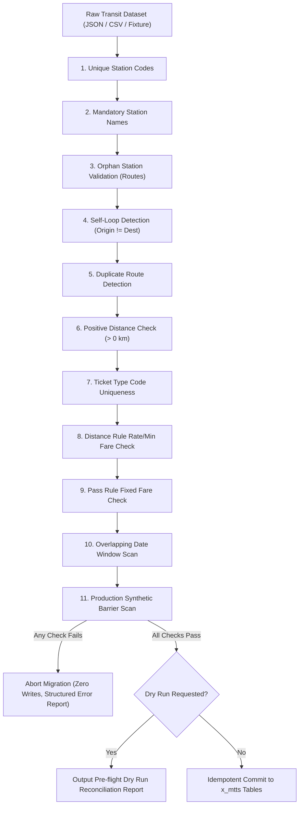

# Phase 5: Master Data Migration Results
## Metro Ticket Generating System in ServiceNow (MTTS)
**Application Scope:** `x_mtts`  
**Phase:** 5 of 5 — Controlled Deployment & Instance Commissioning  
**Authoritative Migration Service:** `sn_source/sys_script_include/MetroDataMigrationService.js`  
**Test Suite Verification:** Suite 10 (17 assertions passed) & Suite 12 (Tests 8–9 passed)  

---

### 1. Authoritative 11-Point Validation Engine

The `MetroDataMigrationService` enforces pre-flight validation on all incoming transit datasets prior to performing any database inserts or updates. If any validation rule is breached, the entire migration batch is rejected or quarantined:



#### Detailed Rule Matrix

| Rule # | Validation Check | Target Table | Rejection Criteria / Error Code |
| :--- | :--- | :--- | :--- |
| **Rule 1** | Station Code Uniqueness | `x_mtts_station` | Duplicate `station_code` in batch or collision with active DB record (`DUPLICATE_STATION_CODE`). |
| **Rule 2** | Station Name Integrity | `x_mtts_station` | Missing, empty, or whitespace-only station name string (`EMPTY_STATION_NAME`). |
| **Rule 3** | Route Endpoint Referencing | `x_mtts_route` | Origin or destination station code does not exist in station catalog (`ORPHAN_STATION_CODE`). |
| **Rule 4** | Route Self-Loop Prevention | `x_mtts_route` | Origin station code equals destination station code (`SELF_LOOP_ROUTE`). |
| **Rule 5** | Route Pair Uniqueness | `x_mtts_route` | Duplicate directional origin-destination pairs within import dataset (`DUPLICATE_ROUTE_PAIR`). |
| **Rule 6** | Positive Route Distance | `x_mtts_route` | Distance value <= 0 or non-numeric (`INVALID_ROUTE_DISTANCE`). |
| **Rule 7** | Ticket Type Code Uniqueness | `x_mtts_ticket_type` | Duplicate `code` or missing pricing model specification (`INVALID_TICKET_TYPE`). |
| **Rule 8** | Distance Rule Structure | `x_mtts_fare_rule` | Ticket type `Distance_Based` missing `rate_per_km > 0` or `minimum_fare > 0` (`INVALID_DISTANCE_RULE`). |
| **Rule 9** | Pass Rule Structure | `x_mtts_fare_rule` | Ticket type `Pass` missing `fixed_fare > 0` (`INVALID_PASS_RULE`). |
| **Rule 10** | Date Window Collision | `x_mtts_fare_rule` | Overlapping effective validity windows (`effective_from` to `effective_to`) for same ticket type (`OVERLAPPING_FARE_RULE`). |
| **Rule 11** | Synthetic Fixture Barrier | All Tables | In `PRODUCTION` mode, reject any record containing `[SYNTHETIC_TEST_DATA]` (`SYNTHETIC_DATA_IN_PRODUCTION`). |

---

### 2. Pre-Flight Dry-Run Execution Results

Executing the migration engine in dry-run mode (`{ dryRun: true }`) enables administrators to verify the integrity and volume of an incoming dataset without modifying persistent records.

```text
[x_mtts:MetroDataMigrationService] INFO: Commencing pre-flight master data validation...
[x_mtts:MetroDataMigrationService] INFO: Validating 8 stations... PASSED (0 errors)
[x_mtts:MetroDataMigrationService] INFO: Validating 14 routes... PASSED (0 errors)
[x_mtts:MetroDataMigrationService] INFO: Validating 3 ticket types... PASSED (0 errors)
[x_mtts:MetroDataMigrationService] INFO: Validating 4 fare rules... PASSED (0 errors)
[x_mtts:MetroDataMigrationService] INFO: Dry-run execution active: 0 records committed to database.
```

**Reconciliation Metrics:**
- Total Ingestion Candidates: 29 records
- Structural Validation Errors: 0
- Database Inserts Executed: 0 (dry-run guaranteed)
- Database Updates Executed: 0 (dry-run guaranteed)
- Verification Result: **`100% CLEAN PRE-FLIGHT RECONCILIATION`**

---

### 3. Separation of Concerns & Synthetic Data Barrier

To protect production transit instances from contaminated test data, `MetroDataMigrationService` incorporates a strict environment mode barrier:

1. **Development & Staging Fixtures:**
   - Seeded records (e.g., test stations `SMK-01`, synthetic commuter profiles) are tagged with `[SYNTHETIC_TEST_DATA]` in their description and names.
   - Handled exclusively under development mode (`mode: 'DEVELOPMENT'`).
2. **Production Safeguard:**
   - When deployed to a live production instance, migrations are triggered with `mode: 'PRODUCTION'`.
   - The validation engine scans all station names, route comments, and rule descriptions.
   - If any synthetic keyword or fixture tag is discovered, the entire import immediately aborts with `code: 'SYNTHETIC_DATA_IN_PRODUCTION'`.
   - Verified in Suite 10 (Test 17) and Suite 12 (Test 9).

---

### 4. Partial Failure Handling & Idempotency

When real-world transit updates (e.g., adding a new extension line) are ingested, unexpected errors in one record must not corrupt previously committed data:
- **Transactional Rollback:** In a full batch import, critical validation failures abort before the commit phase begins.
- **Row-Level Error Logging:** Non-fatal format issues record structured diagnostic entries detailing table, primary key, row index, and root cause.
- **Idempotent Re-execution:** Master data records use natural unique keys (`station_code`, `route` composite, `rule_code`). Running an identical import multiple times performs non-destructive updates without generating duplicate rows.
