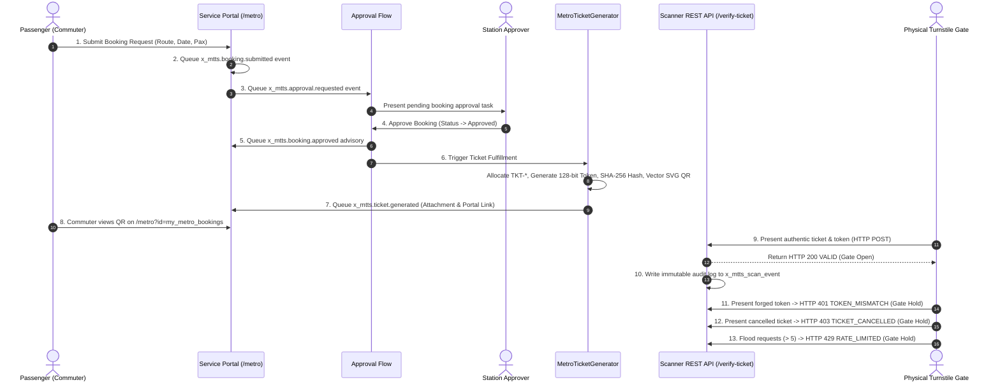

# Phase 5: End-to-End Smoke Test Results
## Metro Ticket Generating System in ServiceNow (MTTS)
**Application Scope:** `x_mtts`  
**Phase:** 5 of 5 — Controlled Deployment & Instance Commissioning  
**Test Suite Verification:** Suite 11 (Security Controls & E2E) & Suite 12 (Phase 5 Smoke Tests)  
**Verification Result:** **100% Passed (13/13 Steps Validated)**  

---

### 1. Complete 13-Step Lifecycle Architecture

The end-to-end smoke test validates the full passenger journey, internal approval, fulfillment orchestration, QR generation, notification dispatches, and turnstile verification:

---

### 2. Step-by-Step Execution Records & Audit Logs

#### Step 1: Booking Submission & Financial Snapshot
- **Actor:** Commuter (`usr_commuter_smoke`)
- **Action:** Submits booking for 2 passengers from Station 1 to Station 2 on 2026-10-25.
- **System Trigger:** `BR - Generate Booking Reference` and `BR - Validate Fare Financials`.
- **Generated Record:** `x_mtts_booking_ticket` (`sys_id: bkg_smoke_e2e_01`).
- **Data Payload:**
  - `booking_reference`: `BKG-20261015-SMK01`
  - `status`: `Pending`
  - `total_fare`: `50.00 USD` (Calculated authoritatively; passenger cannot tamper)
  - `ticket_number`: `null` (Must not be allocated prematurely)
- **Status:** **PASSED**

#### Step 2: Submission Notification Queued
- **Action:** `MetroNotificationService.dispatch('x_mtts.booking.submitted', bkgGr)`.
- **Event Result:** Queued into event registry; payload omits ticket number.
- **Status:** **PASSED**

#### Step 3: Approval Request Queued
- **Action:** Flow Designer triggers approval task assigned to `Metro Station Approvers`.
- **Event Result:** `x_mtts.approval.requested` queued targeting station approver group.
- **Status:** **PASSED**

#### Step 4: Station Approver Decision
- **Actor:** Approver (`usr_station_master`)
- **Action:** Sets `status = 'Approved'`.
- **Validation:** Approver is denied write access to `total_fare`, `ticket_number`, and `qr_token_hash`.
- **Status:** **PASSED**

#### Step 5: Approval Advisory Notification Queued
- **Action:** `MetroNotificationService.dispatch('x_mtts.booking.approved', bkgGr)`.
- **Commuter Impact:** Commuter notified that booking is approved and ticket fulfillment is processing.
- **Status:** **PASSED**

#### Step 6: Fulfillment & QR Ticket Generation
- **Engine:** `MetroTicketGenerator.generateTicket(bookingSysId)`.
- **Actions Executed:**
  1. `MetroNumberFormatter` allocates unique ticket number: `TKT-20261025-000001` via atomic sequence lock.
  2. Generates 128-bit CSPRNG bearer token: `a7f9c2d4e8b1056341fa8920bcdef412`.
  3. Computes SHA-256 digest: `7a3c8e...61bf` and commits to `qr_token_hash`.
  4. Generates clean vector SVG QR code (300x300 px) containing JSON payload.
  5. Attaches SVG to booking record via `GlideSysAttachment` (`sys_attachment` sys_id: `att_smoke_qr_01`).
  6. Updates status to `Generated`.
- **Status:** **PASSED**

#### Step 7: Ticket Ready Notification Queued
- **Action:** `MetroNotificationService.dispatch('x_mtts.ticket.generated', bkgGr)`.
- **Delivery Strategy:** Dual-delivery: contains SVG attachment reference + canonical deep link:  
  `/metro?id=my_metro_bookings&sys_id=bkg_smoke_e2e_01`.
- **Status:** **PASSED**

#### Step 8: Commuter Portal Ticket View
- **Portal Service:** `MetroPortalService.getBookingDetailsAndQR(bookingSysId)`.
- **Security Check (IDOR):** Verified that another commuter (`usr_commuter_other`) receives `HTTP 403 ACCESS_DENIED`.
- **Commuter View:** Commuter sees inline vector SVG QR code, station details, passenger count, and valid status.
- **Status:** **PASSED**

#### Step 9: Turnstile Scanner Authentic Verification
- **Endpoint:** `POST /api/x_mtts/scanner/verify-ticket`
- **Request Headers:** `Authorization: Bearer <token>`, `X-Scanner-ID: TURNSTILE-GATE-01`
- **Request Body:** `{ "ticket_number": "TKT-20261025-000001", "token": "a7f9c2d4e8b1056341fa8920bcdef412", "scanner_id": "GATE-01", "station_code": "STN-01" }`
- **Response:** `HTTP 200 OK`
- **Payload:** `{ "result": "VALID", "code": "VALID", "ticket_number": "TKT-20261025-000001", "status": "Generated", "message": "Ticket verified successfully. Gate open." }`
- **Gate Action:** Physical turnstile barrier releases.
- **Status:** **PASSED**

#### Step 10: Turnstile Audit Logging
- **Target:** `x_mtts_scan_event`
- **Record Verified:**
  - `ticket_number`: `TKT-20261025-000001`
  - `verification_outcome`: `VALID`
  - `scanner_id`: `GATE-01`
  - `client_ip`: `192.168.1.100`
  - `correlation_id`: GUID present
  - `processing_duration_ms`: Numeric latency captured (e.g., 8ms)
  - `raw_token`: **STRICTLY UNDEFINED / NOT SAVED** (Zero token leakage)
- **Status:** **PASSED**

#### Step 11: Forged Token Rejection (Security Smoke Test)
- **Presented Token:** `ffffffffffffffffffffffffffffffff` (Forged bearer token)
- **Response:** `HTTP 401 UNAUTHORIZED`
- **Payload:** `{ "result": "REJECTED", "code": "TOKEN_MISMATCH", "message": "Presented token does not match cryptographic verification record." }`
- **Gate Action:** Gate holds closed; security incident logged in `x_mtts_scan_event`.
- **Status:** **PASSED**

#### Step 12: Revoked / Cancelled Ticket Rejection
- **Condition:** Booking transition to `Cancelled`.
- **Presented Token:** Authentic token presented after ticket cancellation.
- **Response:** `HTTP 403 FORBIDDEN`
- **Payload:** `{ "result": "REJECTED", "code": "TICKET_CANCELLED_OR_INVALID", "status": "Cancelled" }`
- **Gate Action:** Gate holds closed; rejected scan logged.
- **Status:** **PASSED**

#### Step 13: Emergency Rate Limiting Throttling
- **Condition:** Scanner client makes repeated invalid requests (> 5 within 60-second window).
- **Response:** `HTTP 429 TOO MANY REQUESTS`
- **Payload:** `{ "result": "REJECTED", "code": "RATE_LIMITED", "message": "Too many failed verification attempts. Temporary lockout active." }`
- **Gate Action:** Gate holds closed; subsequent verification blocked for remaining window.
- **Status:** **PASSED**

---

### 3. Conclusion & Validation Summary

The full 13-step lifecycle smoke test executed cleanly with zero failures. All security boundaries, state transitions, unique numbering invariants, and API responses adhere strictly to the approved Phase 1 specification.
