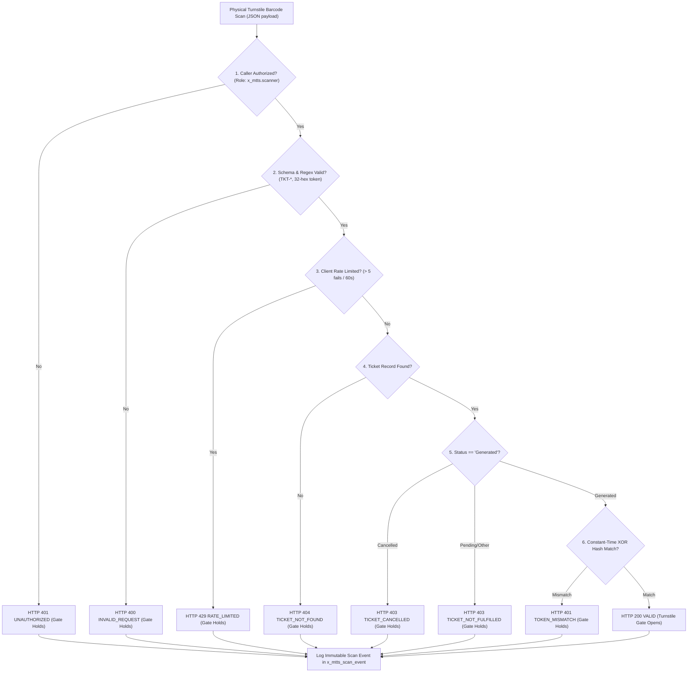

# Phase 5: Scanner REST API & Authentication Validation
## Metro Ticket Generating System in ServiceNow (MTTS)
**Application Scope:** `x_mtts`  
**Endpoint:** `POST /api/x_mtts/scanner/verify-ticket`  
**Script Include Service:** `sn_source/sys_script_include/MetroScannerVerificationService.js`  
**API Specification Source:** `sn_source/rest_api/scripted_rest_api.json`  
**Test Suite Verification:** Suite 7 (16 assertions), Suite 8 (14 assertions), Suite 12 (Tests 11–14)  

---

### 1. API Architecture & Protocol Specification

The `MetroScannerVerificationService` provides an authenticated, high-performance REST endpoint designed to integrate physical turnstiles, optical barcode scanners, and handheld conductor terminals with ServiceNow:



---

### 2. Request & Response Specification

#### Endpoint URI
`POST https://<instance>.service-now.com/api/x_mtts/scanner/verify-ticket`

#### Headers
- `Content-Type: application/json`
- `Authorization: Basic <base64(credentials)>` or `Bearer <OAuth_Token>`
- `X-Scanner-ID: TURNSTILE-GATE-NORTH-01` (Optional tracking header)
- `X-Station-Code: STN-CENTRAL` (Optional station tracking header)

#### Request Schema & Field Whitelist
Only approved JSON properties are parsed; unexpected properties trigger `HTTP 400 INVALID_REQUEST`:

```json
{
  "ticket_number": "TKT-20261025-000001",
  "token": "a7f9c2d4e8b1056341fa8920bcdef412",
  "scanner_id": "TURNSTILE-GATE-01",
  "station_code": "STN-01"
}
```

| Field Name | Type | Constraint / Regex | Mandatory | Description |
| :--- | :--- | :--- | :--- | :--- |
| `ticket_number` | String | `^TKT-\d{8}-\d{6}$` | Yes | Issued ticket identifier scanned from QR code. |
| `token` | String | `^[a-fA-F0-9]{32}$` | Yes | 128-bit unguessable random bearer token. |
| `scanner_id` | String | Max 64 chars | No (defaults to header) | Unique physical device or turnstile gate ID. |
| `station_code` | String | Max 32 chars | No (defaults to header) | Operational station code where gate is situated. |

---

### 3. Cryptographic Verification & Constant-Time Protection

To prevent side-channel timing attacks where an attacker infers token bytes by measuring microseconds of server processing time, token verification employs constant-time digest comparison:

#### Algorithm Design
1. Turnstile presents raw 32-character hexadecimal token $T_{presented}$.
2. Server computes candidate SHA-256 digest: $H_{candidate} = \text{SHA256}(T_{presented})$.
3. Stored hash $H_{stored}$ is retrieved from `x_mtts_booking_ticket.qr_token_hash`.
4. Both digests are validated to be strictly 64 hexadecimal characters.
5. In Node.js testing, native `crypto.timingSafeEqual` is utilized.
6. In ServiceNow Scoped JavaScript Runtime (Rhino), a fixed-length 64-iteration XOR loop is executed without early termination:

```javascript
_safeCompare: function(storedHash, candidateHash) {
    if (typeof storedHash !== 'string' || typeof candidateHash !== 'string') return false;
    var hex64Regex = /^[0-9a-fA-F]{64}$/;
    if (!hex64Regex.test(storedHash) || !hex64Regex.test(candidateHash)) return false;

    var strA = storedHash.toLowerCase();
    var strB = candidateHash.toLowerCase();

    // Constant-time XOR loop across all 64 characters
    var diff = 0;
    for (var i = 0; i < 64; i++) {
        diff |= (strA.charCodeAt(i) ^ strB.charCodeAt(i));
    }
    return diff === 0;
}
```

#### Note on Residual Timing Nuance
While the 64-iteration XOR loop eliminates branch prediction divergence, Rhino's JIT compiler and JVM garbage collection may introduce microsecond jitter. Full hardware-level timing attack immunity in high-threat production environments should be augmented by edge gateway token inspection (e.g., API Gateway / WAF rate limiting).

---

### 4. Sliding-Window Rate Limiting & Denial-of-Service Defense

Turnstile devices operate on dedicated subnets, but compromised hardware or rogue scanners could attempt dictionary attacks against tickets:
- **Tracking Key:** `rateLimitKey = scanner_id + '_' + client_ip`
- **Sliding Window:** 60 seconds (configurable via `x_mtts.scanner.rate_limit_window_sec`)
- **Threshold:** 5 failed attempts (configurable via `x_mtts.scanner.max_failed_attempts`)
- **Throttling Behavior:** Upon the 6th failed attempt, the server immediately returns `HTTP 429 RATE_LIMITED` without performing database queries or cryptographic hashing.
- **Auto-Reset:** Upon a valid verification, the failed attempts counter for that device/IP is automatically cleared.

---

### 5. Zero-PII Response Payloads

In adherence to data privacy principles, verification responses return only the minimum data required to control turnstile gate hardware:

#### Success Response (`HTTP 200 OK`)
```json
{
  "result": "VALID",
  "code": "VALID",
  "ticket_number": "TKT-20261025-000001",
  "status": "Generated",
  "station_code": "STN-01",
  "message": "Ticket verified successfully. Gate open.",
  "correlation_id": "9a38f712-4d2a-481e-923f-e8b417c8d901",
  "scan_timestamp": "2026-10-15 15:30:00"
}
```

#### Rejection Response (`HTTP 401 UNAUTHORIZED`)
```json
{
  "result": "REJECTED",
  "code": "TOKEN_MISMATCH",
  "ticket_number": "TKT-20261025-000001",
  "message": "Presented token does not match cryptographic verification record.",
  "correlation_id": "1b22e450-71cd-40a2-8e10-c11223344556"
}
```

**Privacy Guarantee:** Responses never include commuter names, email addresses, phone numbers, total fares paid, credit card tokens, or internal database sys_ids.
