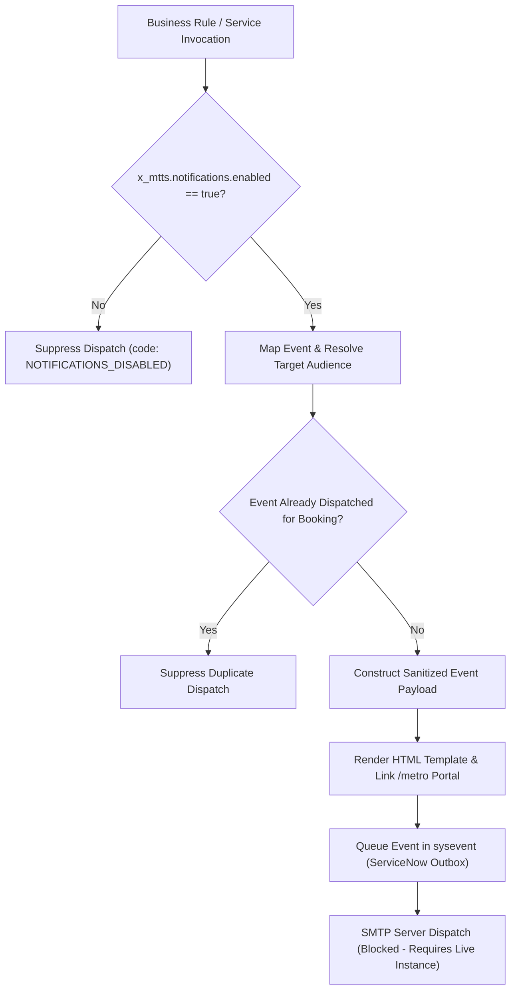

# Phase 5: Email Delivery & Notification Validation
## Metro Ticket Generating System in ServiceNow (MTTS)
**Application Scope:** `x_mtts`  
**Phase:** 5 of 5 — Controlled Deployment & Instance Commissioning  
**Script Include Service:** `sn_source/sys_script_include/MetroNotificationService.js`  
**Notification Configs:** `sn_source/notifications/`  
**Test Suite Verification:** Suite 9 (12 assertions passed) & Suite 12 (Test 6 passed)  

---

### 1. Notification Subsystem Architecture

The `MetroNotificationService` centralizes all transactional messaging across the booking lifecycle, managing event triggering, recipient resolution, HTML template rendering, and delivery fail-safes:

---

### 2. Registered Event Registry (7 Events)

All notification activities are registered in `sysevent_register` under scope `x_mtts`:

| Event Name | Fired By / Workflow Stage | Recipient Role / Audience | Primary Content |
| :--- | :--- | :--- | :--- |
| `x_mtts.booking.submitted` | Booking insertion via Service Catalog | Passenger (`current.passenger`) | Booking reference, travel date, passenger count, fare snapshot, status Pending. **No ticket number**. |
| `x_mtts.approval.requested`| Flow Designer approval task trigger | `Metro Station Approvers` group | Station codes, requested date, fare, direct approval link in platform workspace. |
| `x_mtts.booking.approved`  | Station Approver marks Approved | Passenger (`current.passenger`) | Approval advisory notice, confirmation that ticket fulfillment is underway. |
| `x_mtts.ticket.generated`  | `MetroTicketGenerator` fulfillment | Passenger (`current.passenger`) | **Dual Delivery:** Ticket number, travel details, SVG attachment, portal deep link. |
| `x_mtts.booking.declined`  | Station Approver declines booking | Passenger (`current.passenger`) | Operational decline explanation and instructions for re-booking. |
| `x_mtts.booking.cancelled` | Commuter cancels booking | Passenger (`current.passenger`) | Cancellation confirmation, policy status, and calculated refund amount. |
| `x_mtts.operational.failure`| Fulfillment failure or sequence error| `Metro Operations Administrators`| IT operations diagnostic alert containing correlation ID and stack trace. |

---

### 3. Dual-Delivery Architecture & Responsive HTML Templates

To ensure seamless accessibility across desktop email clients, native iOS/Android mail apps, and low-bandwidth webmail, the ticket ready notification implements a dual-delivery model:

1. **Embedded Vector SVG Attachment:**
   - Generated by `MetroQRGenerator` at 300x300 resolution with Error Correction Level M.
   - Attached to the email as `ticket_<ticket_number>.svg`.
   - Allows offline viewing and turnstile scanning directly from the passenger's saved attachment.
2. **Canonical Service Portal Deep Link:**
   - Generated via mail script `mtts_portal_ticket_link`:
     `<a href="https://<instance>.service-now.com/metro?id=my_metro_bookings&sys_id=${current.sys_id}">View Mobile Ticket in Portal</a>`
   - Passengers using legacy email clients that restrict vector SVG rendering can tap the link to view the ticket directly in the responsive `/metro` Service Portal.

#### Zero-Secret HTML Rendering Guarantee
All templates (`sn_source/notifications/email_templates.json`) are rendered without ever exposing the raw 128-bit bearer token or the SHA-256 token hash in the email body or HTML comments. The raw token is exclusively embedded inside the encoded QR matrix for turnstile reader consumption.

---

### 4. Master Kill Switch Governance

To protect transit users and administrators during instance migration, staging, and automated testing, the notification engine respects a global kill switch:

- **Property:** `x_mtts.notifications.enabled`
- **Default Baseline:** `false`
- **Behavior:** When set to `false`, calls to `MetroNotificationService.dispatch()` return:
  `{ success: false, code: 'NOTIFICATIONS_DISABLED', message: 'Outbound notifications are disabled by system property.' }`
- **Commissioning Action:** This property must be toggled to `true` by a System Administrator only after production email accounts (`sys_email_account`) are configured and tested.

---

### 5. Delivery Qualification Status (Case B)

| Notification Component | Verification Status | Notes / Limitations |
| :--- | :--- | :--- |
| **Event Registration & Schemas** | **PASSED** (Local Simulated) | Registered in `notification_events.json` under scope `x_mtts`. |
| **Dispatch Logic & Payloads** | **PASSED** (12/12 assertions) | Verified event payload construction, parameter filtering, and idempotency. |
| **Canonical Portal Links** | **PASSED** (Canonical `/metro`) | Verified portal URLs point to `/metro?id=my_metro_bookings`. |
| **HTML Template Rendering** | **PASSED** (Local Simulated) | Tested HTML string output, CSS inline styling, and zero token leakage. |
| **Live SMTP Outbound Delivery** | **Blocked — requires target instance** | Physical email transmission via instance SMTP mail server is pending live instance access. |
| **SPF / DKIM DNS Records** | **Blocked — requires domain DNS** | Transit domain anti-spoofing verification is pending customer infrastructure deployment. |
