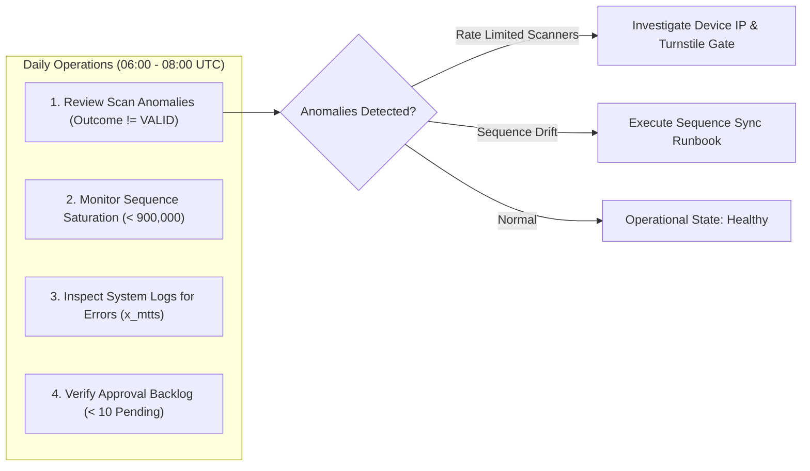

# Phase 5: Recovery & Operational Runbook
## Metro Ticket Generating System in ServiceNow (MTTS)
**Application Scope:** `x_mtts`  
**Phase:** 5 of 5 — Controlled Deployment & Operational Handover  
**Target Audience:** ServiceNow System Administrators, Network Engineers & Transit Operations Leads  

---

### 1. Daily Operations & Routine Health Checks

Transit IT Operations must perform daily reviews to ensure system availability, turnstile responsiveness, and audit integrity:



#### Daily Operational Checklist
1. **Turnstile Verification Anomalies:**
   - Navigate to **Metro Transit > Audit Logs > Turnstile Scan Events**.
   - Filter by: `verification_outcome != VALID` AND `scan_timestamp >= Today`.
   - High volume of `TOKEN_MISMATCH` indicates potential counterfeit attempts or dirty barcode optics.
   - High volume of `RATE_LIMITED` indicates scanner hardware malfunction or network misconfiguration.
2. **Numbering Sequence Saturation:**
   - Inspect `x_mtts_daily_sequence` for current date.
   - If `last_sequence > 900,000`, evaluate daily sequence capacity (max 999,999 tickets per day).
3. **Approval Queue Latency:**
   - Filter `x_mtts_booking_ticket` where `status = Pending` AND `sys_created_on < 2 hours ago`.
   - Escalate delayed approvals to the on-duty Station Master.

---

### 2. Emergency Operational Controls (Kill Switches)

In the event of an operational failure, security breach, or platform incident, administrators can toggle the following system properties immediately without restarting instances:

| Incident Scenario | Target System Property | Action / Value | System Effect | Recovery Action |
| :--- | :--- | :--- | :--- | :--- |
| **Active Brute-Force Attack on REST API** | `x_mtts.scanner.max_failed_attempts` | Set to `1` | Throttles rogue scanners immediately after a single failure. | Block offending IP on perimeter firewall; reset property to `5`. |
| **Email Notification Flooding** | `x_mtts.notifications.enabled` | Set to `false` | Instantly halts all outbound email generation. | Purge `sys_email` outbox; resolve event trigger; set to `true`. |
| **Commercial Policy Dispute / Run on Refunds** | `x_mtts.cancellation.policy_status` | Set to `UNCONFIGURED` | Blocks all automated refund calculations and cancellations. | Clarify tariff policy with transit authority; re-enable to `ACTIVE`. |
| **Unapproved Data Purging** | `x_mtts.audit.retention_policy_status` | Set to `UNCONFIGURED` | Halts automated deletion of `x_mtts_scan_event` audit records. | Verify legal compliance window; restore approved retention days. |

---

### 3. Update Set Back-Out & Application Rollback

If a major defect is identified post-import in a test or production environment, follow the standard ServiceNow update set back-out procedure:

#### Rollback Procedure
1. **Pre-Rollback Snapshot:**
   - Navigate to **System Definition > Tables** and export `x_mtts_booking_ticket` and `x_mtts_scan_event` as XML backups to preserve historical passenger records.
2. **Back-Out Update Set:**
   - Navigate to **System Update Sets > Retrieved Update Sets**.
   - Open `Update Set: Metro Ticket Generating System - Phase 5`.
   - Select **Back Out**.
   - Review the back-out preview log. Confirm that database deletions affect only application schema elements, not unrelated global data.
3. **Verify Scope De-registration:**
   - Verify that `sys_app` record for `x_mtts` is removed or reverted to prior baseline.
   - Confirm portal route `/metro` is deactivated.

---

### 4. Sequence Drift & Concurrency Recovery Runbook

If an unhandled database exception causes an out-of-sync condition in `x_mtts_daily_sequence`:

```javascript
// Administrator Fix Script: Reconcile Daily Sequence
(function reconcileDailySequence() {
    var todayStr = new GlideDateTime().getDate().getValue().replace(/-/g, '');
    var seqType = 'TICKET';

    // 1. Find highest issued ticket number for today
    var maxTicketNum = 0;
    var bkgGr = new GlideRecord('x_mtts_booking_ticket');
    bkgGr.addQuery('ticket_number', 'STARTSWITH', 'TKT-' + todayStr);
    bkgGr.orderByDesc('ticket_number');
    bkgGr.setLimit(1);
    bkgGr.query();

    if (bkgGr.next()) {
        var numStr = bkgGr.getValue('ticket_number'); // TKT-YYYYMMDD-XXXXXX
        var parts = numStr.split('-');
        if (parts.length === 3) {
            maxTicketNum = parseInt(parts[2], 10);
        }
    }

    // 2. Align x_mtts_daily_sequence
    var seqGr = new GlideRecord('x_mtts_daily_sequence');
    seqGr.addQuery('sequence_date', todayStr);
    seqGr.addQuery('sequence_type', seqType);
    seqGr.query();

    if (seqGr.next()) {
        var currentSeq = parseInt(seqGr.getValue('last_sequence') || '0', 10);
        if (currentSeq < maxTicketNum) {
            seqGr.setValue('last_sequence', maxTicketNum);
            seqGr.update();
            gs.info('[x_mtts:Admin] Sequence for ' + todayStr + ' updated from ' + currentSeq + ' to ' + maxTicketNum);
        }
    }
})();
```

---

### 5. Scheduled Audit Retention Activation Runbook

To transition the audit retention service from its default `UNCONFIGURED` state to active production operation:

1. **Stakeholder Approval:** Obtain formal sign-off from Transit Legal & Compliance on the retention window (e.g., 90 days).
2. **Update System Properties:**
   - Navigate to **System Properties**.
   - Update `x_mtts.audit.retention_days` = `90`.
   - Update `x_mtts.audit.retention_policy_status` = `ACTIVE`.
3. **Configure Scheduled Job:**
   - Navigate to **System Definition > Scheduled Jobs**.
   - Create new Scheduled Script Execution:
     - **Name:** `Metro Transit Turnstile Audit Retention Purge`
     - **Active:** `true`
     - **Run:** `Daily` at `02:00:00 UTC`
     - **Script:**
       ```javascript
       var retentionService = new x_mtts.MetroAuditRetentionService();
       var result = retentionService.cleanExpiredScanEvents(false);
       gs.info('[x_mtts:AuditPurge] Cleaned ' + result.deletedCount + ' expired scan events.');
       ```
4. **Validation:** Execute job once in dry-run mode (`cleanExpiredScanEvents(true)`) and verify output in system logs before enabling live purges.
