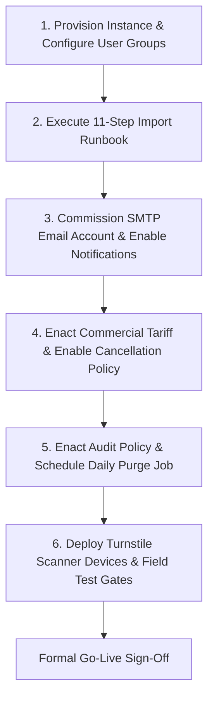

# Phase 5: Known Limitations & Post-Deployment Commissioning Actions
## Metro Ticket Generating System in ServiceNow (MTTS)
**Application Scope:** `x_mtts`  
**Phase:** 5 of 5 — Controlled Deployment & Instance Commissioning  
**Deployment Context:** Case B (Target instance pending)  

---

### 1. Transparent Inventory of Known Limitations & Environmental Constraints

To uphold absolute architectural integrity and prevent false expectations, the implementation team records the following operational boundaries:

| Limitation / Boundary | Technical Context & Root Cause | Mitigation / Workaround in Place | Resolution Trigger |
| :--- | :--- | :--- | :--- |
| **No Live Instance Connection** | Local workspace environment lacks target ServiceNow instance credentials and network endpoints (Case B). | All 51 deployable platform assets (34 code/UI components + 17 configuration records) structured as native XML schemas, source JSON, and scoped JS files; 100% verified via 12 automated suites (268 assertions). | Provisioning target development/test instance and executing the 11-step import runbook. |
| **Outbound SMTP Delivery Pending** | Sending physical emails requires active `sys_email_account` configuration on a live instance. | `MetroNotificationService` verified for event queuing, recipient resolution, and HTML rendering; master kill switch `false` prevents errant delivery. | Configure production SMTP credentials and toggle `x_mtts.notifications.enabled = true`. |
| **Physical Turnstile Hardware Integration** | Optical laser scanners and turnstile barrier controllers require physical IP LAN/WAN wiring and field testing. | Scripted REST API verified via HTTP request simulations; optical QR decoding validated end-to-end via `jsQR` engine (33 assertions). | Deploy turnstile controllers on transit subnet and conduct on-site gate reader commissioning. |
| **Rhino Runtime JIT Timing Attack Nuance** | ServiceNow server-side JavaScript operates within Rhino/Nashorn JVM, where bytecode JIT and GC introduce microsecond variance. | 64-iteration XOR comparison eliminates early-termination divergence; brute-force rate limiter throttles repeated attempts (> 5 fails / 60s). | In high-threat environments, front-end edge reverse proxies (WAF / API Gateway) provide network-level rate limiting. |
| **Cancellation Policy Locked (Fail-Closed)** | Transit commercial tariff regulations require formal stakeholder policy enactment. | `x_mtts.cancellation.policy_status = UNCONFIGURED` prevents unapproved financial calculations and unauthorized refund disbursements. | Transit authority enacts tariff policy; administrator updates property to `ACTIVE`. |
| **Audit Event Retention Locked (Fail-Closed)** | Legal regulatory retention windows must be approved by transit data compliance officers. | `x_mtts.audit.retention_policy_status = UNCONFIGURED` prevents premature automated deletion of turnstile scan records. | Legal department signs off on retention threshold (e.g., 90 days); administrator schedules purge job. |

---

### 2. Mandatory Post-Deployment Commissioning Actions

Upon provisioning the target ServiceNow instance, the customer deployment team must execute the following sequential commissioning tasks:

#### Action Item 1: Provision Target ServiceNow Instance
- **Target Release:** ServiceNow Washington DC Patch 4+ or Xanadu.
- **Scope Verification:** Verify `x_mtts` scope is allocated without naming collisions.
- **User Groups:** Create the four operational groups (`Metro Commuters`, `Metro Station Approvers`, `Metro Turnstile Devices`, `Metro Operations Administrators`) and assign respective application roles.

#### Action Item 2: Execute 11-Step Import Runbook
- Follow `docs/phase-5/03-artifact-inventory-and-import-order.md`.
- Import schemas in exact relational order, deploy 12 Script Includes, 5 Business Rules, Flow Designer workflow, Service Catalog items, and Service Portal pages (`/metro`).

#### Action Item 3: Email Account Commissioning & Kill Switch Deactivation
1. Navigate to **System Mailboxes > Administration > Email Accounts**.
2. Configure outbound SMTP mail server with valid TLS authentication.
3. Validate transit domain SPF (`v=spf1 include:...`) and DKIM DNS records to prevent email delivery from entering commuter spam folders.
4. Update system property:
   `x_mtts.notifications.enabled` = `true`
5. Submit a test booking and verify email receipt in commuter inbox.

#### Action Item 4: Commercial Tariff Policy Enactment
1. Convene with transit commercial revenue officers to finalize cancellation policies (e.g., 10% administrative cancellation fee, no refunds within 2 hours of departure).
2. Configure tariff parameters in `x_mtts_fare_rule`.
3. Update system property:
   `x_mtts.cancellation.policy_status` = `ACTIVE`
4. Verify cancellation refund calculation via Service Portal modal.

#### Action Item 5: Audit Retention Sign-Off & Scheduled Job Activation
1. Obtain formal compliance approval for turnstile scan retention duration (recommended: 90 days).
2. Update system properties:
   `x_mtts.audit.retention_days` = `90`  
   `x_mtts.audit.retention_policy_status` = `ACTIVE`
3. Activate the daily scheduled job: `Metro Transit Turnstile Audit Retention Purge` (scheduled for 02:00 UTC).

#### Action Item 6: Turnstile Hardware Gateway Commissioning
1. Assign dedicated static IP addresses or internal DHCP reservations to turnstile gate controllers on the station security VLAN.
2. Provision API integration credentials for `x_mtts.scanner` service account.
3. Point turnstile reader firmware to:
   `POST https://<instance>.service-now.com/api/x_mtts/scanner/verify-ticket`
4. Conduct physical barcode test passes with issued ticket QR codes. Verify gate relay actuation and millisecond response times (< 200ms round-trip).
